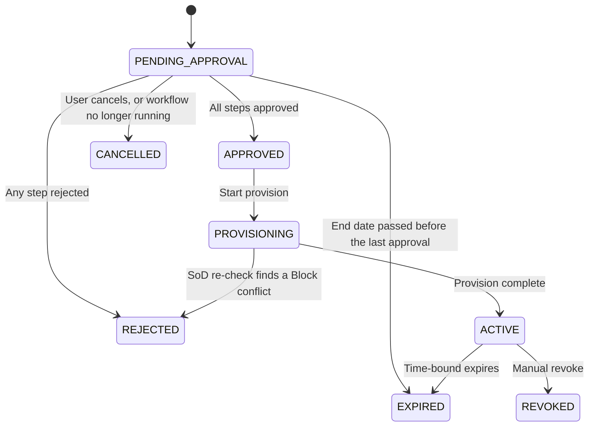
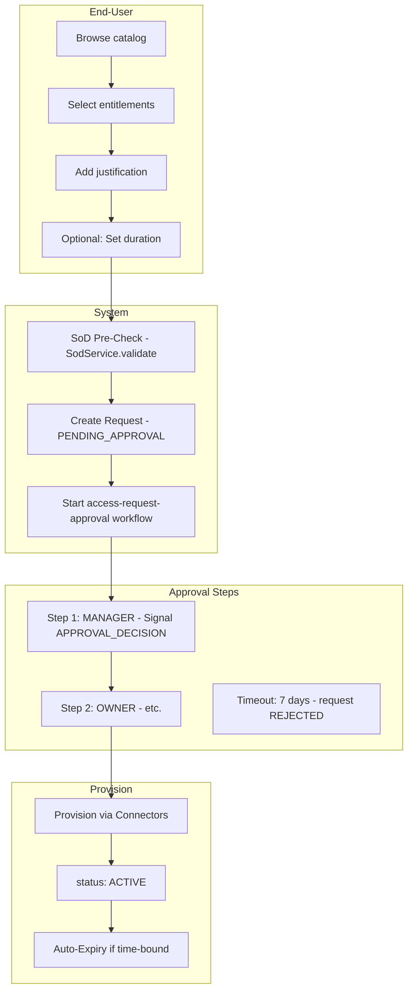

# Access Request Portal Architecture

> **Module:** Access Requests (Extended — supports Pillar 2 Brain)
> **Cross-cutting:** [Data Flows](../../../../../docs/architecture/core/DATAFLOWS.md) | [Temporal Workflows](../../../../../docs/architecture/infrastructure/TEMPORAL_WORKFLOWS.md)

## Overview

The Access Request Portal enables **self-service access governance**. End-users browse a catalog of requestable entitlements, submit requests with business justification, and managers/owners approve or reject through a multi-step Temporal workflow. Approved requests are automatically provisioned; time-bound requests auto-expire.

This implements the **Birthright vs. Requestable** split described in the [Policy Engine doc](../../policy/docs/ARCHITECTURE.md).

---

## Birthright vs. Requestable

| Type | How Assigned | Example |
|------|-------------|---------|
| **Birthright** | Auto-applied by Policy Engine when user attributes match conditions | "All Sales staff get Salesforce" |
| **Requestable** | User requests through portal; requires approval before provisioning | "Adobe Creative Cloud available on request" |

Entitlements are marked `requestable: true` in the **Entitlement Catalog**. Both types coexist -- a user can have birthright entitlements from policies AND requested entitlements from the portal.

---

## Data Flow

### Access Request Status Lifecycle



### Access Request Actor Flow



---

### Access Request Lifecycle (Legacy ASCII)

```
    End-User                        Manager/Owner                    System
       │                                 │                              │
       │  1. Browse catalog              │                              │
       │  2. Select entitlements         │                              │
       │  3. Add justification           │                              │
       │  4. (Optional) Set duration     │                              │
       │                                 │                              │
       ▼                                 │                              │
    ┌──────────────────┐                 │                              │
    │ SoD Pre-Check    │ ◄──────────── SodService.validate()           │
    │ (real-time)      │                                                │
    └────────┬─────────┘                                                │
             │                                                          │
             ▼                                                          │
    ┌──────────────────┐                                                │
    │ Create Request   │ status: PENDING_APPROVAL                       │
    │ Start Workflow   │ ──────────▶ Temporal: access-request-approval  │
    └──────────────────┘                    │                           │
                                            ▼                           │
                              ┌─────────────────────────┐               │
                              │ Approval Step 1: MANAGER │               │
                              │ Signal: APPROVAL_DECISION│               │
                              │ Timeout 7 days: REJECTED │               │
                              └────────────┬────────────┘               │
                                           │                            │
                                     ┌─────┴──────┐                     │
                                     ▼            ▼                     │
                                 APPROVED      REJECTED                 │
                                     │            │                     │
                                     ▼            ▼                     │
                              ┌──────────┐  Request REJECTED            │
                              │ Step 2:  │  (workflow ends)             │
                              │ OWNER    │                              │
                              └────┬─────┘                              │
                                   │                                    │
                                   ▼                                    │
                            Final Approval                              │
                                   │                                    │
                                   ▼                                    │
                         ┌──────────────────┐                           │
                         │ Provisioning     │ ──▶ Connectors            │
                         │ (same pipeline   │                           │
                         │  as birthright)  │                           │
                         └────────┬─────────┘                           │
                                  │                                     │
                                  ▼                                     │
                         status: ACTIVE                                 │
                         (expiresAt set if time-bound)                  │
                                  │                                     │
                                  ▼ (if time-bound)                     │
                         ┌──────────────────┐                           │
                         │ Auto-Expiry      │ ──▶ Deprovisioning        │
                         │ (Temporal timer) │                           │
                         └──────────────────┘                           │
```

---

## Request Status Lifecycle

See the **Access Request Status Lifecycle** state diagram above. Summary: `PENDING_APPROVAL` → `APPROVED` | `REJECTED` | `CANCELLED` | `EXPIRED`; `APPROVED` → `PROVISIONING` → `ACTIVE` → `EXPIRED` | `REVOKED`. A request whose approval workflow could not be started when it was created is `FAILED`.

**Pending gauge:** `euroid_access_requests_pending` (Prometheus, served by the API's `/metrics`) is the number of requests in `PENDING_APPROVAL` across tenants, counted in MongoDB at each scrape (`AccessRequestQueryService.countPendingInAllTenants`, registered by `AccessRequestsModule`). Every way out of pending lowers it, also the ones the worker writes.

**Closed by EuroID** (`AccessRequestClosureService`, `access-request-closure.service.ts`): two endings no person decides store why in `statusReason` and emit `access_request.closed` (`requestId`, `status`, `reason`; actor `system`; audit log, websocket, webhooks):

| Ending | When | `statusReason` |
|---|---|---|
| `EXPIRED` | A time-bound request whose `timeConstraint.expiresAt` has passed when its last approval comes in (approval workflow, `expireBeforeFulfilment` activity). Nothing is provisioned | The requested end date passed before approval completed. |
| `CANCELLED` | An approver approves, rejects or delegates, but the request's approval workflow no longer exists (see "Who decides a step"). Nobody rejected it; the approver's decision stays on the step | The approval workflow is no longer running. |

Two more reasons are stored without the event. A request whose fulfilment failed (see "Fulfilment and expiry change the entitlement only" below) ends `REJECTED` with why in `statusReason`. A time-bound request whose removal Entra ID refused stays `ACTIVE` with the refusal in `statusReason`, until a later attempt succeeds and clears it.

The request page shows the reason ("Closed as EXPIRED", or "Access not removed yet" on an `ACTIVE` request). A request the requester cancelled has no reason. EuroID sends the requester no message for any request outcome; the requester sees it under My requests and on the request page.

---

## Entitlement Catalog Extensions

The existing `entitlement_catalog` collection gains new fields for the portal:

```typescript
{
  // Existing fields
  system: "entra-id",
  name: "Adobe Creative Cloud",
  type: "License",
  origin: "EXTERNAL",
  riskLevel: "LOW",
  owner: "it-ops@contoso.com",

  // New portal fields
  requestable: true,                        // Shown in portal catalog
  approvalRequired: true,                   // Requires workflow approval
  approvalChain: [                          // Who approves, in order
    { type: "MANAGER" },                    // Requester's manager
    { type: "OWNER" },                      // Entitlement owner
  ],
  maxDurationDays: 365,                     // Max time-bound duration
  category: "Creative Tools",              // For catalog browsing
  userDescription: "Adobe CC license for design work",
}
```

### Approval Chain Types

| Type | Resolver |
|------|----------|
| `MANAGER` | The `managerEmail` of the person the access is for (the requester, or the report a manager requests for) |
| `OWNER` | Each requested entitlement's `owner` from the catalog: one step per distinct owner of the entries whose chain has `OWNER` |
| `ROLE` | Any active admin user of the request's tenant whose role is the specified admin role (e.g., `policy-admin`; the exact role, `super-admin` does not count as `policy-admin`). The step stores the role name as `approverId` and `approverEmail`. Once delegated (`delegatedFrom` set) it belongs to the delegate only |
| `SPECIFIC_USER` | A specific user ID or email |

The chain is each requested entry's `approvalChain`, else `MANAGER` then `OWNER`, merged in order with each link once (`approval-chain.ts`): one entry's chain never replaces another's. `POST /access-requests` answers `400` and stores nothing when a step has no approver (the person has no manager, an entry has no owner): such a step could never be decided.

A requester without an identity (an admin known only by their email) must name the person the access is for (`targetIdentityId`); a request for themselves answers `400`.

**Segregation of duties at creation:** a step whose approver is the requester is stored `APPROVED` by the request itself (`decidedBy` the requester, justification "Approved by the request: the requester is the approver of this step."). A manager's request for a direct report is the usual case: only that manager may request on the report's behalf, and they are the `MANAGER` step's approver, which the self-approval guard would refuse, so the step timed out `REJECTED` before. The approval workflow skips such a step (patch `access-request-approval:skip-steps-approved-at-creation`). A step whose approver is the person the access is for refuses the request (`400`), and so does a chain with no step left for someone other than the requester.

---

## Access Request Schema

```typescript
// Collection: access_requests
{
  tenantId: string,
  requestId: string,                    // UUID
  requesterId: string,                  // Identity ID
  requesterEmail: string,
  targetIdentityId?: string,            // For delegation (manager requests for report)

  entitlements: [{
    catalogEntryId: string,             // Ref to entitlement_catalog
    system: string,
    entitlementName: string,
    justification: string,              // Min 10 chars, required
  }],

  status: "PENDING_APPROVAL" | "APPROVED" | "REJECTED" |
          "PROVISIONING" | "ACTIVE" | "EXPIRED" | "REVOKED" | "CANCELLED" |
          "FAILED",                     // FAILED: the approval workflow could not be started

  approvalSteps: [{
    stepOrder: number,
    approverType: "MANAGER" | "OWNER" | "ROLE" | "SPECIFIC_USER",
    approverId?: string,
    approverEmail?: string,
    status: "PENDING" | "APPROVED" | "REJECTED" | "SKIPPED",
    decidedAt?: Date,
    justification?: string,
    decidedBy?: string,                 // Email of who approved or rejected (ROLE: the role holder)
    delegatedFrom?: string,
  }],

  timeConstraint?: {
    requestedDurationDays?: number,
    expiresAt?: Date,
  },

  sodCheckResult?: {                    // see SoD Integration
    passed: boolean,                     // false only for a request the re-check rejected
    violations?: [{ policyName, severity, action, conflictingEntitlements }],
  },                                     // action absent on requests stored before plan 2.9

  workflowId?: string,                 // Temporal workflow ID
  provisionedAt?: Date,
  expiresAt?: Date,
  statusReason?: string,               // why EuroID closed it (see Closed by EuroID)
}
```

---

## Approval Workflow (Temporal)

**Workflow:** `access-request-approval.workflow.ts`

```typescript
// Pseudocode
export async function accessRequestApprovalWorkflow(request: AccessRequest) {
  // (A BLOCK SoD match refused the request before it was stored and the workflow started.)

  // 1. Multi-step approval
  for (const step of request.approvalSteps) {
    await notifyApproverActivity(step);

    const decision = await condition(
      () => stepDecided(step),  // a decision kept for this step, also one that came earlier
      APPROVAL_TIMEOUT        // 7 days default
    );

    if (decision === "REJECTED") {
      await updateRequestStatusActivity(request.requestId, "REJECTED");
      return;
    }
    if (decision === null) {
      // Timeout (ACCESS_REQUEST_APPROVAL_TIMEOUT_DAYS, default 7): the request is REJECTED, no escalation
      await updateRequestStatusActivity(request.requestId, "REJECTED");
      return;
    }
  }

  // 2. End date already passed: nothing is fulfilled, EXPIRED with the reason
  if (request.timeConstraint?.expiresAt <= now()) {
    await expireBeforeFulfilment(request.requestId);
    return;
  }

  // 3. SoD re-check against the access held now; marks PROVISIONING, or REJECTED on a BLOCK match
  const sod = await recheckSodBeforeProvisioning(request.requestId);
  if (!sod.passed) return;

  // 4. Fulfil: add the entitlements on the person's recorded Entra ID account, nothing else
  const provisioned = await provisionAccessRequest(request.requestId);
  await updateRequestStatusActivity(request.requestId, provisioned ? "ACTIVE" : "REJECTED");

  // 5. Time-bound: schedule auto-revocation (timers of at most 90 days until expiresAt)
  if (request.timeConstraint?.expiresAt) {
    await sleep(until(request.timeConstraint.expiresAt));
    let revoked = await revokeActivity(request.requestId);
    // A failed revoke is tried again until it succeeds (patch revoke-until-done)
    while (!revoked.success) { await sleep(backoff()); revoked = await revokeActivity(request.requestId); }
    await updateRequestStatusActivity(request.requestId, "EXPIRED");
  }
}
```

**Signals:** `APPROVAL_DECISION`, `CANCEL_REQUEST`

**Decisions per step** (patch `access-request-approval:buffer-step-decisions`): the workflow keeps every `APPROVAL_DECISION` until its step (`stepIndex`) takes it. A decision that arrives before its step starts waiting (while the approver is being notified, or an approval of a later step while an earlier one still waits) counts for that step and never for another. Runs started before the patch kept only the last decision and cleared it when a step started: such a decision was dropped and the step timed out (`REJECTED`).

**Expiry:** time-bound access is revoked and the request marked `EXPIRED` at its `expiresAt` (a request runs up to 730 days): the run waits in timers of at most 90 days until then (patch `access-request-approval:expire-on-date`). A run started before the patch that already waits keeps its single timer, capped at 90 days. A revoke that fails for a system (`revokeAccessRequest` answers `success: false` with `failedSystems`) is tried again after 5 minutes, then twice as long each time up to 6 hours, until it succeeds; the request stays `ACTIVE` meanwhile (so the mover and the SoD check still count its access) and is marked `EXPIRED` after the revoke that succeeded (patch `access-request-approval:revoke-until-done`). Runs that reached their end date before the patch marked it `EXPIRED` whatever the answer. The revoke (`revokeAccessRequest`) leaves an entitlement the person also holds through a role-based rule on their own account or another request in force (`AccessRequestSodService.grantedElsewhere`: same system, operation type and catalog native id, as the SoD check compares them; a rule's access that PamFilterService gives the linked admin account does not count, since the revoke changes the person's own account); the mover leaves a request's grants the same way (`active-request-grants.ts`).

**Fulfilment and expiry change the entitlement only** (`provisionAccessRequest`, `revokeAccessRequest`, through `EntraEntitlementChanges` in `backend/src/activities/entra-entitlement-changes.ts`): the group membership, directory role or license is added or removed on the Entra ID account recorded for the person (the object id written back for the identity, `liveTargetAccountId`), and nothing else. With no object id recorded (bulk provisioning recorded none before HX-E3), and only when the person's Entra ID provisioning entry says an account was provisioned (`provisionedSystems`: not deprovisioned, not an entry that never synced; bulk creates write it, migration `20261126000007-entra-provisioning-backfill` added it for earlier ones), the account is looked up read-only by the profile's UPN, email (as `mail` or UPN) and employee id (`EntraService.findAccountIdByIdentifiers`); it is used only when exactly one account matches and the identity can record it (`IdentityService.recordTargetAccountId`: no other identity has it, no other id is recorded), and is recorded as the identity's `entra-id` target source before the change, without a profile write or a new provisioning entry. No match, several, or none recordable count as no recorded account. No attribute is written and no account is created: the mover and an edit's sync write attributes from the full Golden Record, and onboarding creates the account. Until this release both went through `provisionUserToEntra` with a profile built by hand, which PATCHed `officeLocation` from `location` and could send empty names, and created an account when no object id was recorded.
- Fulfilment with no recorded or single found account, or a recorded one Entra ID no longer has, fails: the request ends `REJECTED` with the reason in `statusReason`. A change Graph refuses in a way retrying cannot fix (a 4xx other than 408, 409 and 429, refused credentials, a missing config) fails the same way and is emitted as `provisioning.failed`. A failure retrying can fix (a 5xx, no answer, a 429) is thrown, so Temporal retries the activity; it no longer rejects the request.
- Expiry with no recorded or single found account, or a recorded one Entra ID no longer has, is done, as is the removal of a group that no longer exists (Graph 404) or of a license whose SKU the tenant no longer has. A refusal retrying cannot fix keeps the request `ACTIVE` with the reason in `statusReason`, emits `provisioning.failed` once per reason (audit log, console notification, webhooks), and the workflow keeps trying with its backoff (at most every 6 hours): once a person removes the access in Entra ID or fixes the cause, the next attempt succeeds, clears the reason and the request ends `EXPIRED`.
- **Closed as removed by hand** (`AccessRequestManualRemovalService`, `POST /access-requests/:id/removed-manually`, policy-admin, as closing a failed identity expiry: it asserts a removal EuroID cannot verify). For an `ACTIVE` request past its end date whose removal keeps failing, once an admin removed the access in Entra ID: the request becomes `EXPIRED` with `removedManually` (the admin from the token, when, their required note, and the `statusReason` it had as `failureReason`), the note as `statusReason`, audited as `access_request.closed` with `removedManually: true` and the admin as actor. Then the run gets the `REMOVED_MANUALLY` signal, which ends its retries with no further attempt (patch `access-request-approval:revoke-closable-continue-as-new`). Stored before the signal, as a decision is: a run that no longer exists (terminated) leaves the request closed; a signal Temporal cannot deliver puts the request back as it was and answers 503. A policy-admin opens any request of the tenant (`GET /access-requests/:id`), so the request page offers them the button. To find such requests, a policy-admin lists them with `GET /access-requests?removalFailing=true` (`AccessRequestQueryService.listRemovalFailing`; 403 for any other role): every `ACTIVE` request of the tenant whose end date (`expiresAt`, else `timeConstraint.expiresAt`) has passed and that has a `statusReason` (the revoke sets it when Graph refuses the removal, and when a removal fails on an answer retrying can fix, a 5xx, a 429 or no answer, saying it is being retried and why; the next removal that succeeds clears it), ordered by `expiresAt`. The console shows it as the **Removal failing** tab of Access requests (`RemovalFailing.tsx`, `?tab=removal-failing`), with a link to each request. The `provisioning.failed` event of a refused fulfilment or removal carries the request's `accessRequestId`.
- **History bound:** the retry loop (`access-request-revoke-retry.ts`) continues the run as new after 20 retries, with the attempt count in the input (`revokeAttempts`), so the backoff stays at 6 hours and the history stays small. A run that was retrying under the old code takes the new behaviour at its next retry.

**Systems:** fulfilment grants Entra ID entitlements only. `POST /access-requests` refuses (`400`) a catalog entry of another system, and `provisionAccessRequest` fails a stored request with one (it ends `REJECTED`) before granting any part of it.

**End date passed before approval** (patch `access-request-approval:end-date-passed-before-approval`): `expiresAt` is fixed at creation, so approval can take longer than the requested duration. When the last approval comes in after `expiresAt`, the run neither re-checks SoD nor provisions: `expireBeforeFulfilment` closes the request `EXPIRED` with its reason (a request cancelled meanwhile stays cancelled). An unreadable date counts as none. Runs whose last approval came before the patch provisioned such a request and never revoked it.

**Requests of an identity:** the offboarding impact preview and `GET /identity/:id/entitlements` count a request for the identity the access is for (`targetIdentityId`, or the requester on a request stored without it; `AccessRequestQueryService.findActiveRequestsForIdentity`), never a manager's requests for a direct report. A request grant there carries the request's `expiresAt` (the granted one, else the requested one).

**Approver email:** the `notifyApprover` activity (`backend/src/activities/access-request.activities.ts`) runs before each approval step waits, and once for the new approver after a delegation (patch `access-request-approval:notify-delegate-once`; before it the delegate got two mails). With SMTP configured it emails the step's approver (resolved inside the tenant; not the requester; for a `ROLE` step every active admin user of the tenant with that role) a link to the request; it never throws, and a failed send is retried from the dead-letter queue. See [Email notifications](../../notifications/docs/ARCHITECTURE.md).

**Who decides a step:** the approve, reject and delegate routes need only a signed-in user (`viewer`): MANAGER and OWNER steps go to ordinary employees, and what decides is the step. `AccessRequestDecisionService` accepts an approval, rejection or delegation from the step's approver (its `approverId` or `approverEmail` matches the caller's identity id or email) or, for a `ROLE` step, from any active admin user of the tenant with that role (`admin_users`, tenant in the filter). The requester never decides their own request after creating it, and the person the access is for never decides it (`403`); a step is never delegated to either of them (`400`). The decision is written only while the step is still `PENDING`, so of several role holders the first one wins and the others get `400`; the step records `decidedBy`. The written decision is a claim, then the `APPROVAL_DECISION` signal tells the workflow; a delegation is claimed the same way (the new approver is written only on a step still `PENDING`, else `400`). If the workflow no longer exists (`WorkflowNotFoundError`), the request is closed `CANCELLED` with its reason (Closed by EuroID; the decision or the delegate stays on the step) and the route answers `409`. If the signal fails otherwise (Temporal unreachable), the claim is released (`decision-claims.ts`: a decision by its `decidedAt`, the step `PENDING` and a rejected request `PENDING_APPROVAL` again; a delegation gives the step back to its previous approver) and the route answers `503`, so the approver can send it again. `GET /access-requests/pending-approvals` lists the requests whose current step (the first `PENDING` one) is the caller's, and its `/count` (the sidebar badge) counts that same list; a request whose step the caller decided while a later step waits is not listed. They and `GET /access-requests/:id` show a `ROLE` step to the holders of its role (not to the requester or the person the access is for).

---

## API Endpoints

```
POST   /api/v1/access-requests                    Create request
GET    /api/v1/access-requests                    List my requests (query: status)
GET    /api/v1/access-requests/:id                Request detail
PUT    /api/v1/access-requests/:id/approve        Approve current step
PUT    /api/v1/access-requests/:id/reject         Reject request
PUT    /api/v1/access-requests/:id/cancel         Cancel own request
PUT    /api/v1/access-requests/:id/delegate       Delegate approval to another user ({ stepIndex, delegateTo })
GET    /api/v1/access-requests/pending-approvals  My pending approvals
GET    /api/v1/access-requests/pending-approvals/count  Number of my pending approvals (sidebar badge)
POST   /api/v1/access-requests/pre-check-sod      SoD check of a request before it is submitted

GET    /api/v1/entitlement-catalog/requestable    Browse requestable catalog
```

---

## Frontend Components

```
frontend/src/features/access-requests/
├── AccessRequestPortal.tsx      Main page (code-split in App.tsx)
├── EntitlementBrowser.tsx       Searchable catalog grid with categories
├── RequestForm.tsx              Request form with SoD check
├── MyRequests.tsx               Request history with status tracking
├── ApprovalQueue.tsx            Pending approvals for managers
├── RemovalFailing.tsx           Policy-admin: requests past their end date whose removal keeps failing
└── RequestDetail.tsx            Approval chain visualization; stored SoD warnings, a rejection's conflict
```

### Navigation

- Sidebar, Identities section: **Access requests** (`/access-requests`) for every signed-in user. Each requestable entitlement there has a **Request** button that opens the **Request access** form
- Sidebar: **Pending approvals** (`/access-requests/approvals`), with a badge counting the user's pending approval steps (`GET /access-requests/pending-approvals/count`)

---

## SoD Integration

`AccessRequestSodService` (`access-request-sod.service.ts`) checks what the target person would hold with the requested entitlements against the tenant's active SoD policies (`SodService.validate`). What the person holds:

- **Birthright access** from role-based rules: groups, licenses and directory roles, those PamFilterService gives the linked admin account included (`PolicyEngineService.evaluateOperationsWithoutSod(..., { includeAdminOperations: true })`). The rules are evaluated on the profile onboarding and the mover evaluate (`IIdentityQueryPort.findPolicyProfileById`: every profile field and the contracts from the HR sources), so a rule on any attribute (department name or code, cost center, country, a contract) counts. A failed evaluation is logged and leaves birthright access out, as before.
- **Access from the person's other requests** that is `ACTIVE` and not past `expiresAt`, or `PROVISIONING` for at most a day (`PROVISIONING_STALE_AFTER_MS` in `held-requests.ts`, counted from the claim, the request's `updatedAt`; an older one has lost its run, is logged as stale and counts for neither the SoD check, the revoke's `grantedElsewhere` nor the mover's request grants) (target: `targetIdentityId`, or `requesterId` on a request without it). Pending, rejected, cancelled, expired and revoked requests do not count.

A requested entitlement is the operation `{ target: system, type: toOperationType(entitlementType), targetId: nativeId }`; a directory role (`DirectoryRole`) is `role`, as the policy engine and the Entra connector name it. Ids are compared through the entitlement catalog (`EntitlementCatalogService.loadTargetLookup`, `catalog-target-lookup.ts`): a rule names a group by its display name (`params.groupName`), a request by its native id, and an SoD policy by either, so each side is read as the catalog entry's native id (the entry with that native id, else the only entry with that name on the system). An id the catalog does not know, or names twice, matches only itself.

Only a match one of the requested entitlements is part of counts (`SodValidateOptions.involving`). The check is preventive: it refuses what the request would add to a conflict. A conflict the person already holds without the request (two rule groups, or a rule group and an older request) does not refuse an unrelated request; it shows in the access graph's SoD view (`GET /access-explorer/identity/:id/sod-violations`) and in access reviews.

- **At request time** (`POST /access-requests/pre-check-sod`, `POST /access-requests`): BLOCK refuses the request (`400` with `sodViolations`, nothing stored); WARN matches are stored as `sodCheckResult { passed: true, violations }` (each with `action`) and shown to the approvers on the request page.
- **When the last approval comes in**, before fulfilment (`recheckSodBeforeProvisioning` activity, patch `access-request:sod-recheck-before-provision`): `claimForProvisioning` marks the request `PROVISIONING`, then checks it against what the person holds at that moment, its own entitlements left out. A BLOCK match marks it `REJECTED` with `sodCheckResult { passed: false, violations }` (the matches found then) and nothing is fulfilled. Two pending requests for the two sides of a policy each passed at request time; the one approved second is rejected. Because each request is marked `PROVISIONING` before it is checked, two final approvals at the same moment see each other: at least one is rejected, never are both fulfilled. The claim takes only a request still `PENDING_APPROVAL` (or `APPROVED`, or `PROVISIONING` from a retried attempt of the same claim): one the requester cancelled, or that was rejected, meanwhile is not fulfilled. `PUT /access-requests/:id/cancel` is a claim the other way: it writes `CANCELLED` only on a request still `PENDING_APPROVAL` and answers `400` otherwise, so a cancel that loses the race to the last approval never overwrites `PROVISIONING`.

---

## Module Structure

```
backend/src/modules/access-requests/
├── access-requests.module.ts
├── access-requests.service.ts
├── access-request-sod.service.ts        SoD check against held access; re-check before fulfilment
├── access-request-decision.service.ts   Approve, reject, delegate, cancel (claim, then signal)
├── decision-claims.ts                   Undo a claim the workflow could not be told about
├── access-request-closure.service.ts    Requests EuroID closes, with statusReason and audit event
├── access-requests.controller.ts
├── schemas/
│   └── access-request.schema.ts
└── dtos/
    ├── create-access-request.dto.ts
    └── decide-access-request.dto.ts
```

---

## Related Docs

| Doc | Relevance |
|-----|-----------|
| [`policy/docs/ARCHITECTURE.md`](../../policy/docs/ARCHITECTURE.md) | Birthright vs. Requestable split |
| [`privileged-access/docs/ARCHITECTURE.md`](../../privileged-access/docs/ARCHITECTURE.md) | Tier 0 entitlements require approval |
| [`docs/architecture/infrastructure/TEMPORAL_WORKFLOWS.md`](../../../../../docs/architecture/infrastructure/TEMPORAL_WORKFLOWS.md) | `access-request-approval.workflow.ts` |
| [`identity/docs/DATABASE_ARCHITECTURE.md`](../../identity/docs/DATABASE_ARCHITECTURE.md) | `access_requests` collection |
