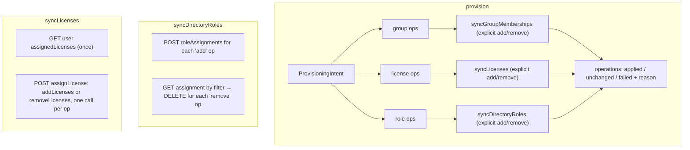

# Entra ID Connector - Deep Dive

> **Module:** Connectors / Entra ID (Pillar 3 — Hands)
> **General connector architecture:** [Connector Architecture](../../docs/ARCHITECTURE.md)
> **Cross-cutting:** [Data Flows](../../../../../../docs/architecture/core/DATAFLOWS.md) | [Temporal Workflows](../../../../../../docs/architecture/infrastructure/TEMPORAL_WORKFLOWS.md)

## Architecture: Facade + 3 Sub-Services

The Entra connector uses a **facade pattern**. `EntraService` is a thin delegation layer over three focused sub-services:

| Sub-Service | File | Responsibility |
|-------------|------|----------------|
| `EntraDiscoveryService` | `entra-discovery.service.ts` | Read-only: health checks, user lookups, entitlement discovery |
| `EntraProvisioningService` | `entra-provisioning.service.ts` | User lifecycle: create, update, UPN resolution |
| `EntraEntitlementsService` | `entra-entitlements.service.ts` | Entitlement execution: groups, roles, licenses (explicit add/remove) |

Supporting files:

| File | Role |
|------|------|
| `entra.client.ts` | Infrastructure: OAuth token, HTTP methods, error mapping, rate limiting |
| `entra.mapper.ts` | Pure logic: `StandardUserDto` → `EntraUserDto` field translation |
| `entra.service.ts` | Facade: delegates to the 3 sub-services, keeps 21+ consumers' imports stable |
| `upn-generator.ts` | Pure function: generates UPN candidates from patterns |

---

## Which Config a Graph Call Uses

`EntraClient` is one instance per worker, shared by every activity, so it keeps no config: each Graph call (`get`, `getByUrl`, `post`, `patch`, `delete`) takes `config: EntraConfig | undefined`, and every sub-service method passes on the `config` it was given to all the calls it makes, including the nested ones (UPN checks, group, license and role operations of `provision`). Tokens are cached in the Nest cache under `oauth:entra:{tenantId}:{clientId}:{sha256 of the secret}`, and the SKU map of `assignLicense` per the same scope (`EntraClient.credentialScope`), so a call never uses a token or data fetched with another config. Before plan item 2.0cm the config was stored on the client (`setRuntimeConfig`) by each call, and concurrent activities of two tenants could run Graph calls with each other's credentials; `entra-tenant-isolation.spec.ts` covers this.

The facade (`EntraService`) picks the config of each call once, before its first Graph call (`EntraTenantConfigService`, plan item 2.0db):

1. the config the caller passes (a canvas config);
2. else the current tenant's installed Entra ID connector config (`ConnectorConfigService`, the `entra-id` connector of the tenant in the request context; read through `CorrelationConfigRegistry`, since importing `ConnectorConfigModule` would be a module cycle);
3. else `undefined`, the `ENTRA_TENANT_ID`, `ENTRA_CLIENT_ID` and `ENTRA_CLIENT_SECRET` environment variables. Only a tenant without an installed Entra ID config, or a call outside any tenant context, gets these.

A config names all three credentials or is rejected: an empty tenant id, client id or client secret is a configuration error (`ConnectorException`, 400, which offboarding, access-review revocation and since 2.0dm `provisionUserToEntra`, `disableEntraUser` and `enableEntraUser` fail at once: "Entra ID config is incomplete (empty: clientSecret) ..."), never filled in from `ENTRA_*`. Until 2.0db each empty field fell back to its variable, so a config with a tenant id and no secret signed the deployment's app registration in to that tenant. An installed config counts even when incomplete: its tenant gets the error, never the deployment's app. `EntraService.isConfiguredForTenant()` tells whether calls without a config have one to run on (installed config or `ENTRA_*`); `isConfigured()` still reads only `ENTRA_*`. `isConfiguredFor(config)` answers the same for a call with a canvas config (any config object counts, an empty one included); onboarding asks it through the `isEntraConfigured` activity and leaves an Entra ID with no config anywhere out of the run (2.0dg).

| Caller | Config |
|--------|--------|
| Onboarding (`isEntraConfigured`, `checkEntraHealth`, `provisionUserToEntra`), mover, admin-account provisioning (`provisionUserToEntra`), offboarding (`deleteUser`, and its lookup by mail), entitlement expiry, impact analysis UPN resolution, blueprints and pipeline health check, blueprints discovery | the canvas config; without one, as below |
| Connector config controller and sync scheduler (health check, discovery) | the tenant's installed config, passed explicitly |
| Access-review gathering and revocation (also the legacy `executeRevocations`), bulk provisioning and its rollback, distributed transactions, reconciliation and drift correction, orphan detection and cleanup, access-request fulfilment, `disableEntraUser` / `enableEntraUser` / `validateUpn`, anomaly detection, policy suggestions, credential management, onboarding batch (test-batch) provisioning, cleanup and diagnostics | the tenant's installed Entra ID connector config, else `ENTRA_*` (before 2.0db always `ENTRA_*`) |

The onboarding batch diagnostics (`GET /batch-provision/health/diagnostics`) run their connection, license and domain checks on the same config, and name it in `entra.configSource` (`EntraService.tenantConfigSource()`): `tenant-connector` (the tenant's installed config, complete or not), `environment` (`ENTRA_*`) or `none` (nothing is checked, status `NOT_CONFIGURED`). Their messages name the tenant's connector config when that is the one that failed or is ready. `keysCheck` still reports the `ENTRA_*` keys only. Before 2.0dm the checks ran only when `ENTRA_*` was set (`isConfigured()`), so a tenant on its own connector config without `ENTRA_*` got "not configured" with no connection attempt.

### Token Request Failures

`ensureToken` asks `login.microsoftonline.com` (`ENTRA_LOGIN_BASE_URL`) for a client-credentials token. A 4xx answer other than 429 means the credentials were refused (wrong secret, unknown tenant or client, app not consented): `UnauthorizedException` (401), which deprovision activities and the provision, disable and enable activities fail at once. Anything else is the token endpoint failing, handled like a Graph failure (`handleError`): 429 waits its retry-after, a 5xx answer or no answer (network error, timeout) is a `ConnectorException` 502, which those activities retry, and a non-HTTP error (the circuit breaker open) is rethrown as it is. Before 2.0db every token failure became 401, so a brief outage of the token endpoint failed an offboarding target for good.

---

## Dumb Pipe Compliance

The Entra connector follows the **dumb pipe principle** (Safety Rule 1):

| Principle | How it's enforced |
|-----------|-------------------|
| **No PAM classification** | Discovery returns raw `metadata.templateId`. `EntitlementCatalogService.absorbDiscovered()` calls `PamFilterService.classifyByTemplateId()` to stamp `adminTier`/`riskLevel` during catalog ingestion. |
| **No governance filtering** | `syncGroupMemberships` and `syncDirectoryRoles` execute explicit `{action: 'add'|'remove'}` operations. Delta calculation and PROTECTED/POLICY filtering happen upstream (Policy Engine). |
| **No credential generation** | Password generated by `CredentialGenerationService` (infrastructure/secrets/), passed to mapper as parameter. |
| **Pure mapper** | `entra.mapper.ts` has no randomness, no side effects, no HTTP calls, no business logic. |

---

## Entra ID: Provision Routing (executeIntent)

The connector routes `ProvisioningIntent` operations by type. Each operation has an explicit `action` ('add' or 'remove') — the connector executes blindly.



### Which Account provision() Updates

`provisionUserToEntra` finds the identity's account by the object id written back for it: the `entra-id` target source of the identity of the profile's `_id` (`liveTargetAccountId`, `modules/identity/identity-provisioning.service.ts`), or the id a caller already read and passes as the activity's last argument (the mover). The id counts until a deprovision removed the account: an Entra ID provisioning entry in DEPROVISIONED, or with `provisionedAt` null (not SYNCED since a deprovision), has no live id. With an id, `EntraProvisioningService.provision` looks the account up by it alone (`GET /users/{id}`); an id Graph answers 404 for fails with 422 ("No Entra ID account has the object id recorded for the identity ..."), not retried, and nothing is created: the identity has an account, and a second one is never made for it. Without an id (a profile without `_id`: bulk rows, PAM admin profiles; an identity whose account was never written back or was removed), the account is the one with the profile's UPN (or email) in the default domain, and none such is created. Before this sweep fix the written-back id was not used, so an identity whose UPN was renamed in Entra ID got a second account from a mover run or a `syncToEntra` edit.

**Must exist (the mover and a sync).** An identity can have an Entra ID account without a written-back id: bulk provisioning writes none back. The mover (`MoverTargetAccessService`) and onboarding started by a `syncToEntra` edit pass `mustExist` (the activity's last argument; no workflow patch, the commands are unchanged). When the identity's Entra ID provisioning entry says it has an account (`provisionedSystems`, the rule the mover uses to pick its systems) and no id is recorded, `EntraProvisioningService.provision` finds the account by the identifiers the profile holds (`EntraDiscoveryService.findAccountIdByIdentifiers`): the UPN (`GET /users/{upn}`), the email as `mail` or UPN, then `employeeId` (written on create and on every update). It updates that account and never creates one. No match fails with 422, not retried: "The Entra ID account of this identity was not found: no object id is recorded for it, and no account has its UPN, email or employee id. Link the account to the identity or re-provision it; ...". Two accounts with the email (as `mail` or UPN) or with the employee id fail with 422 as well (`AmbiguousAccountException`), choosing neither; each lookup asks Graph for two accounts so it can tell. Onboarding of an identity without an account, and a sync for one whose entry says it has none, still create it.

**Create only (a distributed-transaction CREATE).** `provisionUserToEntra` with `createAs` (the activity's eighth argument) calls `EntraProvisioningService.createAccount` instead of `provision()`: it reads no identity and updates no account. It creates the account under the UPN it is given, the one the transaction's prepare resolved (`resolveAvailableUpn`, the UPN pattern included), and fails with 409 when an account is in the way (`existingAccountFor`: an account with that UPN or the profile's own UPN, the email as `mail` or UPN, or the employee id; two accounts with the email or employee id fail with `AmbiguousAccountException`). The object id it returns is therefore always an account it created, which the transaction's rollback may delete (`activities/distributed-transaction-entra.ts`).

### Change Results (plan item 2.0dm)

`provision()` returns one `ProvisioningOperationResult` per operation in `operations` (`shared/dtos/provisioning-result.dto.ts`, helpers in `entra-change-result.ts`): `applied` (Graph made the change), `unchanged` (already as requested: already a member, not a member, role already assigned or not assigned, license already there or not there) or `failed` with `reason` (the error's message) and `status` (the HTTP status of the connector's exception). Every operation is attempted and none throws, so the account created or updated before the intent stays created or updated, and the changes that worked stay made.

| Operation | Failed when |
|-----------|-------------|
| group add / remove | Graph refuses or cannot be asked (also for the display-name lookup), or no group has the id or display name (422, "No Entra ID group has the id or display name ...") |
| role add / remove | Graph refuses the assignment or its deletion, or the assignment lookup fails |
| license add / remove | an add of a SKU the tenant does not have (400 "License SKU ... not found"; a remove of one is `unchanged`, since no user can hold it), the user's licenses cannot be read, or Graph refuses `assignLicense` (e.g. removing a license the user gets through a group) |
| any other type or action | always (400 "Entra ID has no ... operation"), not run |

`changeEntitlements(objectId, intent)` runs the same group, role and license changes on an account the caller names and nothing else: no attribute is written, no account is looked up by UPN or created. Access request fulfilment and expiry use it on the person's recorded account (`backend/src/activities/entra-entitlement-changes.ts`), or, when no object id is recorded, on the one account `findAccountIdByIdentifiers` finds, which they record for the identity first (no profile write).

Before 2.0dm a refused group or role change was logged and dropped, a group name that did not resolve was skipped, and a license `remove` was ignored.

What a failed change means for a run is decided by the activity (`activities/entra-changes-failure.ts`): `provisionUserToEntra` throws after emitting `provisioning.failed` (`partialFailure: true`), with each failed change and its reason in the message (emails masked), and never emits `provisioning.completed` for that call. The failure is not retried (`ApplicationFailure.nonRetryable`, type `EntraChangesFailed`) when a failed change has a status a retry cannot fix (`isRetryableStatus`: a 4xx other than 408, 409, 429), and always when the call created the account, since a retry would not find it and would create a second one; then the account's object id and generated attributes are in the failure's details (`EntraCreatedAccount`), and onboarding and admin-account provisioning write them back to the identity before marking the target ERROR (workflow patches `onboarding:entra-created-account-writeback`, `admin-account-provisioning:entra-created-account-writeback`). When every failure is a 429, a 5xx or no answer, the activity is retried (a 429 after the rate-limit wait); the changes are idempotent. Every caller then shows a failure for Entra ID through its existing failure path: onboarding and admin-account provisioning mark the target ERROR, the mover reports the system `failed` ("Access update failed: entra-id") instead of "Access updated", access-request fulfilment and revocation report the system failed. Bulk provisioning, reconciliation, drift correction and distributed transactions send no intent, so only the account call can fail there.

---

## UPN Resolution & Domain Validation

Entra ID requires a UPN with a **valid M365-verified domain** (e.g., `@example.com`). UPNs must be **unique** within the tenant. If `mary.tester@example.com` is taken, provisioning fails unless we try alternatives.

### Flow: Resolve UPN Before Provision

```
    User (HR) ──▶ (D') Resolve UPN
                         │
                         │ 1. Validate domain (verified in M365)
                         │ 2. Generate candidates: mary.tester, mary.t.tester, mary.tester1…
                         │ 3. For each: checkUserExists(candidate) → first available
                         ▼
    (E) Provision ──▶ Target (Entra ID) with chosen UPN
```

### UPN Generation Patterns (Priority Order)

| Priority | Pattern | Example (Mary T. Tester) |
| --- | --- | --- |
| 1 | `firstname.lastname` | mary.tester@example.com |
| 2 | `firstname.middleinitial.lastname` | mary.t.tester@example.com |
| 3 | `firstname.lastname{n}` | mary.tester1@example.com, mary.tester2@example.com, … |

Patterns are configurable via `upnPatterns` in EntraConfig or Blueprint. Default: `['firstname.lastname', 'firstname.middleinitial.lastname', 'firstname.lastname{n}']`.

### Error Handling

| Scenario | Behavior |
| --- | --- |
| Domain not verified | Fail before API call: "Domain X is not verified in M365" |
| All UPN candidates taken | Throw `UpnExhaustedError` with `candidatesChecked` and `suggestedUpn` |
| Missing first/last name | Fail early: "Cannot generate UPN: firstName and lastName are required" |

---

## Email Authoritative Connector & HR Write-Back

When a user is provisioned to Entra ID (or AD), the target system **generates** the work email (e.g., `firstname.lastname@company.com`). HR systems (Workday, BambooHR) need this email back for payroll, reporting, and employee directory. Not all connectors can generate work email.

### Capability: Who Can Generate Work Email?

| Connector | Can Generate Work Email? | Notes |
| --- | --- | --- |
| **Entra ID** | Yes | Creates user, assigns UPN/mail. Returns `generatedAttributes`. |
| **Active Directory** | Yes | Creates user, assigns mail. Returns `generatedAttributes`. |
| **Okta** | No | Creates the user with the Hub's email as its login (`okta.mapper.ts`); returns no `generatedAttributes`. |
| **SCIM** | No | Sends the Hub's UPN, else email, as `userName` (`scim.mapper.ts`); returns no `generatedAttributes`. |
| **GitHub** | No | Invites the person to the org by GitHub login, else by email (`github.service.ts`); does not generate an email. |
| **ServiceNow** | No | User records use email from Hub; does not generate it. |

**PLANNED:** an **Email Authoritative** mark in the Blueprint, allowed only for connectors that **can** generate work email and for at most one connector per tenant. No such flag or check exists in the code.

### Flow: Generated Email → Hub → HR

```
    Target (Entra ID) ──(1) POST /users ──▶ Returns { id, mail, userPrincipalName }
                                                    │
                                                    ▼
    Connector.create() ──(2)──▶ Returns ProvisioningResult { targetUserId, generatedAttributes }
                                                    │
                                                    ▼
    Onboarding Workflow ──(3)──▶ pushSourceAndReconcile(identityId, 'entra-id', rawData)
                                                    │
                                                    ▼
    Hub Golden Record ──(4)──▶ mastery: { email: 'entra-id' }  (Reconciliation merges)
                                                    │
                                                    ▼
    HR Write-Back Activity ──(5)──▶ PATCH Workday API (workEmail field)
```

Step 5 is not built: `HrActivities.writeBackToHr` (`backend/src/activities/hr.activities.ts`) only logs and returns `{ success: true }`, and no workflow calls it.

### HR Write-Back Connector

The HR connector has two modes:

* **Inbound (Discovery):** Fetches users from Workday → Hub. (Existing.)
* **Outbound (Write-Back):** Pushes generated attributes back to Workday → `PATCH /workers/{id}` with `workEmail`.

Implement when the HR system exposes a write API. Until then, the Hub stores the updated email and HR can sync it via their next inbound feed (if bidirectional sync is supported).

---

## Code Examples

### 1. The Client (`entra.client.ts`)

**Responsibility:** Infrastructure. Handles OAuth token acquisition, HTTP methods, error mapping, rate limiting, and SSRF protection.

```typescript
@Injectable()
export class EntraClient {
  // OAuth token acquisition + caching per credentials (tenant, client id, sha256 of the secret)
  // SSRF protection via validateUrlForFetch() for getByUrl()
  // Rate limit handling (429 → RateLimitedException)
  // `config`: the call's Entra config (all three credentials, else a 400 config error);
  // undefined = ENTRA_* environment variables. Token 4xx (not 429) = 401; 5xx / no answer = 502

  async get<T>(endpoint: string, config: EntraConfig | undefined): Promise<T> { /* ... */ }
  async getByUrl<T>(url: string, config: EntraConfig | undefined): Promise<T> { /* ... */ }
  async post<T>(endpoint: string, body: Record<string, unknown>, config: EntraConfig | undefined): Promise<T> { /* ... */ }
  async patch<T>(endpoint: string, body: Record<string, unknown>, config: EntraConfig | undefined): Promise<T> { /* ... */ }
  async delete(endpoint: string, config: EntraConfig | undefined): Promise<void> { /* ... */ }
  credentialScope(config: EntraConfig | undefined): string { /* cache scope, no secret */ }
}
```

### 2. The Mapper (`entra.mapper.ts`)

**Responsibility:** Pure Logic. Transforms `StandardUserDto` into `EntraUserDto`. No API calls, no side effects, no randomness.

```typescript
@Injectable()
export class EntraMapper {
  // Password is generated externally by CredentialGenerationService (Brain)
  // and passed in as a parameter — the mapper never generates credentials.
  toEntraProfile(
    user: StandardUserDto,
    defaultUsageLocation: string,
    overrideUpn?: string,
    password?: string,
  ): EntraUserDto {
    return {
      displayName: user.displayName || `${user.firstName} ${user.lastName}`,
      userPrincipalName: overrideUpn ?? user.userPrincipalName ?? user.email,
      mailNickname: user.samAccountName || user.email.split('@')[0],
      department: user.departmentCode || user.departmentName,
      usageLocation: user.countryCode || defaultUsageLocation,
      // ACTIVE or PENDING; a linked admin account (PAM) only ACTIVE (shared/utils/linked-admin-profile.ts)
      accountEnabled: targetAccountEnabled(user),
      ...(password && {
        passwordProfile: { forceChangePasswordNextSignIn: true, password },
      }),
    };
  }

  toEntraUpdatePayload(user: StandardUserDto): Record<string, unknown> { /* ... */ }
}
```

### 3. The Facade (`entra.service.ts`)

**Responsibility:** Thin delegation layer. Keeps all 21+ consumers' imports stable while the implementation is split into sub-services.

```typescript
@Injectable()
export class EntraService implements IEntraConnector {
  constructor(
    private readonly discovery: EntraDiscoveryService,
    private readonly provisioning: EntraProvisioningService,
    private readonly entitlements: EntraEntitlementsService,
    private readonly client: EntraClient,
    private readonly tenantConfig: EntraTenantConfigService, // caller's config, else installed, else ENTRA_*
  ) {}

  // Discovery (read-only) → delegates to EntraDiscoveryService
  checkConnection(config?: EntraConfig): Promise<boolean> { /* ... */ }
  discoverEntitlements(config?: EntraConfig): Promise<Entitlement[]> { /* ... */ } // every page of groups (@odata.nextLink, entra-graph-pages.ts)
  listUsers(options?, config?): Promise<{ users: TargetAccount[]; nextLink?: string }> { /* ... */ }

  // Provisioning (user lifecycle) → delegates to EntraProvisioningService
  resolveAvailableUpn(user, config?): Promise<{ chosenUpn; candidatesChecked }> { /* ... */ }
  provision(user, intent?, config?): Promise<ProvisioningResult> { /* ... */ }

  // Entitlements (explicit add/remove, each op reported) → delegates to EntraEntitlementsService
  syncGroupMemberships(userId, groupOps): Promise<ProvisioningOperationResult[]> { /* ... */ }
  syncDirectoryRoles(userId, roleOps, config?): Promise<ProvisioningOperationResult[]> { /* ... */ }
  assignLicense(objectId, skuName): Promise<boolean> { /* ... */ }
}
```

### 4. PAM Classification (Activity Layer — NOT in connector)

**Responsibility:** The activity layer stamps PAM tier classification after raw discovery. This keeps the connector as a dumb pipe.

```typescript
// entra.activities.ts — discoverEntitlements()
async discoverEntitlements(config?, tenantId?, correlationId?) {
  const entitlements = await this.entraService.discoverEntitlements(config);

  // PAM classification happens in EntitlementCatalogService.absorbDiscovered()
  // (Brain layer) — discovery just passes raw entitlements with metadata through.
  await this.entitlementCatalog.absorbDiscovered(ENTRA_SYSTEM, entitlements);
  return entitlements;
}
```

PAM classification happens during catalog ingestion in `EntitlementCatalogService.absorbDiscovered()`, which calls `PamFilterService.classifyByTemplateId()` / `classifyByRid()` based on entitlement metadata. The role-to-tier mapping lives in `PamFilterService` (`modules/policy/pam-filter.service.ts`).
