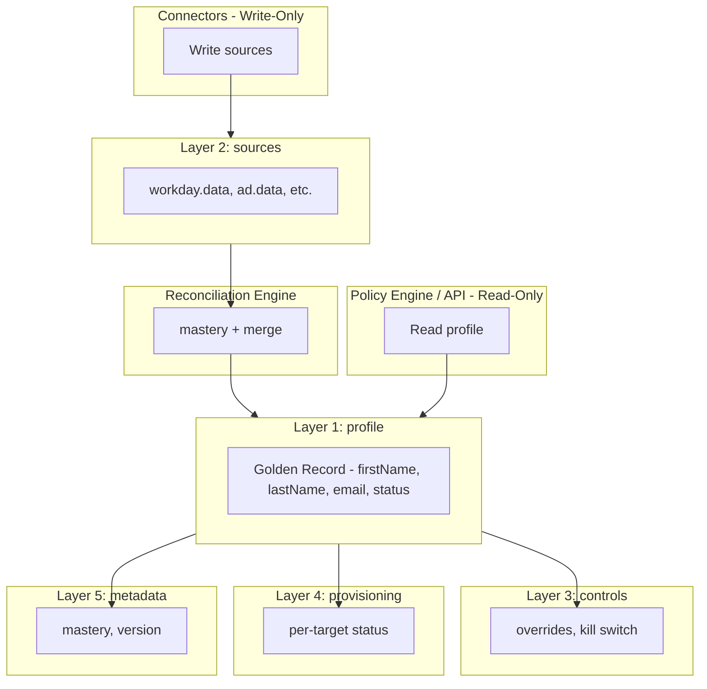

# 💾 Database Architecture - The Onion Model (2026)

> **Module:** Identity (Pillar 1 — Heart)
> **Cross-cutting:** [Data Flows](../../../../../docs/architecture/core/DATAFLOWS.md) | [Event Bus](../../../../../docs/architecture/core/EVENT_BUS_ARCHITECTURE.md)

## 🎯 The Core Philosophy

**"Identity is Layered, Not Flat."**

Traditional systems fail because they try to smash everything into one `User` table.

* **The 2026 Standard:** We use the **Onion Model**.
* **Core:** The calculated "Golden Record" (Read-Only for connectors).
* **Layers:** The raw data from each source (Write-Only for connectors).
* **Skin:** The metadata that decides who wins (Mastery).



---

## ⚠️ Database Landmines (Critical Safety Protocol)

### 🧨 Landmine 1: The "Flat Map" Trap

* **The Trap:** Storing `managerId` directly on the root Identity document.
* **The Explosion:** HR sends `manager: "123"`. AD sends `manager: "CN=Bob"`. They overwrite each other every sync cycle.
* **The 2026 Fix:** **Source Segregation.**
* Store raw data in each source's `LinkedAccount.rawData` — e.g. `sources[i].rawData.managerId` (where `sourceName === 'workday'`).
* The Reconciliation Engine calculates the "Golden" `identity.profile.managerId`.


### 🧨 Landmine 2: Secret Sprawl (The "Env" Leak)

* **The Trap:** Storing `clientSecret` in the `Blueprints` collection in plain text.
* **The Explosion:** A developer dumps the DB to their laptop for debugging and leaks 50 production API keys.
* **The 2026 Fix:** **Envelope Encryption.**
* Secrets in MongoDB are **AES-256 encrypted**.
* The decryption key lives in **HashiCorp Vault** (or AWS KMS), never in the DB.


### 🧨 Landmine 3: The "Unbounded Array" (Performance Killer)

* **The Trap:** Storing `auditLogs` as an array inside the `Identity` document.
* **The Explosion:** After 2 years, a user has 50,000 logs. The document exceeds MongoDB's 16MB limit. The user cannot log in.
* **The 2026 Fix:** **Reference Pattern.**
* Audit logs live in a separate `AuditLog` collection with `userId` index. Never embed unbounded lists.


---

## 🏗️ The Schema: Identity Collection

This is the most important document in the system.

```typescript
// The "Onion" Document
interface Identity {
  _id: string; // Internal UUID (Immutable)

  // 🟢 LAYER 1: The Golden Record (Computed)
  // This is what the Policy Engine reads.
  profile: {
    firstName: string;
    lastName: string;
    email: string;
    status: 'ACTIVE' | 'INACTIVE' | 'PENDING' | 'SUSPENDED' | 'TERMINATED' | 'DELETED' | 'GUEST';
    // ...StandardUserDto fields (see shared/dtos/standard-user.dto.ts)
  };

  // 🟡 LAYER 2: The Sources (Raw Evidence)
  // This is what Connectors write to. An ARRAY of LinkedAccount objects (max 50).
  sources: LinkedAccount[]; // NOT a keyed map — iterate by sourceName

  // 🔴 LAYER 3: Control Plane (Overrides)
  // Manual interventions by Admins.
  controls: {
    isLoginDisabled: boolean;        // Kill switch (true = login blocked): status SUSPENDED; the status it
                                     // replaced waits in metadata.statusUnderKillSwitch and returns when it is off
    manualDepartment?: string;       // Override of the HR-mastered department (attribute control)
    manualDepartmentInfo?: { reason; setBy; setAt; expiresAt? }; // Why, who, when, until when
    manualJobTitle?: string;         // Override of the HR-mastered job title
    manualJobTitleInfo?: { reason; setBy; setAt; expiresAt? };
    overrides?: { email?: string };  // Attribute overrides
  };

  // 🔵 LAYER 4: Provisioning State (Output)
  // Status of downstream systems. An ARRAY of ProvisioningState objects.
  provisioning: ProvisioningState[];

  // The profile values policy access was last applied with (shared/utils/access-baseline.ts):
  // set at the first SYNCED target, advanced by completed mover runs. No names, contact data or
  // identifiers. The access preview and re-evaluation compare the profile with it.
  accessBaseline?: { attributes: Record<string, unknown>; recordedAt: Date; recordedBy: 'provisioning' | 'mover' };

  // ⚫ LAYER 5: Metadata
  // A Mixed path (type: Object): a change made inside it is saved only after
  // markModified('metadata') or set('metadata.<key>', value).
  // correlationConflict, requiresReview, conflictDetails: set on an identity a low-confidence
  // correlation match hit (IdentityCorrelationService.ensureIdentityFromUser), whose record then
  // gets an identity of its own (conflictDetails.incomingIdentityId), or, when an identity already
  // has the record's email, is held in conflictDetails.incomingSource (as is a record no rule
  // matches whose email a live identity has: matchedBy 'email', confidence 0). GET /identity/conflicts
  // lists them; POST /identity/:id/resolve-conflict merges or clears them
  // (identity/docs/MULTI_HR_INGESTION.md, Correlation conflicts).
  metadata: {
    mastery?: Record<string, string>;  // e.g. { jobTitle: 'workday', email: 'entra-id' }
    version?: number;
    primaryHrSource?: string;
    primaryContractExternalId?: string;
    correlationConflict?: boolean;
    requiresReview?: boolean;
    conflictDetails?: {
      matchedBy: string;
      matchedValue?: string;
      confidence: number;
      existingSnapshot?: Record<string, unknown>;
      incomingSnapshot?: Record<string, unknown>;
      incomingIdentityId?: string;
      incomingSource?: LinkedAccount;  // the held record (no identity of its own)
    };
    correlationStatus?: 'correlated' | 'uncorrelated' | 'ambiguous' | 'manual-review';
    ambiguousCandidates?: string[];
    // PATCH /identity/:id of departmentName / jobTitle: per attribute and source, the HR value the
    // edit replaced. The policy profile's HR contract takes the edited value while that source
    // still sends it (identity/manual-contract-overrides.ts).
    manualOverrides?: { departmentName?: Record<string, string>; jobTitle?: Record<string, string> };
    // A rehire an HR sync revived: when, and from which source (HR joiner detection reads it).
    rehiredAt?: Date;
    rehiredFrom?: string;
  };
}

// LinkedAccount — one per source system connection
interface LinkedAccount {
  sourceName: string;           // e.g. 'workday-prod', 'ad', 'entra-id'
  externalId: string;           // e.g. "10045"
  lastSync: Date;
  rawData: Record<string, unknown>; // Raw data from this source
  contractType?: 'primary' | 'secondary';
  sourceRole?: 'primary-hr' | 'secondary-hr' | 'target';
}

// ProvisioningState — one per target system
interface ProvisioningState {
  targetSystem: string;         // e.g. 'entra-id', 'ad'
  status: 'PENDING' | 'SYNCING' | 'SYNCED' | 'ERROR' | 'DEPROVISIONED';
  lastSync?: Date;
  errorMsg?: string;
  writebackComplete?: boolean;  // Prevents circular writeback on re-sync; false after a deprovision
  // First SYNCED, kept through a later ERROR; null after a deprovision; absent on entries no
  // write has touched since 2.0dq. Whether the identity has an account there, for the mover
  // (IdentityProvisioningService hasProvisionedAccount)
  provisionedAt?: Date | null;
  expiresAt?: Date;             // Time-bound access auto-expiry
  activeFrom?: Date;            // Delayed activation (future-dated)
  grantedBy?: 'policy' | 'request' | 'manual'; // How the entitlement was granted
  expiryWarnings?: { soon?: Date; tomorrow?: Date }; // expiresAt the 7-day / 1-day warning was emitted for
  // Last failed removal by the expiry run, for the expiresAt it names; cleared by
  // POST /identity/:id/access/expiry/retry (operator) and /removed-manually (policy-admin)
  expiryFailure?: { expiresAt: Date; failedAt: Date; reason: string; retryable: boolean; attempts: number; nextAttemptAt?: Date };
}

// LinkedAdminAccount — linked admin identity reference on primary identities
interface LinkedAdminAccount {
  identityId: string;           // MongoDB ObjectId ref to admin Identity
  adminTier: 'TIER_0' | 'TIER_1' | 'TIER_2';
  // The privileged session (privilegedSessionWorkflow); only it writes ACTIVATING, ACTIVE and,
  // after a session, INACTIVE (PAM ARCHITECTURE.md)
  status: 'PENDING' | 'ACTIVATING' | 'ACTIVE' | 'INACTIVE';
  activatedAt?: Date;
  deactivatedAt?: Date;
  expiresAt?: Date;             // When the active session ends
  sessionId?: string;           // The last session's id (the API waits for its outcome by it)
  activationError?: string;     // Why the last activation failed (nothing stayed enabled)
  disableError?: string;        // Why disabling the accounts failed (retried hourly)
}

// Additional fields on Identity for PAM:
// linkedAdminAccounts?: LinkedAdminAccount[];  // On primary identities
// parentIdentityId?: string;                   // On admin identities (refs primary)
// adminTier?: 'TIER_0' | 'TIER_1' | 'TIER_2'; // On admin identities
// pamTargetState?: 'enabled' | 'disabled';     // On admin identities: last known state of its
//                                              // accounts in the targets; unset = unknown
```

---

## 🗄️ Persistence Strategy

**Current State:** MongoDB is the primary persistence layer and the source of truth. Audit immutability is achieved via SHA-256 hash-chain (see API_CHANGELOG, CURRENT_TASK_117).

> **Polyglot strategy (v2.0):** what is built and what is still planned:
>
> | Data Type | Store | Purpose | Status |
> |-----------|-------|---------|--------|
> | **Write Model** | MongoDB (Onion) | High-throughput writes, survivorship logic, source-of-truth. | Built |
> | **Read Model** | ElasticSearch | Fast filtering, full-text search, dashboard aggregation (CQRS). | Audit events only (analytics v2, `backend/src/infrastructure/elasticsearch/`), optional and fail-open; no identity read model |
> | **Relationships** | Neo4j / Neptune | Deep entitlement hierarchy, nested groups, SoD path analysis. | Neo4j, optional (compose profile `graph`), for the Access Explorer (`backend/src/infrastructure/graph/`); no nested groups |
> | **Audit Logs** | QLDB / Merkle Log | Immutable, cryptographically verifiable audit trail. | Hash chain and Merkle checkpoints in MongoDB (`audit_roots`), checkpoints exported to S3 with Object Lock (`audit-archive.service.ts`); no QLDB |
> | **History** | S3 (Parquet) | Cold storage for logs > 90 days (Event Sourcing snapshots). | Not built: no event store; the audit archive writes gzipped JSON |

---

## 🗄️ Collection Strategy (MongoDB)

| Collection | Role | Indexing Strategy | Status |
| --- | --- | --- | --- |
| **`identities`** | The Core | `{ tenantId: 1, "profile.email": 1 }` (unique among live identities: partial over `deletedAt: null`), `{ tenantId: 1, "sources.sourceName": 1, "sources.externalId": 1 }`, `{ "provisioning.expiresAt": 1 }` (sparse), `{ tenantId: 1, "parentIdentityId": 1 }` (sparse), `{ tenantId: 1, "metadata.conflictDetails.matchedBy": 1 }` (partial over `metadata.requiresReview: true`: the open conflicts correlation reads before a mint, `identity-email-case-conflict.ts`) | **Active (Golden Record)** |
| **`blueprints`** | Config | `{ "name": 1 }` (Low volume) | Active |
| **`entitlement_catalog`** | Catalog | `{ "system": 1, "type": 1, "tenantId": 1 }` (For fast policy lookup) | Active |
| **`audit_events`** | History | `{ action: 1 }`, `{ severity: 1 }`, `{ tenantId: 1, timestamp: -1 }`, `{ resourceType: 1, resourceId: 1 }`; unique, partial: `{ tenantId: 1, eventId: 1 }`, `{ tenantId: 1, seq: 1 }` (chain position); TTL `{ timestamp: 1 }` (`AUDIT_RETENTION_DAYS` + 30 days); text index | Active |
| **`audit_chain_heads`** | Audit hash chain | `{ tenantId: 1 }` (unique): one head per tenant, the last chain position and its hash | Active |
| **`access_requests`** | Access Requests | `{ "tenantId": 1, "requesterId": 1 }`, `{ "tenantId": 1, "status": 1 }`, `{ "approvalSteps.approverId": 1, "status": 1 }` | Active |
| **`identity_risk_scores`** | Risk Scoring | `{ "tenantId": 1, "identityId": 1 }` (unique), `{ "tenantId": 1, "score": -1 }` | Active |
| **`sod_policies`** | SoD Rules | `{ "tenantId": 1, "status": 1 }` | Active |
| **`role_bundles`** | Role Bundles | `{ "tenantId": 1 }` | Active |
| **`jobs`** | Temporal | Managed by Temporal (Do not touch) | Active |

### The `users` Collection (Decommissioned)

The flat `users` collection has been **fully decommissioned**. All reads and writes use the `identities` collection exclusively. Migration script: `backend/src/scripts/migrate-user-to-identity.ts`. The only remaining user collection is `admin_users` for platform administrator accounts (separate concern from identity governance).

---

## 🔌 The Entitlement Catalog (The Cache)

To prevent the Policy Engine from hammering APIs, we cache all available groups/roles here.

```typescript
// Collection: entitlement_catalog
interface Entitlement {
  nativeId: string;     // GUID or SKU id — e.g. "00g-123-456"
  name: string;         // e.g. "Salesforce Users"
  type: 'Group' | 'License';
  system?: string;      // e.g. "entra-id"
  tenantId: string;

  // Governance
  origin?: 'POLICY' | 'EXTERNAL';       // POLICY = policy-defined; EXTERNAL = ad-hoc discovered
  governanceLevel?: 'STRICT' | 'OPEN';  // STRICT = revert drift; OPEN = sync back only
  governanceTags?: string[];             // e.g. ['PROTECTED', 'MANDATORY', 'REVIEW_REQUIRED']
  owner?: string;                        // For access reviews — e.g. "VP of Sales"
  riskLevel?: string;                    // For risk-based self-review
  metadata?: any;

  // PAM (Privileged Access Management)
  adminTier?: 'TIER_0' | 'TIER_1' | 'TIER_2';  // Admin tier classification
  requiresAdminAccount?: boolean;  // If true, Policy Engine redirects to admin identity

  // Access Request Portal
  requestable?: boolean;           // If true, visible in self-service catalog
  approvalRequired?: boolean;      // If true, request needs approval chain
  approvalChain?: Array<{          // Multi-step approval chain
    type: 'MANAGER' | 'OWNER' | 'ROLE' | 'SPECIFIC_USER';
    value?: string;
  }>;
  maxDurationDays?: number;        // Max allowed duration for time-bound requests
  category?: string;               // For catalog browsing (e.g. "Productivity", "Security")
  userDescription?: string;        // User-facing description for catalog browsing
}
```

---

## 🔐 Secrets Management (Blueprint Config)

Connectors need credentials. We store them safely.

```typescript
interface Blueprint {
  name: string;        // "Entra ID Production"
  type: 'entra-id';
  
  // 🔒 Encrypted Fields (AES-256-GCM, envelope encryption)
  config: {
    tenantId: string;  // Plain text (Safe)
    clientId: string;  // Plain text (Safe)
    clientSecret: string; // Encrypted! Stored as "euroid:v2:<keyId>:<ciphertext>"
    // v1 ciphertexts (legacy) still decrypt. Run rotate-encryption-key.ts to upgrade.
  };
}
```

---

## 🚀 Migration Strategy (For Future Updates)

When the schema needs to change (e.g., adding `profile.pronouns`):

1. **Code First:** Update the Zod schema and TypeScript Interface.
2. **Lazy Migration:** Update the `ReconciliationService` to calculate the new field during the next sync.
3. **No Downtime:** Old documents stay as-is until they are "touched" by a sync event.
