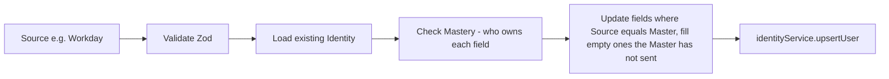
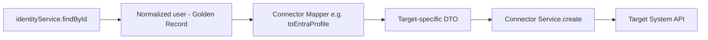

# Hub & Spoke Model - The 2026 Way

> **Module:** Identity (Pillar 1 — Heart)
> **Cross-cutting:** [Data Flows](../../../../../docs/architecture/core/DATAFLOWS.md) | [Event Bus](../../../../../docs/architecture/core/EVENT_BUS_ARCHITECTURE.md)
> **Related:** Connectors consume the Hub output; see [Connector Architecture](../../connectors/docs/ARCHITECTURE.md) for the Dumb Pipe contract.

---

## 🎯 The Challenge

Traditional IAM systems face a dilemma:

* **Too Rigid**: Hard-coded schemas break when you add a new field.
* **Too Flexible**: Schema-less approaches lose type safety and validation.

**The 2026 Solution:** Structured core + flexible extensibility + **Runtime Safety**.

---

## 🏗️ Architecture: StandardUserDto Design

### The Three-Layer Approach

```
┌─────────────────────────────────────────────────────────────────┐
│                      LAYER 1: CORE FIELDS                       │
│  Strongly typed, Zod-validated, indexed - the "contract"        │
│  firstName, lastName, email, jobTitle, department, etc.         │
└─────────────────────────────────────────────────────────────────┘
                              ↓
┌─────────────────────────────────────────────────────────────────┐
│                 LAYER 2: CUSTOM ATTRIBUTES                      │
│  Flexible key-value store for org-specific fields               │
│  { "badgeColor": "blue", "parkingSpot": "A-12" }                │
└─────────────────────────────────────────────────────────────────┘
                              ↓
┌─────────────────────────────────────────────────────────────────┐
│                      LAYER 3: METADATA                          │
│  Audit trail, versioning, data residency, mastery flags         │
│  mastery: { "jobTitle": "Workday", "email": "AD" }              │
└─────────────────────────────────────────────────────────────────┘
```

---

## 📊 StandardUserDto Structure

### 1. **Identifiers** (The Stable & The Link)

```typescript
// 1. The Forever ID (Internal)
id: string;              // UUID (e.g., "550e8400-e29b...") - NEVER CHANGES

// 2. The Source Link (External)
sourceSystem: string;    // "Workday"
sourceUserId: string;    // "WD-12345"
tenantId: string;        // "acme-corp"
```

**Why the UUID?**

* If you migrate from Workday to BambooHR, `sourceUserId` changes.
* The `id` (UUID) stays the same, preserving history, tickets, and permissions.

### 2. **Core Fields with Runtime Validation** (Zod)

In 2026, we don't just trust TypeScript. We verify inputs at the API gate.

```typescript
import { z } from 'zod';

// Define the schema (Runtime)
export const StandardUserSchema = z.object({
  firstName: z.string().min(1),
  lastName: z.string().min(1),
  email: z.string().email(),
  
  // Enums are enforced at runtime
  status: z.nativeEnum(UserStatus), // ACTIVE, INACTIVE, PENDING, SUSPENDED, TERMINATED, DELETED, GUEST
  
  // Arrays are safer than boolean flags
  tags: z.array(z.string()).default([]),
  
  // The flexible bucket
  customAttributes: z.record(z.any()).optional()
});

// Derive the type (Compile time)
export type StandardUserDto = z.infer<typeof StandardUserSchema>;
```

### 3. **Attribute Mastery** (The "Who Wins?" Logic)

Real-world users are stitched together from multiple sources.

```typescript
metadata: {
  mastery: {
    // HR owns the job details
    jobTitle: 'Workday',
    department: 'Workday',
    
    // IT owns the digital identity
    email: 'EntraID',
    phone: 'ServiceNow' 
  },
  lastUpdatedBy: 'temporal-worker-1'
}
```

**The Logic:**

* If **EntraID** sends an email: it replaces the Golden Record email, also one HR set before (EntraID is the master, a target included).
* If **Workday** sends an email update: **IGNORE** once EntraID has sent an email (because `email` master is EntraID). Before that, Workday may fill an empty email, so the identity has one before its first provisioning; EntraID's email replaces it when it comes.
* If **EntraID** sends a job title update: **IGNORE** (because `jobTitle` master is Workday).

The implemented rules (where masters are configured, precedence, secondary HR sources, contract-critical fields) are in [MULTI_HR_INGESTION.md](./MULTI_HR_INGESTION.md#survivorship-rules-merge-strategy) § Survivorship Rules; `ReconciliationService` (`reconciliation.service.ts`) applies them.

* If an admin edits a field an HR source masters (`PATCH /identity/:id`): **REFUSED** (409, the owner named), since the next sync would set it back and access would flap. The override of an HR-mastered department or job title is the explicit control (`PATCH /identity/v2/:id/controls`, reason required, optional expiry, audited), which reconcile and the policy contracts both honour until it is removed or expires ([MULTI_HR_INGESTION.md](./MULTI_HR_INGESTION.md#hr-mastered-fields-and-their-override)).

---

## 🔄 The Hub & Spoke Data Flow

### Inbound (HR → Hub)



### Outbound (Hub → Connectors)



---

### Inbound (HR → Hub) — Code

```typescript
// Step A: Receive Data (e.g., from Workday)
const incomingData = { ... };

// Step B: Validate (Runtime Safety)
const parseResult = StandardUserSchema.safeParse(incomingData);
if (!parseResult.success) {
  throw new Error("Invalid HR Data: " + parseResult.error);
}

// Step C: Check Mastery (The "Brain")
const existingUser = await db.users.findById(incomingData.id);
const finalUser = { ...existingUser };

// Only update fields where Source == Master
if (user.metadata.mastery.jobTitle === 'Workday') {
   finalUser.jobTitle = incomingData.jobTitle;
}
// A field whose master has sent no value yet may be filled while it is empty
// (see MULTI_HR_INGESTION.md § Survivorship Rules)

// Step D: Save
await identityService.upsertUser(finalUser);
```

### Outbound (Hub → Connectors) — Code

```typescript
// Step A: Fetch Normalized User
const user = await identityService.findById("uuid-123");

// Step B: Transform (Connector Logic)
// The connector blindly trusts the Hub because the Hub has already handled mastery
const entraUser = entraMapper.toEntraProfile(user);

// Step C: Provision
await entraService.provision(entraUser);
```

---

## 🎯 Key Design Decisions (The 2026 Way)

### 1. **Runtime Validation (Zod)**

❌ **Old Way:** `interface User { email: string }`. If API sends `{ email: 123 }`, the app crashes later.
✅ **2026 Way:** `z.string().email()`. The app rejects bad data instantly with a clear error.

### 2. **Field-Level Mastery**

❌ **Old Way:** "Last write wins." (If AD syncs after HR, it overwrites the title).
✅ **2026 Way:** "Mastery Map." HR owns Title; IT owns Email. They never overwrite each other.

### 3. **Data Residency & PII**

❌ **Old Way:** All data in one DB.
✅ **2026 Way:** Data tagging for Sovereignty.

> **PLANNED**: neither field exists in the DTO or anywhere in `backend/src`, and nothing masks fields by such a list.

```typescript
// In the DTO
dataResidency: "EU", // This user's data CANNOT leave EU region
piiFields: ["socialSecurityNumber", "homeAddress"] // Automatically masked in logs
```

---

## 📈 Performance & Indexes

### MongoDB Indexes

Defined in `identity.schema.ts`; every index but `provisioning.expiresAt` starts with `tenantId`. There is no index on `tags`.

```javascript
{ tenantId: 1 }                             // tenantId @Prop index: true
{ tenantId: 1, "profile.email": 1 }        // unique among live identities (partial: deletedAt null); stored lower-cased
{ tenantId: 1, "profile.status": 1 }
{ tenantId: 1, deletedAt: 1 }
{ tenantId: 1, "sources.sourceName": 1, "sources.externalId": 1 } // the inbound key (HR sync)
{ tenantId: 1, "profile.correlationId": 1 } // unique where set
{ tenantId: 1, "profile.employeeId": 1 }   // an access review's manager named by managerId
{ "provisioning.expiresAt": 1 }            // sparse
{ tenantId: 1, parentIdentityId: 1 }       // sparse
```

---

## 🚀 Migration Strategy

### From Legacy to 2026 Schema

A sketch: there is no migration worker. The code writes `schemaVersion: '2.0.0'` (`bulk-provisioning.controller.ts`, `reconciliation.controller.ts`).

```typescript
// Migration Worker (Temporal)
async function migrateUser(oldUser) {
  // 1. Generate UUID if missing
  const newId = oldUser.uuid || uuidv4();
  
  // 2. Move loose fields to customAttributes
  const { color, parking, ...core } = oldUser;
  
  // 3. Create 2026 User
  const newUser = {
    id: newId,
    ...core,
    customAttributes: {
       badgeColor: color,
       parkingSpot: parking
    },
    schemaVersion: "2.0.0"
  };
  
  // 4. Validate before saving
  return StandardUserSchema.parse(newUser);
}
```

---

## 📚 Summary: The 2026 Hub & Spoke Model

| Feature | Old Way | 2026 Way | Why? |
| --- | --- | --- | --- |
| **Identity ID** | Email or Source ID | **Hub UUID** | Survives name changes & HR system swaps. |
| **Validation** | TypeScript Interface | **Zod Schema** | Catches bad data at the door. |
| **Custom Fields** | Add Column to DB | **Key-Value Store** | No migrations; instant extensibility. |
| **Conflicts** | Last Write Wins | **Field Mastery** | Ensures HR controls Title, IT controls Email. |
| **Compliance** | "Trust me" | **Data Residency Tags** | Required for GDPR/China/US compliance. |
