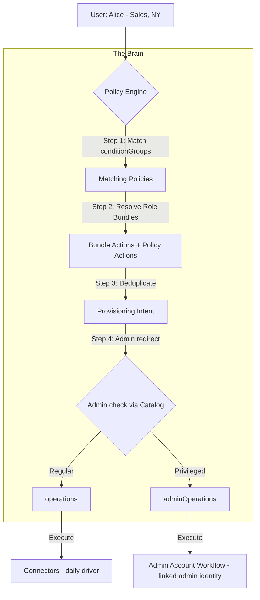

# 🧠 Policy Engine Architecture - The 2026 Standard

> **Module:** Policy (Pillar 2 — Brain)
> **Cross-cutting:** [Data Flows](../../../../../docs/architecture/core/DATAFLOWS.md) | [Event Bus](../../../../../docs/architecture/core/EVENT_BUS_ARCHITECTURE.md)

## 🎯 The Vision

We are moving beyond simple "If/Then" scripts. The 2026 Policy Engine is a **Deterministic State Machine** that manages the **Desired State** of a user.

* **Input:** User Identity (Attributes + Context).
* **Process:** Evaluate Rules → Resolve Conflicts → Request Approvals.
* **Output:** A unified **Provisioning Intent** (The "Desired State").

---

## ⚠️ Policy Landmines (Critical Safety Protocol)

The Policy Engine is the most dangerous component. A single misconfiguration can wipe out access for the entire CEO suite.

### 🧨 Landmine 1: The "Denial of Service" Policy

* **The Trap:** A rule like `IF department != 'IT' THEN Remove-All-Access`.
* **The Explosion:** During an HR sync, a glitch temporarily clears the `department` field for all users. The Policy Engine immediately revokes access for 5,000 employees.
* **The 2026 Fix:** **Impact Analysis Circuit Breakers.**
* **PLANNED:** if a policy execution results in >5% of total users losing access, **BLOCK THE SYNC** and alert an admin. No code does this: the closest check is the impact analysis circuit breaker, which warns above 10% affected users and blocks nothing ([Simulation doc](../../blueprints/docs/ARCHITECTURE.md)).
* **Simulation Mode:** All new policies default to "Dry Run" mode first.


### 🧨 Landmine 2: The Race Condition (Flickering Access)

* **The Trap:** Policy A says "Add to GitHub". Policy B says "Remove from GitHub".
* **The Explosion:** User access "flickers" on and off depending on which policy ran last.
* **The 2026 Fix:** **Deterministic Conflict Resolution.**
* **Deny Wins:** If *any* policy says "Remove", the user is removed.
* **Priority Weights:** `P1` policies always override `P2` policies.


### 🧨 Landmine 3: The "Phantom" Entitlement

* **The Trap:** A policy assigns `Group-123`. The Admin deletes `Group-123` in Entra ID.
* **The Explosion:** The connector throws 404 errors forever. The workflow retries infinitely.
* **The 2026 Fix:** **Referential Integrity (The Catalog).**
* Policies can *only* select entitlements that exist in the **Entitlement Catalog** (MongoDB).
* If a Group is deleted in the target, the Catalog sync marks it as "Archived", and the Policy Engine flags the policy as "Invalid".


---

## 🏗️ Architecture Overview

**Current implementation:** Policies evaluate `conditionGroups` against user attributes and produce `actions[]` (assign_group, assign_license, etc.). When a policy has `roleBundleId` set, the engine resolves the Role Bundle's actions (with inheritance) and merges them into the output.

**Key capabilities:**
- **Role Bundle resolution**: Policies can reference a `roleBundleId` to inherit a reusable set of actions (with parent bundle inheritance, max depth 5). A bundle action keeps its `timeConstraint` (passed on to the operation) and `targetId`. A bundle that cannot be read fails the evaluation (never an intent without its operations, which a mover or reconcile run would read as removals); a bundle that no longer exists resolves to nothing. `DELETE /role-bundles/:id` refuses (400) a bundle a policy uses or another bundle inherits.
- **Admin operation redirection**: Operations targeting entitlements with `requiresAdminAccount: true` are separated into `adminOperations[]` for provisioning to linked admin identities (see [privileged-access/docs/ARCHITECTURE.md](../../privileged-access/docs/ARCHITECTURE.md))
- **Time-bound access**: Policy actions can include `timeConstraint` for auto-expiring entitlements
- **Birthright vs. Requestable**: Birthright policies auto-apply; requestable entitlements are available through the Access Request Portal (see [access-requests/docs/ARCHITECTURE.md](../../access-requests/docs/ARCHITECTURE.md))



---

## 📜 Policy Evaluation Engine

The `PolicyEngineService` evaluates `conditionGroups` (with AND/OR join operators) against user attributes and supports operators like `equals`, `contains`, `regex`, `in`, `greater_than`, etc. A group holds at least one condition: `POST /policy` and `PATCH /policy/:id` refuse an empty one (400), and the engine never matches a stored empty group (an AND of nothing would be true for everyone).

### Evaluation Modes

There is one mode: `PolicyEngineService` evaluates every policy in TypeScript (`policy-engine.service.ts`). No `FEATURE_POLICY_ENGINE_MODE` or other mode switch exists.

The OPA code below (Rego compiler and evaluator) is built and registered in `PolicyModule`, but nothing calls `OpaEvaluatorService`: `PolicyEngineService` never uses it, and no code runs `syncPolicies()`. `OPA_ENABLED` (default `false`) only makes `OpaClientService` check OPA's health at start (`infrastructure/opa/docs/ARCHITECTURE.md`).

### OPA Integration (`modules/policy/opa/`)

| File | Purpose |
|------|---------|
| `rego-compiler.service.ts` | Translates EuroID Policy documents into Rego rules. Supports all 12 condition operators, AND/OR groups, customAttributes field resolution, and action type mapping. |
| `opa-evaluator.service.ts` | Wraps the OPA client with EuroID-specific I/O mapping. Maps `StandardUserDto` + `Policy[]` to OPA input, and OPA results back to `ProvisioningOperation[]`. |

**Rego compilation**: Active policies are compiled into a single Rego module under `package euroid.policy.evaluate`. Each policy becomes a `matched_operations` rule. Condition groups use Rego's `any()` for OR joins and sequential assertions for AND joins.

**Policy sync**: `OpaEvaluatorService.syncPolicies()` compiles active policies to Rego and pushes the bundle to OPA via `PUT /v1/policies/`. A content fingerprint (hash of policy names, priorities, conditions, and actions) prevents redundant pushes when nothing has changed. No code calls it.

**Fallback**: When `OPA_FALLBACK_ON_ERROR=true` (default), a failed OPA query returns `null` (with `false` it throws). Since `PolicyEngineService` never calls OPA, no evaluation falls back. See `infrastructure/opa/docs/ARCHITECTURE.md` for client details.

---

## ⛔ Segregation of Duties (SoD) Matrix

Before generating the final Intent, the engine checks the **SoD policies** (MongoDB `sod_policies` collection via `SodService`).

* **Definition:** `sod_policies` collection defines toxic combinations (e.g., `Create Vendor` + `Pay Vendor`): two or more entitlements `{ system, type, targetId }`, each listed once (`CreateSodPolicySchema` refuses a repeated one).
* **Validation:** The engine validates the whole intent, `operations` and the `adminOperations` PamFilterService moved to the linked admin account, against active SoD policies (`evaluate`, `evaluateForRiskScoring`; the risk score's SoD factor counts the same matches). The result is `PolicyProvisioningIntent.sodValidation` (blockers and warnings); WARN matches are also in `sodWarnings`. `PolicyActivities.evaluateUser` turns BLOCK matches into a non-retryable `SoDViolation` failure (`shared/types/sod-violation.ts`): onboarding skips the person and fails at the end of the batch, a mover run fails.
* **Matching:** a policy matches when every entitlement it lists is an `add` operation of the set: the system as the policy engine names systems (`systemKey`, `shared/utils/normalize-system-name.ts`: `entra` is `entra-id`, `active-directory` is `ad`, case and dashes ignored; an operation on target `all` matches a policy on any system), the type case-insensitively, `targetId` exactly. A caller may pass `resolveTargets` (`SodValidateOptions`), so a `targetId` is then also compared as its entitlement catalog native id (a rule's group display name and a request's or a policy's native id are one entitlement; `EntitlementCatalogService.loadTargetLookup`). Every caller does: the access request check, and the policy engine's own check in `evaluate` (onboarding, the mover) and `evaluateForRiskScoring` (`PolicyEngineService.validateSod`). A target the catalog does not know, or names twice on its system, is compared by its own id. With `involving` (the access request check passes the requested entitlements) only a match that includes one of those operations counts. `CreateSodPolicySchema` refuses an entitlement listed twice by the same rule. Types go through `toOperationType` (`shared/utils/entitlement-operation-type.ts`): a directory role is `role` whether the policy, the policy engine or an access request (catalog type `DirectoryRole`) names it, and a policy stored as `directoryrole` still matches.
* **Access requests:** `AccessRequestSodService` (`modules/access-requests/`) adds the person's other requests in force and checks again before fulfilment; see the Access Requests architecture.

---

## 🧩 Core Concepts

### 1. The "Birthright" vs. "Requestable" Split

The original design mixes everything together. In 2026, we split policies into two types:

* **Birthright Policies (Automated):** "You are in Sales, so you *must* have Salesforce." (Enforced automatically).
* **Requestable Policies (Shop):** "You *can* have Adobe Pro, but you must ask for it." (Available in the Service Catalog).

### 2. Contract-Aware Policy Patterns (Split Provisioning)

When a user has multiple contracts (e.g. Surgeon + Professor), the Policy Engine evaluates **each contract independently** and provisions the UNION of entitlements:

* **Root-level (backward compatible):** `user.departmentName === 'Medical'` — matches the primary contract.
* **Per-contract:** Each active contract is evaluated with a "virtual user" where `jobTitle`/`departmentName` come from that contract. A user with contracts `[{title:Surgeon, dept:Medical}, {title:Professor, dept:Education}]` matches both "IF dept=Medical → EPIC" and "IF dept=Education → Canvas".
* **Array pattern:** `user.contracts?.some(c => c.department === 'Medical')` — matches if ANY contract has that department.
* **Deduplication:** Same entitlement from multiple contracts is provisioned only once.
* **Contracts come from the HR sources** (`IdentityOnionService.buildProfileWithContractsForPolicy`): one per HR source, with that source's title and department. An attribute control (`controls.manualDepartment` / `manualJobTitle`, `PATCH /identity/v2/:id/controls`) replaces the value of the primary HR contract and of any HR contract holding the primary's value while it is set, as reconcile does in the profile (`identity/attribute-controls.ts`, `controlledContractValue`). Else a department or title an operator edits by hand (`PATCH /identity/:id`, possible only where no HR source masters the field) overrides the value of the HR sources that held the replaced value, until such a source sends another value (`identity/manual-contract-overrides.ts`, `metadata.manualOverrides`). Without that, the edited identity matched the old department through its contract and the mover never removed the old department's access.

### 3. Business Roles (The "Bundle")

* **Business Role:** "Sales Representative" = `Department=Sales`
* **Contains:**
* Entra Group: `SG-Sales`
* Salesforce Profile: `Standard User`
* Slack Channel: `#sales-general`

---

What happens if Policy A says "Block USB Access" but Policy B (for VIPs) says "Allow USB Access"?

* **Solution:** Priority Weights & Segregation of Duties (SoD) checks.
* *Example:* "Deny" rules always override "Allow" rules unless the "Allow" rule has `criticality: high`.

---

## 🎨 UI Concept: The Policy Studio (Upgraded)

### The "Simulation" Bar

A key feature in 2026 is **Impact Analysis**. Before saving a policy, the UI shows:

> ⚠️ **Warning:** This policy change will remove Salesforce access for 15 users in the "Marketing" department.

### Visual Rule Builder (Enhanced)

We add a **Time Condition** (Temporal Access).

* **Condition:** `Department = Sales`
* **Time:** `Expires in 30 days` (For contractors).

```
┌─────────────────────────────────────────────────────────────────┐
│  Create Policy: "Contractor Access"                             │
├─────────────────────────────────────────────────────────────────┤
│  WHEN:                                                          │
│     employmentType = "Contractor"                               │
│                                                                 │
│  THEN ASSIGN ROLE: "External Vendor"                            │
│                                                                 │
│  WITH CONSTRAINTS:                                              │
│     ⏰ Time Limit: 90 Days (Auto-expire)                        │
│     ✋ Approval: Manager must approve extension                 │
│     🚫 SoD Check: Cannot also have "Finance Admin" role         │
└─────────────────────────────────────────────────────────────────┘

```

---

## 🗄️ Data Model (Upgraded)

We need to store **Relationships**, not just rules.

### Business Role Schema

```typescript
interface BusinessRole {
  id: string;
  name: string;      // "Sales Representative"
  owner: string;     // "VP of Sales" (for access reviews)
  entitlements: {
    system: string;  // "entra-id"
    targetId: string;// "group-guid-123"
  }[];
  inheritance: string[]; // ["Standard Employee"] - extends other roles
}

```

### Policy Schema (Actual)

```typescript
interface Policy {
  name: string;
  description?: string;
  priority: number;           // Higher = evaluated first
  status: 'active' | 'disabled' | 'draft' | 'testing';
  risk?: 'low' | 'medium' | 'high' | 'critical';

  // The Trigger — nested condition groups with AND/OR join
  conditionGroups: {
    joinOperator: 'AND' | 'OR';
    conditions: {
      field: string;          // e.g. 'departmentName', 'employmentType'
      operator: string;       // 'equals', 'contains', 'regex', 'in', etc.
      value: any;
    }[];
  }[];

  // The Outcome — direct actions (not role references)
  actions: {
    type: string;             // 'assign_group', 'assign_license', 'remove_group', etc.
    target: string;           // Target system — e.g. 'entra-id'
    params: Record<string, any>; // e.g. { groupName: 'SG-Sales', groupId: 'guid-123' }
  }[];

  // Optional scoping
  targetEmploymentTypes?: string[]; // e.g. ['FULL_TIME', 'SERVICE_ACCOUNT']
  roleBundleId?: string;            // Link to RoleBundle — resolved during evaluation (actions merged)

  // Metadata
  createdBy?: string;
  lastTriggered?: Date;
  affectedUsers?: number;
  totalExecutions?: number;
}
```

---

## 🧠 The Engine Logic (Service Layer)

The evaluation is a **2-pass process**:

```typescript
@Injectable()
export class PolicyEngineService {

  evaluateWithPolicies(user: StandardUserDto, policies: Policy[]): PolicyProvisioningIntent {
    const operations = [];

    for (const policy of policies) {
      // Pass 1: Evaluate conditionGroups against user attributes
      //   - Root-level evaluation (backward compatible)
      //   - Per-contract evaluation (if user has multiple contracts)
      const rootMatches = this.matchesPolicy(user, policy);

      if (rootMatches) {
        // Collect actions from policy AND resolved Role Bundle (if roleBundleId set)
        this.addPolicyActions(operations, policy);
      }

      // Per-contract: each active contract evaluated as a "virtual user"
      for (const contract of user.contracts || []) {
        if (this.matchesPolicy(contractAsUser, policy)) {
          this.addPolicyActions(operations, policy);
        }
      }
    }

    // Pass 2: Deduplicate operations (same entitlement from multiple policies/contracts)
    const deduped = deduplicate(operations);

    // Pass 3: Admin redirect — check Entitlement Catalog for requiresAdminAccount
    const { regular, admin } = separateAdminOperations(deduped);
    return { operations: regular, adminOperations: admin };
  }
}
```

**Post-evaluation:** SoD validation runs after intent generation and PAM splitting via `SodService.validate()`, over `operations` and `adminOperations` together, not during aggregation.

---

## Extended Provisioning Intent

```typescript
interface PolicyProvisioningIntent {
  operations: Operation[];              // Regular entitlements (daily-driver account)
  adminOperations?: AdminOperation[];    // Privileged entitlements (linked admin identity)
  sodWarnings?: SodViolation[];
  suppressedOperations?: SuppressedOperation[]; // evaluate() only: left out by access review exclusions
}

interface AdminOperation extends Operation {
  adminTier: 'TIER_0' | 'TIER_1' | 'TIER_2';
}
```

For admin operation handling, see [privileged-access/docs/ARCHITECTURE.md](../../privileged-access/docs/ARCHITECTURE.md).

---

## Access Review Exclusions

A revoke in an access review is a durable, audited exception to the policies. Without it, a review revoke of policy-granted access did not stick: the next onboarding, mover run or re-evaluation granted it again.

**Recording.** When a campaign closes, `AccessReviewRevocationActivities.listRevocationTasks` hands every revoked entitlement it takes up (a `revoked` item, an `expired` one when the campaign auto-revokes) to `ReviewExclusionRecorder` (`review-exclusion-recorder.service.ts`) before it writes any revocation result, so a failed recording is redone by the activity's retry. The outcome of the removal (removed, already gone, manual action, failed) does not matter. `ReviewExclusionService.record` (`review-exclusion.service.ts`) keeps one active exclusion per identity, system and entitlement in `review_exclusions` (`schemas/review-exclusion.schema.ts`, unique partial index on the active ones): identity id, system as reviewed, the entitlement's type, name and id in the target, campaign id and name, review item, decision (`revoked`, or `expired` for an auto-revoke), reviewer (none for an auto-revoke), justification, decision time and creation time. A second campaign revoking the same access, or a retried close, keeps the first. An account item (a target whose memberships the review cannot read: GitHub, ServiceNow, the targets that keep no account) becomes an exclusion of the whole system for the identity (`scope: account`, key `*`).

**Granting policies.** Each exclusion names the active policies whose operations it suppresses when it is recorded (the identity's policy profile evaluated without exclusions, `evaluateWithPolicies`, once per identity per batch), by id and name. `GET /policy/review-exclusions/counts` returns, per policy, how many of its grants reviewers revoked (`active`, `lifted`); the policy list shows "N revoked in reviews", so a policy reviewers keep overriding is visible for redesign.

**Enforcement.** `evaluate`, `evaluateForRiskScoring` and `evaluateOperationsWithoutSod` run `evaluateHonouringReviews`: the policies' operations, minus what an active exclusion of the identity suppresses (`review-exclusion-match.ts`), then the PAM split. Every intent goes through them: onboarding (`PolicyActivities.evaluateUser`), the mover and re-evaluation (both sides of the delta), the access preview, `GET /identity/:id/entitlements`, access request SoD, risk scoring, and SoD itself (a revoked entitlement is not counted). `evaluateWithPolicies` (simulation, impact counts) stays the policies alone. The identity is the profile's `_id`, or for a policy profile built without it (the mover, the access preview, the entitlements handler) the identity with that email.

**The "before" side of a delta.** The mover run and the access preview compare the policies for the access baseline (the profile access was last applied with) with the current profile. Their "before" side (`reviewExclusionsLiftedSince`: the baseline's `recordedAt`) also leaves out what an exclusion lifted after the baseline suppressed: the review took that access away and no run has given it back yet, so the delta adds it. Once a run advanced the baseline, such an exclusion no longer counts there.

**Onboarding.** Onboarding provisions an account in every active canvas target. With the patch `onboarding:review-exclusions` it first asks `PolicyActivities.getReviewExcludedTargets` (default queue) for the run's targets the person has an account exclusion in, and leaves those out of their provisioning (no call, no provisioning entry, no account), with the timeline entry "Not provisioned to <target>: excluded by an access review" and the run's result naming them ("Left out by an access review exclusion: github."). That is not a failure (`workflows/onboarding-review-exclusions.ts`).

| Exclusion | Suppresses |
|---|---|
| Entitlement (`scope: entitlement`) | `add`/`set` operations of the same kind (group; directory role as `role`; license) whose target is the system as `systemKey` compares names (`entra` is `entra-id`, `active-directory` is `ad`) or `all`, and whose `targetId` (or `groupName`, `groupId`, `roleName`, `roleTemplateId`, `licenseSku` param) is the entitlement's id, its name, or an AD group's first RDN (`CN=Sales`), compared without case and without the spaces around a DN's commas. An `all` operation is suppressed as a whole. |
| Account (`scope: account`) | Every `add`/`set` operation whose target is the system; `all` operations are kept. |

An exclusion never suppresses a `remove`, and offboarding does not evaluate the policies: a leaver still loses everything. `evaluate` returns the suppressed operations as `suppressedOperations` (`suppressedBy: { reason: 'Suppressed by access review', exclusionId, campaignId }`); the identity map's policy trace shows them as suppressed.

**Lift.** The identity's Access tab lists its active exclusions (`GET /identity/:id/access/review-exclusions`, viewer). A policy-admin lifts one (`POST /identity/:id/access/review-exclusions/:exclusionId/lift`, no body; 404 for another identity's or tenant's, 409 when already lifted; `modules/mover/review-exclusion-lift.service.ts`): the exclusion stays as `lifted` with `liftedBy` and `liftedAt`, and the run that gives the access back starts at once with the admin as actor (`run` in the answer):

| Exclusion | Run | Why |
|---|---|---|
| Entitlement | The identity's re-evaluation (`AccessReevaluationService.reevaluate`, audited `ACCESS_REEVALUATION_REQUESTED`) | Its delta adds the lifted access (see the "before" side above) |
| Account | Onboarding for the identity (`identity.provision_requested` with reason `access-review-exclusion-lifted`, audited with the admin as actor) | The re-evaluation creates no account; onboarding skips the SYNCED targets and creates the missing one with the system's grants |

When the run cannot start (no access baseline, no provisioned target, a run in progress, no email, Temporal unreachable) the lift stays done and the answer says why (`run: { type, started: false, reason }`).

**Offboarding.** When an identity's offboarding has run (`identity.offboarding_completed`, also with failed targets), its active exclusions end: lifted by `system` with `liftReason: 'identity offboarded'` and audited (`ReviewExclusionOffboardingHandler`, `infrastructure/events/handlers/review-exclusion-offboarding.handler.ts`). They judged that employment; a rehire is evaluated afresh.

**GDPR.** The erasure deletes the subject's exclusions and the DSAR export includes them (`modules/compliance-reporting/docs/GDPR_COMPLIANCE.md`).

**Audit.** `access_review.exclusion_created` (actor: the reviewer; an auto-revoke: the system) and `access_review.exclusion_lifted` (actor: the admin; at offboarding `system:offboarding`, with `reason`) reach the audit log through the catch-all audit handler, with ids only (`access-event-schemas.ts`): no reviewer address, no justification, no entitlement name.

**Not covered.** An exclusion of a linked admin identity is not applied to its parent's `adminOperations`. An Entra ID directory role a policy assigns by template id only (no `roleName`) is not matched: the review knows the role by its object id and name.

## Policy Changes Need a Second Policy-Admin

A policy is created as DRAFT and goes live only through `POST /policy/:id/activate`. `PolicyService.update` sends any policy that is not a draft (ACTIVE, DISABLED, TESTING) back to DRAFT when its conditions, actions or role bundle change, so the change needs that activation again; toggling (`PATCH /policy/:id/toggle`) refuses a draft. A name or description change keeps the status. A change of a role bundle's actions or inheritance (`PATCH /role-bundles/:id`, `RoleBundlesService.update`) does the same to every policy that uses the bundle, directly or through a bundle that inherits it (up to the 5 levels evaluation follows), with the bundle's editor as `lastEditedBy` and a `policy.updated` event (actor: the editor, `previousStatus`) per policy whose status changed. A bundle's name, description, icon, color or tags keep the policies live.

Such a change also records its author on the policy (`lastEditedBy`, `lastEditedAt`; an unknown caller as `unknown`), never taken from the request. `activate` refuses the last editor of a policy edited so, and the creator of a policy never edited so (403): whoever wrote the current grants needs another policy-admin to approve them. The creator may activate another admin's change. Policies created by `system` (seeded) stay exempt.

In the UI (Provisioning > Role-based rules, `frontend/src/components/policy-engine/PolicyList.tsx` with `PolicyStatusCell.tsx`) a draft row has a disabled switch and an **Activate** button for policy-admins, with a confirmation that names the policy and the identities its impact count matches. The page disables the button for the admin the API would refuse, compared as `activate` compares (`lastEditedBy`, else `createdBy`, against the session's email); a session without an email leaves it on and the 403 shows in the toast.

---

## Time-Bound Access

Policy actions can include a `timeConstraint` for auto-expiring entitlements:

```typescript
interface PolicyAction {
  type: string;
  target: string;
  params: Record<string, any>;
  timeConstraint?: {
    durationDays?: number;   // e.g., 90 for contractor access
    expiresAt?: Date;        // Fixed expiry date
  };
}
```

When provisioned, `ProvisioningState.expiresAt` is set. A Temporal CronWorkflow (`entitlement-expiry.workflow.ts`) checks hourly and deprovisions expired entitlements. Notifications are sent 7 days and 1 day before expiry.

---

## Credential Generation Policy

Password generation is a **Brain responsibility**, not a connector responsibility. The `CredentialGenerationService` (in `infrastructure/secrets/`) provides a centralized, configurable password generator used by the activity layer before calling connectors.

### Why Centralized?

Connectors are "dumb pipes" — they must not contain credential policy logic. Different target systems have different complexity requirements, but the *decision* about what those requirements are belongs to the Brain. The connector merely receives and forwards the password.

### Per-Connector Policy

| Connector | Password Length | Character Sets | Called By |
|-----------|----------------|----------------|-----------|
| **Entra ID** | 20 (default) | Full A-Z, a-z, 0-9, `!@#$%^&*()-_=+` | `EntraProvisioningService.provision()` |
| **Active Directory** | 16 | Reduced sets (excludes ambiguous: I, O, l, 0, 1) | `AdActivities.provisionUserToAd()` |

### API

```typescript
// infrastructure/secrets/credential-generation.service.ts
interface CredentialPolicy {
  length?: number;        // Default: 20, minimum: 4
  upperChars?: string;    // Default: 'ABCDEFGHIJKLMNOPQRSTUVWXYZ'
  lowerChars?: string;    // Default: 'abcdefghijklmnopqrstuvwxyz'
  digitChars?: string;    // Default: '0123456789'
  specialChars?: string;  // Default: '!@#$%^&*()-_=+'
}

// Guarantees: one char per class, Fisher-Yates shuffle, crypto.randomInt()
service.generatePassword(policy?: CredentialPolicy): string;
```

### Flow

```
Activity Layer ──▶ CredentialGenerationService.generatePassword(policy)
                         │
                         ▼ (password string)
Activity Layer ──▶ Connector.provision(user, intent, password)
                         │
                         ▼ (LDAP addUser / Graph POST /users)
                   Target System
```
