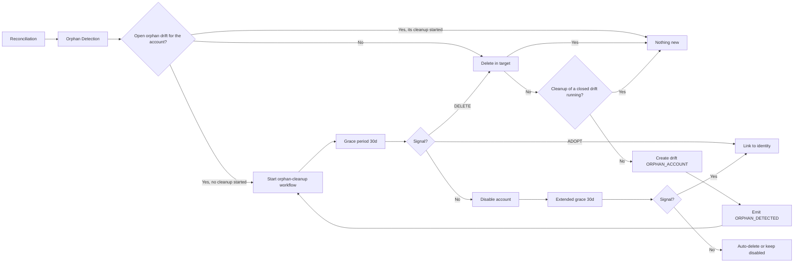

# Orphan Account Detection & Cleanup

> **Module:** Reconciliation (Pillar 4 — Eyes)
> **Related:** [Reconciliation Architecture](./ARCHITECTURE.md) | [Temporal Workflows](../../../../../docs/architecture/infrastructure/TEMPORAL_WORKFLOWS.md)

Orphaned accounts are target system accounts (e.g., Entra ID users) that have no corresponding identity in the Identity Hub, or whose Hub identity is TERMINATED/DELETED.

## Which Accounts Are Orphans

`OrphanDetectionService.isStillOrphan` decides, for every account the target system lists:

* **Left alone:** an Entra ID guest (`#EXT#` in its UPN, any case), and an account whose UPN or mail `ORPHAN_EXCLUDED_ACCOUNTS` names (Configuration below; break-glass admins, service accounts, shared mailboxes). No drift, no `orphan.detected`, no cleanup.
* **Owned:** an account a live identity that is not TERMINATED or DELETED has, by email (the account's UPN or its mail, each compared in the lower-cased form identity emails are stored in, and as given for an address stored in another case before that), by source or id equal to the account's id (an AD DN, as provisioning write-back links it), or by its objectGUID (an adopted AD orphan).
* **Orphan:** any other account.

Before this release the account was looked up by its UPN only (its mail when the UPN was empty), case-sensitively, and guests and service accounts were orphans too: an employee whose UPN differed from the stored email, or a break-glass admin, was quarantined and disabled after the grace period.

**Page by page.** `detectOrphans` works through a system's accounts a page at a time: Entra ID's as Graph pages them (999), an AD or SCIM listing in pages of 500. For each page one hub query answers which of its accounts' keys (UPN, mail, id, objectGUID) a live identity that is not TERMINATED or DELETED has (`IdentityService.findLiveOwnerKeys`), where it made up to six lookups per account before; after each page the activity heartbeats, and it heartbeats every 30 seconds while it runs (`ORPHAN_DETECTION_HEARTBEAT_MS`, `heartbeatEvery`), since AD and SCIM list the whole directory in one call before the first page. The daily run gives `runOrphanDetection` its own proxy, 2 hours per attempt with a heartbeat timeout of 2 minutes (2 attempts; a retry starts the listing again, which records nothing twice: One Record per Account, below), instead of the run's 5 minutes, and a system whose detection fails (or whose orphan's cleanup cannot be started) is named with the error in the run's report, `orphanDetectionFailures: [{ system, error }]` (`GET /api/v1/reconciliation/result/:workflowId`), where it was only logged (patch `reconciliation:orphan-detection-heartbeat`; fixture `backend/test/fixtures/reconciliation-pre-orphan-detection-heartbeat.history.json`, recorder and proof in `backend/test/workflows/reconciliation-orphan-detection.workflow.e2e-spec.ts`).

## Lifecycle

## One Record per Account

An account has one open orphan record (`OrphanDetectionService.detectOrphans`, drifts found by `DriftService.findOrphanDrifts` on `orphanDetails.targetSystem` and `orphanDetails.externalId`). A run that finds an orphan account:

| The account has | The run |
|---|---|
| An open (`open` or `quarantined`) orphan drift with a cleanup workflow id | Records nothing: no drift, no `orphan.detected`, no cleanup |
| An open orphan drift without a cleanup workflow id (the run, or the detection attempt Temporal retried, stopped before the cleanup started) | Starts that drift's cleanup; records no drift and no event |
| A latest orphan drift an admin ignored | Records nothing: an ignore is a decision, as for detected drifts (`DriftService.recordDetection`) |
| Only closed orphan drifts, one of whose cleanups still runs (a drift closed before closing by hand cancelled its cleanup, or a cancel that failed) | Records nothing (`OrphanCleanupService.isRunning`) |
| None of these (no orphan drift, or the latest was corrected and no cleanup runs) | Records a new drift, emits `orphan.detected` and starts its cleanup |

Before 2026-11-24 every run recorded an orphan again: a new drift, event and cleanup per run. Duplicates recorded then stay as they are; for an account with several open drifts and no cleanup id on any, a run starts a cleanup for the oldest only. `detectOrphans` returns every orphan found in `orphans` and the drifts to start a cleanup for in `driftRecords`.

The daily reconciliation starts each cleanup with `startChild` (parent close policy ABANDON: the cleanup outlives the run) under the drift's own workflow id, `t-<tenant>-orphan-cleanup-<driftId>` (`backend/src/workflows/orphan-cleanup-id.ts`), records it on the drift at once (`updateDriftWorkflowId`) and goes on without waiting for it. A start for a drift whose cleanup already runs (started before, its id never recorded) collides on that id: the run records the running cleanup's id and starts no second one. So `POST /api/v1/reconciliation/orphans/:driftId/signal` reaches the cleanup during the grace periods. Before the patch `reconciliation:start-orphan-cleanup` the run awaited each cleanup (`executeChild`, weeks, id `<run>-orphan-<driftId>-<index>`) before it recorded the id and went on to the next orphan: the route answered `400 Orphan workflow not yet started` and the run stayed open. A run started before the patch keeps that path until the cleanup it waits for ends, then starts the remaining ones without waiting (fixture `backend/test/fixtures/reconciliation-pre-start-orphan-cleanup.history.json`, recorder and proof in `backend/test/workflows/reconciliation-orphan-cleanup-start.workflow.e2e-spec.ts`). The cleanup's input carries the run's `requireApprovalForDeletes`: with `true` it keeps the account disabled after the extended grace whatever `ORPHAN_AUTO_DELETE_AFTER_EXTENDED` says, and the account goes only when a person sends [Delete] (patch `orphan-cleanup:approval-for-deletes`; a cleanup started before the worker ran it, or without the flag, follows the orphan config). An account of a user the run's `excludedUsers` names is left alone: no drift, no `orphan.detected`, no cleanup (`OrphanDetectionService.isExcluded`; the account's UPN or mail is an excluded email, or the TERMINATED or DELETED identity it belonged to has an excluded id or email; patch `reconciliation:scan-scope`, [ARCHITECTURE.md](./ARCHITECTURE.md), Run Settings).

## Adopt, Delete and Closing by Hand

`OrphanCleanupService` (`orphan-cleanup.service.ts`) reads, signals, starts and stops a drift's cleanup; the workflow id always comes from the drift record or is built from it.

* **[Adopt] / [Delete]** (`POST /api/v1/reconciliation/orphans/:driftId/signal`, operator): a running cleanup gets the `ADOPT_ACCOUNT` or `DELETE_ACCOUNT` signal. When none runs (it ended, for example kept disabled after the extended grace with `ORPHAN_AUTO_DELETE_AFTER_EXTENDED=false`, or never started), a fresh cleanup run for the drift starts with the signal (`signalWithStart`, id `t-<tenant>-orphan-cleanup-<driftId>`, `TenantId` search attribute) and applies it at once, before any grace period or disable; its id goes on the drift. A drift already `corrected` or `ignored` without a running cleanup is `409`.
* **Who decided:** the route passes the operator (email, else user id) with the signal, and the cleanup records it as the drift's `orphanDetails.decidedBy` for an ADOPT or DELETE (patch `orphan-cleanup:signal-actor`); before the patch, and for a signal without one, `decidedBy` is `workflow-signal`. The `:driftId` must be a drift id (24 hex characters), else `400`.
* **Asking again before acting** (patch `orphan-cleanup:recheck-before-acting`): before it disables the account after the grace period, and before every delete (a DELETE signal or the auto-delete after the extended grace), the cleanup calls `confirmOrphan` (`backend/src/activities/orphan.activities.ts`). It goes on only while the drift is `open` or `quarantined` and the account is still an orphan (`OrphanDetectionService.isStillOrphan`, above: an identity created since for the account, or an exclusion added since, ends it). An account that is no longer an orphan has its drift closed `corrected` (`drift.resolved`, `no_longer_orphan`); a drift closed by hand is left as it is. In both cases the cleanup ends without touching the account. A cleanup started before the worker ran the patch asks too when it reaches its next disable or delete after the deploy.
* **Disable and delete per system:** the disable works in Entra ID (by UPN or mail), AD (the DN of the account the UPN or mail finds, `AdService.setUserEnabled`) and SCIM (the user whose userName or email it is, `SCIMService.setActive`). `disabledAt` is set only when the disable changed the account; a disable that found no account leaves it unset and the cleanup waits for the extended grace. Deleting: an Entra ID orphan by the object id detection recorded as the drift's `externalId` (Graph `DELETE /users/{id}`, so an account renamed after detection is still found and a UPN another account took over names no one else; a cleanup started before the patch below deletes by the UPN or mail); a SCIM orphan with `DELETE /Users/{id}` by the SCIM id detection recorded as the drift's `externalId` (`SCIMService.deleteUser`, whatever the connector's `deprovisionStrategy`; a user already gone counts as deleted). The cleanup passes `externalId` to `deleteOrphanAccount` (patch `orphan-cleanup:delete-by-external-id`; fixture `backend/test/fixtures/orphan-cleanup-pre-delete-by-external-id.history.json`, recorder and proof in `backend/test/workflows/orphan-cleanup-delete-by-id.workflow.e2e-spec.ts`); a cleanup started before the patch passes none, and the SCIM user is found by its userName or email, none found leaving the drift quarantined. **An Active Directory orphan is never deleted by EuroID**: AD gives no recycle bin guarantee and a deleted account's SID is lost (`backend/src/shared/utils/orphan-delete-policy.ts`). `POST .../signal` with `DELETE` for an AD orphan answers 422 with that reason and signals nothing, `GET .../simulate-delete` answers `deletable: false` with it, and the orphan list offers no [Delete] for AD. Where the cleanup would delete an AD orphan (the auto-delete after the extended grace with `ORPHAN_AUTO_DELETE_AFTER_EXTENDED=true`, or a DELETE signal sent another way), it leaves the account disabled and the drift quarantined and records the reason on the drift, `orphanDetails.keptReason` (activity `keepOrphanAccount`, patch `orphan-cleanup:ad-never-deleted`; fixture `backend/test/fixtures/orphan-cleanup-pre-ad-never-deleted.history.json`, recorder and proof in `backend/test/workflows/orphan-cleanup-ad-kept.workflow.e2e-spec.ts`); the list shows it as "Kept, never deleted". Delete such an account in AD by hand if it must go, then [Ignore] or correct the drift. A cleanup started before the patch tries the delete, which the activity refuses, and logs it.
* **Closing an orphan drift by hand** (`POST /api/v1/reconciliation/drifts/:id/ignore`, `.../correct`, `DriftService.ignoreDrift` / `autoCorrect`) cancels its running cleanup first, so the account is not disabled or deleted later. The cleanup ends `CANCELLED` (Temporal cancellation, no workflow change). When the cleanup cannot be stopped (Temporal unreachable), the request fails and the drift stays as it was.

## Components

| Component | Path | Responsibility |
|-----------|------|----------------|
| OrphanDetectionService | `backend/src/modules/reconciliation/orphan-detection.service.ts` | Fetches target accounts, looks up in Hub, creates drift records (one open record per account) |
| OrphanCleanupService | `backend/src/modules/reconciliation/orphan-cleanup.service.ts` | Is a cleanup running, signal or start one (ADOPT/DELETE), cancel one (drift closed by hand) |
| OrphanActivities | `backend/src/activities/orphan.activities.ts` | Disable, delete, adopt, update drift |
| orphan-cleanup.workflow | `backend/src/workflows/orphan-cleanup.workflow.ts` | Grace period lifecycle with signals |
| Drift schema | `backend/src/modules/reconciliation/schemas/drift.schema.ts` | `ORPHAN_ACCOUNT` type, `orphanDetails` subdocument |

## Drift Schema Extensions

- **DriftType:** `ORPHAN_ACCOUNT` (distinct from `ORPHANED_USER`)
- **DriftStatus:** `quarantined` (added)
- **orphanDetails:** `targetSystem`, `externalId`, `accountName`, `discoveredAt`, `gracePeriodEndsAt`, `disabledAt`, `decision`, `decidedBy`, `adoptedIdentityId`

## Events

- **ORPHAN_DETECTED** (`orphan.detected`) — Emitted once per orphan, by `OrphanDetectionService.detectOrphans` when it records the drift. The orphan cleanup workflow emitted it a second time (`emitOrphanDetected`) until the patch `orphan-cleanup:detection-emits-orphan-detected`; it still does when replaying a history from before it (fixture `backend/test/fixtures/orphan-cleanup-pre-detected-once.history.json`, recorder in `backend/test/workflows/orphan-cleanup-detected-once.workflow.e2e-spec.ts`). Payload: `driftId`, `targetSystem`, `externalId`, `accountIdentifier`, `tenantId`. The event reaches the audit log, the tenant websocket and webhooks, so it carries no name, UPN or mail in clear. `externalId`, the event's aggregate and the drift's `userId` and `orphanDetails.externalId` are the account's opaque id: the Entra ID object id, the SCIM id, an AD account's objectGUID (read by `AdService.listUsers`, written as AD shows it, e.g. `33221100-5544-7766-8899-aabbccddeeff`). Only an LDAP entry without objectGUID falls back to its DN, whose CN is the person's name. `accountIdentifier` (`orphan-event-identifier.ts`) is that id where it is opaque, else the UPN or mail masked (`a•••@corp.example`), else the id with its DN name masked. The drift record and the orphan cleanup workflow input keep the clear UPN or mail: the cleanup disables and deletes the account by it. An adopted AD orphan is linked to its identity by objectGUID; detection counts an AD account as owned when an identity has it by email, by DN (provisioning write-back) or by objectGUID.

## Configuration

| Env Var | Default | Description |
|---------|---------|-------------|
| ORPHAN_GRACE_PERIOD_DAYS | 30 | Days before auto-disable |
| ORPHAN_EXTENDED_GRACE_DAYS | 30 | Days after disable before resolution |
| ORPHAN_AUTO_DELETE_AFTER_EXTENDED | false | If true, auto-delete after extended grace (Entra ID, SCIM); else keep disabled. An AD orphan is always kept disabled, the reason on its drift |
| ORPHAN_EXCLUDED_ACCOUNTS | (none) | UPNs or mail addresses detection never quarantines, comma-separated, any case; `*` matches any text (`breakglass@corp.example,svc-*@corp.example`). Every tenant and target system; read by the API and the worker (`backend/src/infrastructure/config/orphan.config.ts`) |

## API Endpoints

- `GET /api/v1/reconciliation/drifts?type=ORPHAN_ACCOUNT` — List orphan drifts
- `POST /api/v1/reconciliation/orphans/:driftId/signal` — Signal ADOPT or DELETE
- `GET /api/v1/reconciliation/orphans/stats` — Summary statistics

## Workflow Signals

- **ADOPT_ACCOUNT(identityId)** — Link account to identity (adds source to Identity)
- **DELETE_ACCOUNT** — Delete account in target system (Entra ID, SCIM; an AD account is kept disabled, the reason recorded)
- **EXTEND_GRACE_PERIOD(days)** — Extend the second grace period

## Integration

Orphan detection runs as a phase in the daily reconciliation workflow, after the scatter-gather drift detection completes. For each target system in `config.targetSystems`, the workflow calls `runOrphanDetection` and starts one `orphan-cleanup` workflow per drift it returns (see One Record per Account), without waiting for it. A system without an installed connector config has no orphans. An installed AD config without host or Root Base DN, or a SCIM config without base URL, fails that system's orphan detection with an error naming the setting (`reconciliation-target-config.ts`; the workflow logs `Orphan detection failed`), never "no accounts".
