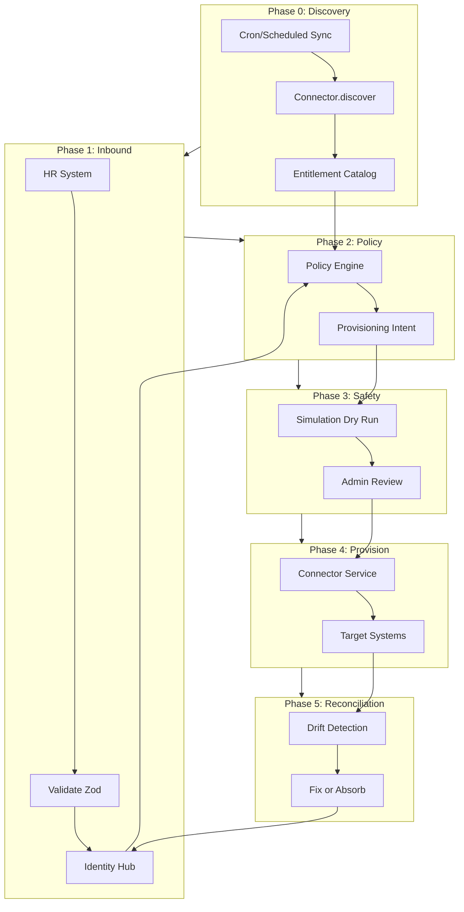
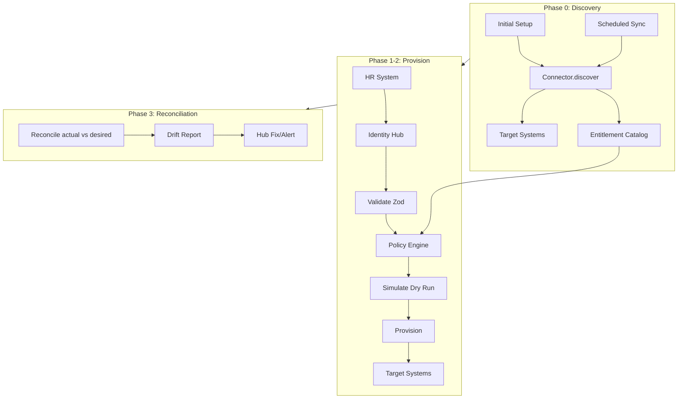

# 🔄 Data Flows - Architecture Overview

This document describes the main data flows for each part of the EuroID architecture. Each section maps to a doc in this folder.

---

## 📑 Flow Index

For a quick index of all mermaid diagrams, see **[DIAGRAMS_INDEX.md](../DIAGRAMS_INDEX.md)**.

| Section | Doc | What it describes |
| --- | --- | --- |
| [System (Life of a User)](#-system-flow-life-of-a-user) | core/SYSTEM_ARCHITECTURE.md | End-to-end flow from HR sync to drift fix |
| [Multi-HR Ingestion](#-multi-hr-ingestion) | [identity/MULTI_HR_INGESTION.md](../../../backend/src/modules/identity/docs/MULTI_HR_INGESTION.md) | Multiple HR systems, primary/secondary contracts, survivorship rules |
| [Connectors](#-connectors-flow) | [connectors/ARCHITECTURE.md](../../../backend/src/modules/connectors/docs/ARCHITECTURE.md) | Discovery, provisioning, and reconciliation with target systems |
| [Database (Onion)](#-database-flow-the-onion) | [identity/DATABASE_ARCHITECTURE.md](../../../backend/src/modules/identity/docs/DATABASE_ARCHITECTURE.md) | How data moves through Identity layers |
| [Hub & Spoke](#-hub--spoke-flow) | [identity/HUB_AND_SPOKE.md](../../../backend/src/modules/identity/docs/HUB_AND_SPOKE.md) | Inbound validation/mastery and outbound to connectors |
| [Policy Engine](#-policy-engine-flow) | [policy/ARCHITECTURE.md](../../../backend/src/modules/policy/docs/ARCHITECTURE.md) | User → conditionGroups → actions → intent |
| [Reconciliation](#-reconciliation-flow) | [reconciliation/ARCHITECTURE.md](../../../backend/src/modules/reconciliation/docs/ARCHITECTURE.md) | Desired vs actual state, drift detection, fix/absorb |
| [Simulation](#-simulation-flow) | [blueprints/ARCHITECTURE.md](../../../backend/src/modules/blueprints/docs/ARCHITECTURE.md) | Dry-run policy evaluation and impact report |
| [Temporal Workflows](#-temporal-workflows-flow) | [infrastructure/TEMPORAL_WORKFLOWS.md](../infrastructure/TEMPORAL_WORKFLOWS.md) | Orchestration: workflows, activities, signals |
| [Frontend](#-frontend-flow) | [frontend/ARCHITECTURE.md](../../../frontend/docs/ARCHITECTURE.md) | UI state and user-facing flows |
| [Privileged Access](#-privileged-access-management-flow) | [privileged-access/ARCHITECTURE.md](../../../backend/src/modules/privileged-access/docs/ARCHITECTURE.md) | Admin identity creation and lifecycle |
| [Access Requests](#-access-request-flow) | [access-requests/ARCHITECTURE.md](../../../backend/src/modules/access-requests/docs/ARCHITECTURE.md) | Self-service request and approval |
| [Risk Scoring](#-risk-scoring-flow) | [risk-scoring/ARCHITECTURE.md](../../../backend/src/modules/risk-scoring/docs/ARCHITECTURE.md) | Nightly composite risk score calculation |

---

## 🏗️ System Flow (Life of a User)

End-to-end path from HR system to target systems and back. See **SYSTEM_ARCHITECTURE.md**.

**Prerequisite:** The **Entitlement Catalog** must be populated via Discovery before the Policy Engine can resolve entitlements. Discovery runs via NestJS `@Cron` dispatching `scheduledSyncWorkflow` (per-connector configurable interval). See **[connectors/ARCHITECTURE.md](../../../backend/src/modules/connectors/docs/ARCHITECTURE.md) § Discovery Scheduling**.



Phase 3 happens when an admin changes a policy or a blueprint: the simulation runs then (see Simulation Flow), and the pipeline readiness check requires an impact analysis before deploy (`modules/blueprints/pipeline.service.ts`). One identity's provisioning runs no simulation.

**Legacy ASCII view:**

```
    ┌──────────────── The Menu (Discovery) ─────────────────────────┐
    │  (0) Setup / Scheduled Sync → Discover Entitlements            │
    │       → Entitlement Catalog (MongoDB: groups, licenses, roles) │
    └────────────────────────────────────────────────────────────────┘
                                                    │ Catalog is fresh
                                                    ▼
    HR System (Workday) ──(1) Inbound Sync──▶ Identity Hub
                                                    │
                                                    ▼
    ┌────────────────── The Brain & Nervous System ──────────────────┐
    │  (2) Trigger → Temporal Workflow → (3) Policy Engine            │
    │       (reads Catalog)        → (4) Provisioning Intent          │
    └────────────────────────────────────────────────────────────────┘
                                                    │
    ┌────────────────────── The Safety Net ──────────────────────────┐
    │  (5) Simulation (Impact Analysis) → (6) Admin Review           │
    └────────────────────────────────────────────────────────────────┘
                                                    │
    ┌──────────────────────── The Hands ────────────────────────────┐
    │  (7) Approved → Connector Service → (8) Target System (Entra)  │
    └────────────────────────────────────────────────────────────────┘
                                                    │
    ┌──────────────────────── The Eyes ──────────────────────────────┐
    │  (9) Drift Detection (Reconciliation) → (10) Fix/Alert → Hub   │
    └────────────────────────────────────────────────────────────────┘
```

---

## 🔌 Connectors Flow

How connectors interact with the Entitlement Catalog, Policy Engine, and target systems. See **[connectors/ARCHITECTURE.md](../../../backend/src/modules/connectors/docs/ARCHITECTURE.md)**.

**Critical:** Discovery (Phase 0) populates the Entitlement Catalog **before** the Policy Engine can evaluate. Without it, the engine has no menu of groups/licenses to assign.



**Legacy ASCII view:**

```
    ┌─ Phase 0: DISCOVERY ────────────────────────────────────────┐
    │  (0a) Initial Setup ──┐                                      │
    │  (0b) Scheduled Sync ─┼──▶ Connector.discover() ──▶ Target  │
    │      (per-connector) ─┘           │                 Systems  │
    │                                   ▼                          │
    │                         Entitlement Catalog (MongoDB)         │
    └───────────────────────────────────┬──────────────────────────┘
                                        │ Catalog is fresh
    ┌─ Phase 1-2: PROVISION ────────────┼──────────────────────────┐
    │                                   │                          │
    │  HR System ──(A)──▶ Identity Hub  │                          │
    │                   (B) Validate    │                          │
    │                        │          ▼                          │
    │                  (C) Policy Engine (reads Catalog)            │
    │                        │                                     │
    │                  (D) Simulate (Dry Run)                       │
    │                        │                                     │
    │                  (E) Provision ──────────▶ Target Systems     │
    └──────────────────────────────────────────────────────────────┘
                                                    │
    ┌─ Phase 3: RECONCILIATION ───────────────────────────────────┐
    │  (G) Reconcile (actual vs desired) → Drift Report → Hub      │
    └──────────────────────────────────────────────────────────────┘
```

**Steps:** (0) Discovery populates Catalog → (A) HR data into Hub → (B) Validate (Zod) → (C) Policy evaluation (reads Catalog) → (D) Optional simulation → (E) Provision to targets → (G) Reconcile target state → Drift report back to Hub.

---

## 💾 Database Flow (The Onion)

How data is written and read across the Identity document layers. See **[identity/DATABASE_ARCHITECTURE.md](../../../backend/src/modules/identity/docs/DATABASE_ARCHITECTURE.md)**.

```
    Connectors (Write-Only)                Policy Engine / API (Read-Only)
            │                                        │
            ▼                                        ▼
    ┌───────────────────────────────────────────────────────────────────┐
    │  LAYER 2: sources[].rawData (raw per system)                       │
    │  one LinkedAccount per source: workday, ad, etc.                   │
    └───────────────────────────────────────────────────────────────────┘
                            │
                            ▼  Reconciliation Engine (mastery + merge)
    ┌───────────────────────────────────────────────────────────────────┐
    │  LAYER 1: profile (Golden Record)                                 │
    │  firstName, lastName, email, status, ...                          │
    └───────────────────────────────────────────────────────────────────┘
                            │
    ┌───────────────────────────────────────────────────────────────────┐
    │  Policy contracts (built per evaluation, not stored)              │
    │  When a person has multiple concurrent HR contracts (e.g.,        │
    │  Professor at School + Surgeon at Hospital), each HR source in    │
    │  sources[] gives one contract (title, department). The Policy     │
    │  Engine evaluates each and provisions the union.                  │
    └───────────────────────────────────────────────────────────────────┘
                            │
            ┌───────────────┼───────────────┐
            ▼               ▼               ▼
    LAYER 3: controls   LAYER 4: provisioning   LAYER 5: metadata
    (overrides, kill)    (per-target status)    (mastery, version,
                                                primaryHrSource)
```

**Unbounded data:** Audit logs and similar never live inside Identity; they live in separate collections (e.g. `audit_events`) with reference by `userId` / `targetId`.

---

## 🔄 Hub & Spoke Flow

Inbound (source → Hub) and outbound (Hub → connectors). See **[identity/HUB_AND_SPOKE.md](../../../backend/src/modules/identity/docs/HUB_AND_SPOKE.md)**.

**Inbound (e.g. HR → Hub):**

```
    Source (e.g. Workday) ──▶ Validate (Zod) ──▶ Load existing Identity
                                                          │
                                                          ▼
                                    Check Mastery (who owns each field?)
                                                          │
                                                          ▼
                                    Update only fields where Source == Master
                                                          │
                                                          ▼
                                    identityService.upsertUser(finalUser)
```

**Outbound (Hub → Connector):**

```
    identityService.findById(id) ──▶ Normalized user (Golden Record)
                                                │
                                                ▼
    Connector Mapper (e.g. toEntraProfile) ──▶ Target-specific DTO
                                                │
                                                ▼
    Connector Service.create() ──▶ Target System API
```

---

## 🧠 Policy Engine Flow

From user attributes to provisioning intent. See **[policy/ARCHITECTURE.md](../../../backend/src/modules/policy/docs/ARCHITECTURE.md)**.

```
    User (Identity + attributes)
                │
                ▼
    ┌──────────────────────────────┐
    │  Pass 1: Evaluate policies   │  (conditionGroups vs user attributes)
    │  Collect actions + resolve   │  (Role Bundles with inheritance)
    │  per root + per contract     │
    └──────────────────────────────┘
                │
                ▼
    ┌──────────────────────────────┐
    │  Pass 2: Deduplicate         │  (same entitlement from multiple policies)
    └──────────────────────────────┘
                │
                ▼
    ┌──────────────────────────────┐
    │  Pass 3: Admin redirect      │  (check Catalog for requiresAdminAccount)
    │  Split → operations          │  (daily-driver account)
    │       → adminOperations      │  (linked admin identity)
    └──────────────────────────────┘
                │
                ▼
    PolicyProvisioningIntent { operations, adminOperations?, sodWarnings? }
                │
                ▼
    SoD validation (post-intent, via SodService)
```

Policies map to `actions[]` directly and/or via **Role Bundles** (resolved during evaluation). Entitlement IDs come from the **Entitlement Catalog**. After deduplication, operations are split: regular entitlements go to the daily-driver account, privileged entitlements (flagged `requiresAdminAccount` in Catalog) are redirected to **Admin Operations** for linked admin identities.

---

## 👁️ Reconciliation Flow

Desired state vs actual state, drift, and remediation. See **[reconciliation/ARCHITECTURE.md](../../../backend/src/modules/reconciliation/docs/ARCHITECTURE.md)**.

```
    Target System (e.g. Entra ID) ──(1) Discovery)──▶ Linked Account (raw)
    Hub Golden Record ──(2) Policy Eval)──▶ Provisioning Intent (desired)
                │                                    │
                └──────────────┬─────────────────────┘
                               ▼
                    Reconciliation Engine (compare)
                               │
              ┌────────────────┼────────────────┐
              ▼                ▼                ▼
         Match?           Mismatch?        Circuit breaker
              │                │            (>5% churn → STOP, PLANNED)
              ▼                ▼
         ✅ Sync         ⚠️ DRIFT
                               │
              ┌────────────────┼────────────────┐
              ▼                                 ▼
    Option A: Auto-Revert (fix target)   Option B: Absorb (update Hub)
    (by severity / mastery rules)
```

The churn circuit breaker is a target design: reconciliation has no churn check. What exists is the pipeline circuit breaker (`modules/blueprints/circuit-breaker.service.ts`), which pauses the pipeline when the provisioning error rate in a rolling hour passes its threshold.

---

## 🛡️ Simulation Flow

Impact analysis before applying a policy change. See **[blueprints/ARCHITECTURE.md](../../../backend/src/modules/blueprints/docs/ARCHITECTURE.md)**.

```
    Admin edits a policy (draft) or a blueprint
                │
                ▼
    POST /api/v1/policy/simulate          POST /api/v1/blueprints/impact-analysis
                │                                     │
                ▼                                     ▼
    All Hub users, read in pages, evaluated by the Policy Engine (nothing written)
                │                                     │
                ▼                                     ▼
    Matched users + operations           Per-user deltas vs stored provisioning
    per system                           state, assessRisk() (circuitBreakerTriggered)
                │                                     │
                └──────────────────┬──────────────────┘
                                   ▼
    UI: impact view (blueprint: over the threshold, "Cannot proceed without override")
```

Both routes run synchronously in the request (`PolicyEngineService.simulate`, `ImpactAnalysisService.computeDeltas`).

> **PLANNED:** canary users (CEO, admins, service account, edge case) in every simulation, a quick sample of 5 users, and the full blast radius as a background Temporal job with progress polling.

---

## ⏳ Temporal Workflows Flow

Orchestration: workflows (deterministic) vs activities (side effects). See **infrastructure/TEMPORAL_WORKFLOWS.md**. **Task queues:** Per-connector bulkhead isolation — see **`backend/src/infrastructure/temporal/docs/TASK_QUEUES.md`**.

```
    Client (Frontend / API) ── Start Workflow ──▶ Temporal Service
                                                          │
                                                          ▼
    ┌────────────────────── Worker process ──────────────────────┐
    │  Temporal ── Task ──▶ Workflow (logic only, no API/Date/random) │
    │       │                                                       │
    │       │  Call Activity                                        │
    │       ▼                                                       │
    │  Activity (Entra, Slack, DB) ──▶ External APIs               │
    │       │                                                       │
    │       │  Wait for Signal (e.g. approval)                      │
    │       ▼                                                       │
    │  condition(() => isApproved, '7 days') ──▶ Resume when signalled │
    └──────────────────────────────────────────────────────────────┘
```

Workflows schedule activities; activities do I/O. Signals and timers live in the workflow; state is durable.

---

## 🖥️ Frontend Flow

Main user-facing flows and where state lives. See **[frontend/ARCHITECTURE.md](../../../frontend/docs/ARCHITECTURE.md)**.

```
    ┌─ Design Studio (Policy Builder) ─────────────────────────────┐
    │  React Flow canvas → Conditions + Actions (nodes)             │
    │  → Validation (red if incomplete) → Save → API (policy CRUD)  │
    │  State: React Query (server) + Zustand (draft)                │
    └──────────────────────────────────────────────────────────────┘

    ┌─ Simulation Drawer ───────────────────────────────────────────┐
    │  Rule change → "Calculating Impact..." → Simulation API       │
    │  → Blast radius + table (Recharts, Ant Design Table) → Confirm/Cancel │
    └──────────────────────────────────────────────────────────────┘

    ┌─ Identity 360 View ───────────────────────────────────────────┐
    │  Tabs: Profile | Access | Recommendations* | Drift |          │
    │  Credentials* | Timeline | Risk | Raw data (*: operator+)     │
    │  Data: useQuery(['identity', id]) + useQuery(['drift', id])   │
    │  Drift indicator: synced vs drifted (with “click to fix”)     │
    └──────────────────────────────────────────────────────────────┘
```

Server state: React Query. Ephemeral UI state (e.g. draft policy, simulation result): Zustand.

---

## 🔀 Multi-HR Ingestion

How multiple HR systems (Workday, BambooHR, etc.) feed the Hub and how primary vs secondary contracts are resolved. See **[identity/MULTI_HR_INGESTION.md](../../../backend/src/modules/identity/docs/MULTI_HR_INGESTION.md)**.

```
    HR-A (Workday) ──contract A──┐
                                 ├──▶ Identity Hub
    HR-B (BambooHR) ─contract B──┘
                                       │
                          ┌────────────┼────────────┐
                          ▼            ▼            ▼
                    Person-level    contract A    contract B
                    (name, email,   (Professor,   (Surgeon,
                     mastery)        School)       Hospital)
                          │            │            │
                          ▼            ▼            ▼
                    Policy Engine (evaluates profile + each contract)
                          │
                          ▼
              Union of entitlements, deduplicated
              → provisioned to the target systems
```

**Key concepts:** Per-contract employment data (no merging of job titles/departments), person-level identity (name, email), field-level mastery for person fields, per-contract policy evaluation with the union of entitlements provisioned.

> **Architecture:** The identity stores no contracts. For policy evaluation `IdentityOnionService.buildProfileWithContractsForPolicy` (`modules/identity/identity-onion.service.ts`) builds one contract (title, department) per HR source in `sources[]`. Person-level fields (name, email) use mastery to determine the authoritative source.
> `PolicyEngineService.evaluateWithPolicies` evaluates the profile and each active contract and provisions the union of entitlements, deduplicated; no target is bound to one contract. See `backend/src/modules/policy/docs/ARCHITECTURE.md` (multi-contract evaluation).

---

## 🔐 Privileged Access Management Flow

How admin identities are created and managed when privileged entitlements are assigned. See **[privileged-access/ARCHITECTURE.md](../../../backend/src/modules/privileged-access/docs/ARCHITECTURE.md)**.

```
    Policy Engine evaluates user
                │
                ▼
    PolicyProvisioningIntent
    ├── operations: [ regular entitlements ]
    └── adminOperations: [
          { type: group, targetId: "Global Admin", adminTier: TIER_0 }
        ]
                │
    ┌───────────┴──────────────┐
    │                          │
    ▼                          ▼
    Regular Provisioning    Admin Account Workflow (Temporal)
    (daily-driver)                │
                                 ▼
                    1. Linked admin identity exists?
                    2. If not → create Identity (adm-*)
                       employmentType: ADMIN_ACCOUNT
                       parentIdentityId → primary identity
                    3. Onboard admin identity to targets
                    4. Assign privileged entitlements
                    5. Update parent.linkedAdminAccounts
                    6. Audit: ADMIN_ACCOUNT_CREATED
```

**Key concepts:** Tier 0/1/2 classification in Entitlement Catalog, `requiresAdminAccount` flag, linked admin identity as first-class Identity document, separate lifecycle (activate/deactivate).

---

## 🛒 Access Request Flow

How end-users request access and how approvals are processed. See **[access-requests/ARCHITECTURE.md](../../../backend/src/modules/access-requests/docs/ARCHITECTURE.md)**.

```
    End-User browses Entitlement Catalog (requestable: true)
                │
                ▼
    Submit Request (entitlements + justification + optional duration)
                │
                ▼
    ┌──────────────────────────────┐
    │  SoD Pre-Check               │  (validate against current + requested)
    │  Build Approval Chain        │  (from Catalog approvalChain[])
    └──────────────────────────────┘
                │
                ▼
    AccessRequest (status: PENDING_APPROVAL)
                │
                ▼
    Temporal Workflow: access-request-approval
    ┌──────────────────────────────┐
    │  For each approval step:     │
    │  → Wait for signal (7 days)  │
    │  → APPROVED → next step      │
    │  → REJECTED → end            │
    │  → TIMEOUT → REJECTED, end   │
    └──────────────────────────────┘
                │
                ▼ (all steps approved)
    Generate PolicyProvisioningIntent
    → Provision to target systems
    → Set expiresAt if time-bound
    → Status: ACTIVE
```

**Key concepts:** Requestable entitlements, multi-step approval chain, SoD pre-check, delegation, time-bound requests, auto-expiry.

---

## 📊 Risk Scoring Flow

How per-user risk scores are calculated nightly. See **[risk-scoring/ARCHITECTURE.md](../../../backend/src/modules/risk-scoring/docs/ARCHITECTURE.md)**.

```
    Temporal CronWorkflow (nightly)
                │
                ▼
    For each active identity (paginated, 100/batch):
    ┌──────────────────────────────────────────────┐
    │  Factor 1: Entitlement count (8)              │
    │  Factor 2: High-risk entitlements (22)        │
    │  Factor 3: SoD violations (22)                │
    │  Factor 4: Anomaly history (13)               │
    │  Factor 5: Admin tier (13)                    │
    │  Factor 6: Dormant account (10)               │
    │  Factor 7: Peer group deviation (12)          │
    └──────────────────────────────────────────────┘
                │
                ▼
    Composite Score (0-100) → Upsert identity_risk_scores document
    → Update trend (INCREASING / STABLE / DECREASING)
    → Trim history (last 30 data points)
    → Emit RISK_SCORES_CALCULATED event
```

**Key concepts:** Batch calculation (not real-time), 7-factor weighted model, trend tracking, configurable weights via env vars. The weights above are the defaults of `RISK_WEIGHT_*` (`backend/src/infrastructure/config/risk-scoring.config.ts`); peer group deviation comes from the Intelligence module.

---

## 🔗 How the Flows Fit Together

1. **Discovery** is the prerequisite: connectors fetch groups/licenses/roles from target systems and populate the **Entitlement Catalog** (runs via NestJS `@Cron` + per-connector `scheduledSyncWorkflow`).
2. **System flow** is the big picture: Discovery → HR → Hub → Temporal → Policy → Simulation (optional) → Connectors → Targets → Reconciliation → back to Hub.
3. **Multi-HR ingestion** (when multiple HR systems exist): Primary HR wins for contract-critical fields; secondary HR supplements; see `backend/src/modules/identity/docs/MULTI_HR_INGESTION.md`.
4. **Connectors** are the execution layer: they consume **Provisioning Intent** and write **sources**; discovery fills the **Entitlement Catalog** that the Policy Engine depends on.
5. **Database (Onion)** defines where connectors write (sources), what reconciliation computes (profile), and what policies read (profile + metadata).
6. **Hub & Spoke** defines how inbound data is validated and mastered, and how outbound data is taken from the Golden Record only.
7. **Policy Engine** evaluates conditionGroups against user attributes, producing direct actions as the Provisioning Intent that connectors execute and reconciliation compares against.
8. **Reconciliation** compares that intent to target state and drives fix/absorb decisions.
9. **Simulation** reuses the Policy Engine in dry-run mode to produce impact before commit.
10. **Temporal** runs the long-running steps (onboarding, offboarding, mover, provisioning, scheduled sync, reconciliation batches, approval waits, admin account provisioning, access request approvals) and seven schedules: entitlement expiry (hourly); recertification, risk score calculation, intelligence batch and credential rotation (daily); audit archive and archival (daily, when enabled). See `backend/src/worker.ts`.
11. **Privileged Access Management** redirects admin-tier entitlements to linked admin identities — separate Identity documents with their own lifecycle.
12. **Access Request Portal** lets end-users browse requestable entitlements, submit requests with justification, and drives multi-step approval workflows.
13. **Risk Scoring** calculates a nightly composite score (0-100) per identity from 7 weighted factors, enabling risk-based governance decisions.
14. **Frontend** drives policy edits, simulation requests, identity/drift views, access requests, approval queues, PAM dashboards, and risk dashboards using the APIs that implement the above.

For deeper detail, landmines, and schemas, see the corresponding doc in `docs/architecture/`.

---

## 🔧 Cross-Cutting Concerns

These docs describe infrastructure that spans all flows:

| Doc | What It Covers |
| --- | --- |
| **infrastructure/OBSERVABILITY_ARCHITECTURE.md** | Structured logging, correlation IDs, metrics, dashboards |
| **core/EVENT_BUS_ARCHITECTURE.md** | Domain events, decoupled consumers (audit, metrics, timeline) |
| **security/PLATFORM_AUTH_ARCHITECTURE.md** | OIDC authentication, RBAC roles/guards, actor attribution |
| **[temporal/TASK_QUEUES.md](../../../backend/src/infrastructure/temporal/docs/TASK_QUEUES.md)** | Per-connector task queues (bulkhead pattern), scaling guidance |
| **API_CHANGELOG.md** | API changelog with breaking changes and deprecations |
| **[privileged-access/ARCHITECTURE.md](../../../backend/src/modules/privileged-access/docs/ARCHITECTURE.md)** | Linked admin identities, tiered admin model, PAM data flow |
| **[access-requests/ARCHITECTURE.md](../../../backend/src/modules/access-requests/docs/ARCHITECTURE.md)** | Self-service access request portal, approval workflows |
| **[risk-scoring/ARCHITECTURE.md](../../../backend/src/modules/risk-scoring/docs/ARCHITECTURE.md)** | Composite risk scoring model, nightly batch calculation |
