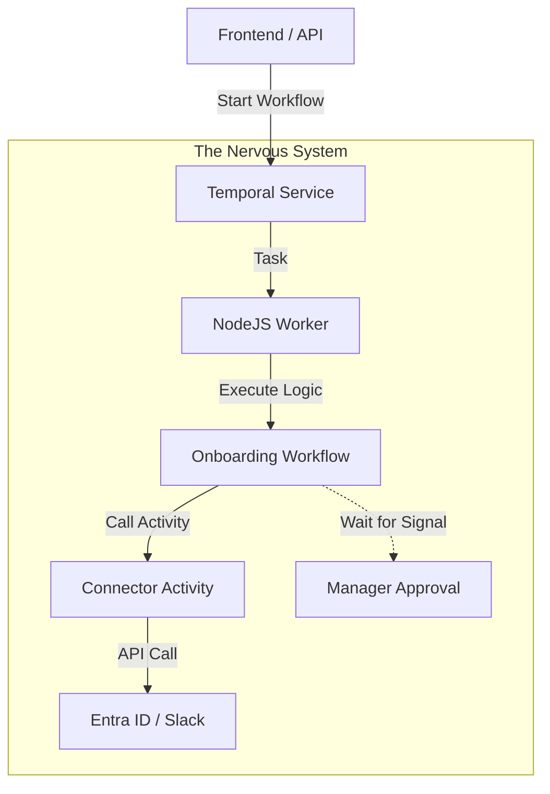
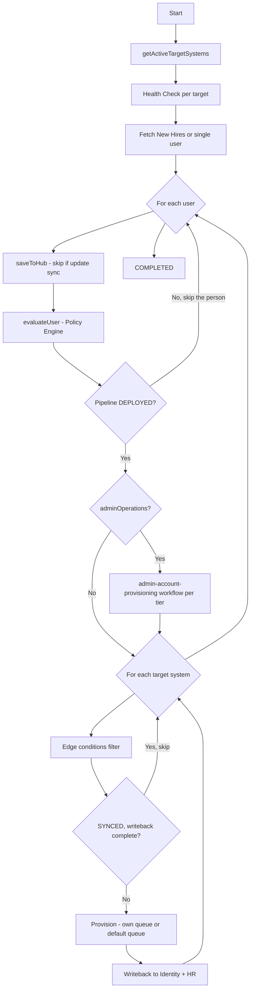
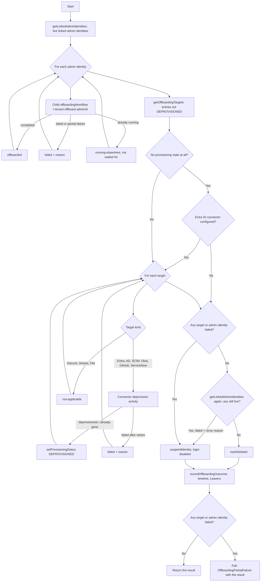

# ⏳ Temporal Workflow Patterns - The 2026 Standard

## 🎯 The Core Problem

**"Distributed Systems are Flaky."**

* **Scenario:** Onboarding a user requires 5 steps: (1) HR Sync → (2) Create AD User → (3) Wait for Sync → (4) Create Email → (5) Send Welcome Email.
* **The Failure:** If Step 4 fails (API outage), standard code crashes. You are left with a user who has an AD account but no email, and HR thinks they are done.
* **The Solution:** **Durable Execution.** Temporal ensures that if Step 4 fails, it retries indefinitely (or rolls back Step 2).

---

## ⚠️ Workflow Landmines (Critical Safety Protocol)

Temporal is powerful, but it makes it easy to shoot yourself in the foot.

### 🧨 Landmine 1: The Non-Deterministic Trap

* **The Trap:** You use `Math.random()` or `new Date()` inside a Workflow.
* **The Explosion:** The workflow crashes and replays history. The second run generates a different random number. Temporal sees a mismatch between "History" and "Code" and throws a `WorkflowTaskFailed` error.
* **The 2026 Fix:** **Pure Logic Only.**
* **Rule:** Workflows must be deterministic code.
* Move all randomness, current time, and API calls into **Activities** (Side Effects).


### 🧨 Landmine 2: The "Infinite Retry" Wallet Burner

* **The Trap:** You deploy a bug where `CreateUser` always fails with `400 Bad Request`.
* **The Explosion:** Temporal's default policy is "Retry Forever." It retries 10,000 times in an hour. Your logging bill skyrockets, and the Target System blocks your IP.
* **The 2026 Fix:** **Smart Retry Policies.**
* **Non-Retryable Errors:** Configure the workflow to *fail immediately* on `400 Bad Request` or `403 Forbidden`. Only retry `500 Server Error` or `429 Too Many Requests`.


### 🧨 Landmine 3: The "Zombie" Workflow

* **The Trap:** A workflow is sleeping for 30 days ("Waiting for Manager"). You change the code logic. The workflow wakes up.
* **The Explosion:** The "New Code" tries to run on "Old History". The state map doesn't match. The workflow terminates unexpectedly.
* **The 2026 Fix:** **Versioning.**
* **Dev:** Nuke the DB (`npm run clean`).
* **Prod:** Use `workflow.patch()` or start new workflows under a v2 name.


---

## 🏗️ Architecture: The Orchestrator

Temporal separates **Logic** (Workflows) from **Side Effects** (Activities).



---

## 🔄 Onboarding Workflow Flow

`onboarding.workflow.ts` — Dynamic, system-agnostic provisioning. Discovers active targets from the canvas, validates health, fetches new hires (or a single user for update sync), evaluates policy, provisions per target, and optionally runs admin-account-provisioning for privileged entitlements.

Only a DEPLOYED pipeline provisions (patch `onboarding:pipeline-guard-deployed`, `pipeline-guard.ts`): right after the policy step, before the person's admin accounts, `getPipelineStatus` is read for each person, and in DRAFT or SIMULATED (before the first Deploy), PAUSED (an operator or the circuit breaker) or STOPPED nothing is provisioned for that person, admin accounts included; the run completes and its result ends with `<n> of <total> not provisioned: the provisioning pipeline is paused.` (or `stopped`, or `not deployed (DRAFT)`). HR joiners wait for the same status, so a run an identity edit, a new HR source, a manual link or [Provision] starts follows the same gate. Histories from before the patch ran the admin account children first and skipped the person only while PAUSED or STOPPED (fixture `test/fixtures/onboarding-pre-pipeline-guard-deployed.history.json`, recorder in `test/workflows/onboarding-pipeline-guard.workflow.e2e-spec.ts`).

A failed admin account child (`onboarding-admin-tiers.ts`, patch `onboarding:admin-account-failure-not-fatal`) no longer fails the run before the person's own targets: every tier's child is started, the failed tiers with the child's own reason go on the person's timeline (`recordAdminAccountFailed`, "Admin account not provisioned"), the person's targets are provisioned, and after the last person the run fails (`AdminAccountFailed`, not retried) naming the identity ids and tiers; a run that also refused someone for SoD fails with `SoDViolation` (the admin failures are on the timelines). The next run of the person starts the children again. A cancellation is not caught. Histories from before the patch failed the run at the first failed child (fixture `test/fixtures/onboarding-pre-admin-account-failure.history.json`, recorder in `test/workflows/onboarding-admin-account-failure.workflow.e2e-spec.ts`).

A BLOCK SoD conflict fails `evaluateUser` without retry (`SoDViolation`, `shared/types/sod-violation.ts`). With patch `onboarding:sod-block-fails-person` (`onboarding-sod-block.ts`) the run puts the reason on that person's timeline (`recordOnboardingBlocked`), provisions nothing for them, goes on with the rest of the batch and then fails (`SoDViolation`), naming the refused identity ids. Runs from before the patch fail at that step.

Every start goes through `OnboardingService.triggerOnboarding` (workflow id `t-{tenant}-onboard-{identityId}`, one run per person at a time). Every run has its person: a run started without `targetEmail` fails at once (`OnboardingTargetRequired`, not retried; patch `onboarding:target-required`), because the all-users run returned every active identity's profile in one activity result, over Temporal's payload limit on a large tenant. Only histories recorded before the patch keep that path. The id, memo, log line and audit entry name the identity by id, never by email; the workflow input keeps `targetEmail`, which the workflow reads the identity by. The workflow's own log lines (Temporal's runtime logger, not redacted) name the person by identity id too, as do those of offboarding and PAM admin account provisioning (orphan cleanup names the drift id); `infrastructure/observability/log-pii.spec.ts` reads `src/workflows`. Runs started before plan 2.0dn have the id `t-{tenant}-onboard-{email}` (`@` and `.` replaced); while one of them is still open, a start for the same person fails as already started, naming that run, so the person is not onboarded twice. `POST /onboarding/start` answers 404 for an email no identity of the tenant has (create the identity or run an HR sync first). Triggers: [Provision] on the Users page (`POST /onboarding/start`), `POST /identity?triggerWorkflow=true`, `PATCH /identity/:id?syncToEntra=true` and critical-field edits of an unprovisioned identity, a manual link, and the HR sync. A critical-field edit and a new HR source start none for an open HR joiner (its start date ahead, or waiting in a mass-joiner batch): the joiner flow starts it (`modules/joiners/open-joiner.ts`). An HR sync (`POST /connectors/:name/ingest`, or the scheduled `scheduledSyncWorkflow` -> `runScheduledSync` activity -> `SyncSchedulerService` -> `HrIngestionService`) ends with three detections, each awaited: leaver detection (`HR_SYNC_COMPLETED`), HR mover detection (`HR_SYNC_MOVERS_REQUESTED`) and HR joiner detection (`HR_SYNC_JOINERS_REQUESTED`, `modules/joiners/docs/ARCHITECTURE.md`). Joiner detection records the identities the run minted and, once the tenant's pipeline is DEPLOYED and up to the mass-joiner limit, starts one onboarding run per joiner through `IDENTITY_PROVISION_REQUESTED`; the memo carries `reason: joiner:hr-sync:<source>`, the workflow input is the usual `{ targetEmail, tenantId }`. Deploy itself starts no run: the first full sync after it starts the joiners recorded before. The ingest result (and the scheduled-sync log line) carries the `leavers`, `movers` and `joiners` summaries.



The targets are the canvas connectors whose manifest declares `provision` (`getActiveTargetSystems`, `activities/config.activities.ts`): an HR source on the canvas (CSV HR, JSON API HR, which declare only `ingest`) is not one, and a node type without a registered manifest stays in, so its health check fails the run. A node's connector is its `data.type`; a target node saved without one (the default canvas's `entra-target` before plan 2.0da) counts as the registered connector its id `<system>-target[-suffix]` names (`entra-target` -> `entra-id`). Each target is health-checked and provisioned on its own queue (Entra ID, AD, Okta, SCIM) or, for a target without one (GitHub, ServiceNow, Discord webhook, Google Sheets, File outbound), on the default queue as `check<System>Health` / `provisionUserTo<System>` (the names are in `backend/src/infrastructure/temporal/docs/TASK_QUEUES.md`). Those five connectors load their saved connector config themselves (`ConnectorConfigService`, the request's tenant), so no secret enters workflow history. A target with an account returns its id for the write-back: ServiceNow `snow-<sys_id>` (the id offboarding deactivates), GitHub the invited account (`github-user-<id>`, also when it was already invited or a member) when the identity has a GitHub login (custom attribute `githubLogin`), else the invitation (`github-invitation-<id>`; none when the person was already invited or a member, and offboarding finds the invitation by email anyway). Discord webhook, Google Sheets and File outbound keep no account: their provision returns only a `detail` such as "no account: line appended to the outbound file", nothing is written back, and the provisioning entry is SYNCED for the delivered record; offboarding reports them `not-applicable`. A failed health check (connector not installed, unreachable) fails the run with `HealthCheckFailed` before anything is provisioned.

Onboarding is idempotent per identity and target (patch `onboarding:skip-synced-targets`): a target whose provisioning entry is SYNCED with `writebackComplete` is not provisioned again, so a second run for the person (an all-users run, Provision pressed twice, a new HR source, a manual link) posts no second Discord message, file line or sheet row and opens no second ServiceNow incident. A provision that succeeds with nothing to write back (a no-account target, GitHub's existing invitation) sets `writebackComplete` at once. A SYNCED entry without it (an account id that never reached the identity, from before `onboarding:writeback-until-complete`) is still provisioned and written back once more. The one exception is `syncToEntra` in the workflow input (`PATCH /identity/:id?syncToEntra=true`): Entra ID is provisioned again so the edited profile reaches the existing account; other SYNCED targets are still skipped. Histories from before the patch provision every target on every run (fixture `test/fixtures/onboarding-pre-skip-synced.history.json`). A write-back does not start onboarding either: the target account it adds to the identity emits `identity.sources_changed` with depth 1, which `SourcesChangedHandler` skips (before, an all-users run started a per-person run for each written-back person; a per-person run collided with itself and the start was dropped).

An Entra ID target with no config anywhere is left out of the run (patch `onboarding:entra-not-configured`, plan item 2.0dg). Before its health check, onboarding reads the Entra ID node's canvas config (`getConnectorConfig('entra-id')`, the config provisioning gets) and asks `isEntraConfigured` on the Entra ID queue (`EntraService.isConfiguredFor`: the canvas config, else the tenant's installed Entra ID connector config, else `ENTRA_*`, the pick every Entra ID call makes). When that finds nothing, Entra ID gets no health check, no provisioning and no provisioning entry, a workflow log line says it was left out, the other targets run as usual, the run completes, and its result ends with `Skipped entra: not configured.` (and ` No target left to provision.` when Entra ID was the only target). Each person the run processes gets "Not provisioned to entra: not configured" on the identity timeline: the run passes the targets it left out to `getIdentityByEmail`, the lookup it makes per person anyway (trailing argument `notConfiguredTargets`, no new command), which records them by identity id. Otherwise the health check runs on the canvas config; before the patch it ran with config `undefined`, so a tenant whose Entra ID credentials were only on the canvas node failed every run at the health check. A configured Entra ID that is unreachable, refuses the credentials or has an incomplete config (canvas or installed; an empty canvas config object counts as an incomplete config) still fails the run with `HealthCheckFailed`. Histories from before the patch check Entra ID with config `undefined` (fixture `test/fixtures/onboarding-pre-entra-not-configured.history.json`).

An AD target is health-checked on its canvas node's config (patch `onboarding:ad-not-configured`, `onboarding-health-check.ts`): `getConnectorConfig('ad')`, the config `provisionUserToAd` gets. AD has no installed connector config or environment fallback, so an AD node without a config is left out of the run like an unconfigured Entra ID: no health check, no provisioning, no provisioning entry, "Not provisioned to ad: not configured" on the timeline and `Skipped ad: not configured.` in the result. A config that is there but lacks a host or base DN, or whose bind fails, still fails the run with `HealthCheckFailed`. Before the patch AD was checked with config `undefined`, which `AdService.healthCheck` answers false without trying LDAP, so every run with AD on the canvas failed at the health check, its Entra ID provisioning included (fixture `test/fixtures/onboarding-pre-ad-not-configured.history.json`, recorder in `test/workflows/onboarding-ad-not-configured.workflow.e2e-spec.ts`).

A target that answers without having done its work is not SYNCED (patches `onboarding:unprovisioned-not-synced` and `admin-account-provisioning:unprovisioned-not-synced`, `provision-result.ts`). `provisionUserToAd` answers `{ success: false, skipped: true, error }` without throwing when its config lacks a host or base DN (the admin account child has no health check, so an AD node without a config reaches it). Such a target's provisioning entry becomes ERROR with that reason (no account id, so the mover and offboarding do not count it as provisioned), no provisioning outcome is recorded for the circuit breaker, the run goes on with the other targets, and the onboarding result ends with `Not provisioned to ad: <reason>.`; the admin child asks for no standing-state settle run when nothing was provisioned. A write-back that answers `success: false` (the identity is gone) leaves the target SYNCED without `writebackComplete`, so the next run writes the account id back again. Histories from before the patches marked both SYNCED, the provision a success and the writeback complete (fixtures `test/fixtures/onboarding-pre-unprovisioned-not-synced.history.json` and `test/fixtures/admin-account-provisioning-pre-unprovisioned-not-synced.history.json`).

A target an access review excluded for the person (a revoked account item: an account exclusion of that system, `modules/policy/docs/ARCHITECTURE.md`) is left out of their provisioning (patch `onboarding:review-exclusions`, `onboarding-review-exclusions.ts`): before the target loop the run asks `getReviewExcludedTargets(identityId, targets)` (PolicyActivities, default queue, `QUERY_RETRY`), which also puts "Not provisioned to <target>: excluded by an access review" on the timeline; the loop skips those targets (no provisioning call, no provisioning entry, no account) and the result names them ("Left out by an access review exclusion: github."). Not a failure. A person without an identity record, or a run without targets, asks nothing. Histories from before the patch ask nothing and provision every target; replay fixture `test/fixtures/onboarding-pre-review-exclusions.history.json` (recorder in `test/workflows/onboarding-review-exclusions.workflow.e2e-spec.ts`).

---

## 🔄 Offboarding Workflow Flow

`offboarding.workflow.ts` removes a leaver's access in every target where the identity has an account and reports per system what happened. It reads `identity.provisioning` (`getOffboardingTargets`: every entry not yet DEPROVISIONED, so SYNCED and also SYNCING, ERROR and PENDING, which may hold a half-created account) and the account id from the identity's account record (`sources[]` of the target, written back by onboarding: Entra `objectId`, AD DN, Okta and SCIM ids). Per target (`offboarding-deprovision.ts`):

| Target | Activity (queue) | Outcome |
|---|---|---|
| Entra ID | `deleteUser` (provisioning-entra), by objectId, else the email as UPN and then by mail | deprovisioned, already-gone on a Graph 404 for the objectId; without one, no user with the email as UPN or mail fails for an admin to check |
| AD | `deprovisionAdUser` (provisioning-ad), by DN; `disableAdUser` before the patch `offboarding:ad-deprovision-outcome` | deprovisioned (disabled), already-gone (LDAP "no such object" for the DN); failed without a DN or config |
| SCIM | `deprovisionScimUser` (provisioning-scim), by the stored id, else `userName eq` the identity's UPN or email / `emails.value eq` the email (read by the activity from the identity id) | deprovisioned (deactivated or deleted per `deprovisionStrategy`), already-gone (stored id 404); no match without a stored id fails |
| Okta | `deprovisionOktaUser` (provisioning-okta), by the stored id, else the login; reads the user's status first | deprovisioned (deactivated, or deactivated and deleted per `deprovisionStrategy`; a user already `DEPROVISIONED` is not deactivated again, only deleted with `delete`), already-gone (stored id 404, or already deactivated); an unknown login fails |
| GitHub | `deprovisionGitHubUser` (default queue; account id and identity id passed, the GitHub login read by the activity) | With a GitHub account (written-back `github-user-<id>`, else the identity's `githubLogin`): deprovisioned (removed from the organization, or a pending email invitation cancelled), already-gone (not in the organization, or the account deleted). Without: deprovisioned (pending invitation cancelled), already-gone (invitation failed or expired); failed for an accepted invitation (the API cannot find a member by email) |
| ServiceNow | `deprovisionServiceNowUser` (default queue), by `snow-<sys_id>`, else email, then `user_name` | deprovisioned (`active=false`, `locked_out=true`, never deleted), already-gone (stored sys_id gone); no record without a stored id fails |
| Discord webhook, Google Sheets, File outbound | none | not-applicable (they keep no account) |

Entitlement expiry (`entitlementExpiryWorkflow`, CronWorkflows below) removes expired access through the same activities and counts the outcomes the same way.

Linked admin accounts first (patch `offboarding:linked-admin-cascade`, `offboarding-linked-admins.ts`): before the person's own targets, `getLinkedAdminIdentities` (default queue, `PrivilegedAccessActivities`) returns the person's live linked admin identities (PAM): those whose `parentIdentityId` is the person and those the person's `linkedAdminAccounts` entries name, not soft-deleted, in the tenant, oldest first, with each one's email. Each is offboarded by a child `offboardingWorkflow` under the service's id convention `t-{tenant}-offboard-{adminId}` (`offboarding-id.ts`), with the parent's `TenantId` search attribute (`inheritTenantAttributes`) and a memo of its own (`Offboarding: identity <adminId> (linked admin account of identity <personId>)`), `ParentClosePolicy.ABANDON` (a started removal runs to its end), one after another. The outcome per admin identity goes to the result's `linkedAdmins` (`identityId`, `workflowId`, `outcome`, `reason`): `offboarded`; `failed` when the child failed or left a target failed, which counts like a failed target (the person is suspended, not deleted, the result is `partial-failure`, and the failure message names `linked admin identity <adminId>`); `running-elsewhere` when an offboarding of that admin identity already runs (`WorkflowExecutionAlreadyStartedError`), which is not waited for (that run reports its own result). Right before the person would be deleted, `checkNoLiveLinkedAdmins` calls `getLinkedAdminIdentities` again: an admin identity still live then (its offboarding elsewhere has not finished, or it was linked while the run went on) becomes `failed`, its reason saying to rerun the person's offboarding, so the person is suspended with `partial-failure` instead; one whose offboarding finished meanwhile (deleted) stays `running-elsewhere` and does not hold the person. A person is never deleted while one of their admin identities is live. An admin identity's own offboarding also targets its `DEPROVISIONED` entries that EuroID's own deprovision did not record (`provisionedAt` not null), as a PAM deactivation would have left them, when the account id is stored (`getOffboardingTargets`; without it the deprovision would fail on every rerun). Deleting an admin identity sets its entry on the person `INACTIVE` (`IdentityMutationService.markAsDeleted`). Histories from before the patch leave the linked admin accounts alone (fixture `test/fixtures/offboarding-pre-linked-admin-cascade.history.json`, recorder and tests in `test/workflows/offboarding-linked-admins.workflow.e2e-spec.ts`).

A target's activity is retried per `CONNECTOR_RETRY` (a 429 waits the target's retry-after; bad credentials and other client errors fail at once); what still fails is a `failed` result with its reason, and the other targets are still attempted. The Golden Record is always updated: soft-deleted when nothing failed, otherwise suspended (`controls.isLoginDisabled`, so reconciliation keeps it SUSPENDED) and kept. Only an identity with no provisioning state at all is tried in Entra ID, and only when an Entra ID connector is configured; a rerun after every target is DEPROVISIONED removes nothing more. A target whose onboarding never finished (SYNCING, ERROR, PENDING) is deprovisioned when the connector finds its account; otherwise it is `failed` with a reason saying provisioning never completed. `recordOffboardingOutcome` emits `identity.offboarding_completed`: the identity timeline gets one entry per system and a summary, and the result is stored as the workflow's offboarding record (`offboarding_records`, Leavers page), whichever trigger started it. With a failed target the workflow then fails (`OffboardingPartialFailure`, the result in the failure details); otherwise it returns the result. An admin who removed a failed target's account by hand closes it outside the workflow (Leavers page, `POST /leavers/offboardings/:workflowId/removed-manually`): the target becomes `removed-manually` and `DEPROVISIONED`, and once no target is left failed the Golden Record is soft-deleted through the same `markAsDeleted` (`modules/leavers/docs/ARCHITECTURE.md`); closing the last one is refused (409) while a linked admin identity of the person is live. Histories from before the patch `offboarding:per-system-results` replay the old flow (fixtures `test/fixtures/offboarding-pre-per-system-results.*.history.json`); histories from before `offboarding:unsynced-targets` read only SYNCED targets (`getProvisionedTargets`) and fall back to Entra whenever none is left (fixture `test/fixtures/offboarding-pre-unsynced-targets.history.json`); histories from before `offboarding:ad-deprovision-outcome` call `disableAdUser` (fixture `test/fixtures/offboarding-pre-ad-deprovision-outcome.history.json`). Failure reasons are masked in the activity (emails, the CN/UID of an LDAP DN) because they reach workflow history as well as the timeline and the Leavers page.

Two triggers, both through `IDENTITY_OFFBOARD_REQUESTED` -> `OffboardingService.triggerOffboarding` (workflow id `t-{tenant}-offboard-{identityId}`): `DELETE /identity/:id`, and HR leaver detection after each HR sync (`modules/leavers/docs/ARCHITECTURE.md`), which puts `reason: leaver:<terminated|end-date|missing-from-source>` in the workflow memo. The memo's `targetDescription` names the identity by id (`Offboarding: identity <id>`), as onboarding's does; until the final sweep of 2026-11-23 it was the email.



Onboarding writes the account id back until a writeback has completed for the target (`writebackComplete`, patch `onboarding:writeback-until-complete`); before that patch only a `PENDING` provisioning entry was written back, which no code creates. For identities provisioned before the patch, the next onboarding run therefore writes back once more, and that writeback also calls `writebackToHrSource`. This is harmless today: it writes only when the blueprint enables `hrWriteback` and the primary HR connector has write-back fields, and both HR connectors (`csv-hr`, `json-api-hr`) declare none (`writeBackCapableFields: []`, `updateUserFields` answers read-only), so nothing is sent to HR. A deprovision (offboarding, expiry, an access review revoke, an expiry or offboarding target closed as removed manually) sets `writebackComplete` back to false (`IdentityProvisioningService.updateProvisioningState`), so a later provision of that target writes its new account id back; until the final sweep of 2026-11-23 only a rehire's revival did, and a re-provision after a revoke or an expiry left the removed account's id for the mover and offboarding. Entries deprovisioned before that kept `writebackComplete: true`; migration `20261124000000-deprovisioned-writeback-incomplete` sets it to false on every `DEPROVISIONED` entry, so their next provision writes the new account id back too. A future write-back-capable HR connector would receive the Golden Record's `email`, `workPhone` and `officeLocation` once per such identity, the values that ingest from that HR source produced.

An Entra ID provisioning that created the account but did not make a group, directory role or license change fails without retry (`EntraChangesFailed`, `activities/entra-changes-failure.ts`) with the account's object id and generated attributes in its details. Onboarding and admin-account provisioning write that account back to the identity before they mark the target `ERROR` (patches `onboarding:entra-created-account-writeback` and `admin-account-provisioning:entra-created-account-writeback`), so the next run finds and updates it instead of creating a second account; a failed writeback is logged and the target is still marked `ERROR`. Histories from before the patches mark the target `ERROR` only (fixtures `test/fixtures/onboarding-pre-entra-created-writeback.history.json`, `test/fixtures/admin-account-provisioning-pre-entra-created-writeback.history.json`).

---

## 🔄 Access Review Workflow Flow

`access-review.workflow.ts` (one per activated campaign, workflow id `t-{tenant}-access-review-{campaignId}-{ts}`) checks the campaign every minute until no item is pending or the deadline passes, escalating overdue items. Then it expires the items still pending, removes what the campaign revoked and completes the campaign (`completeCampaign`, which also stores `revocationSummary`).

Cancelling a campaign (`POST /access-reviews/campaigns/:id/cancel`, `AccessReviewCampaignService.cancel`, an optional reason) sets it `CANCELLED`, audits `access_review.campaign_cancelled` with the admin and the reason, and then cancels the workflow through Temporal (`WorkflowHandle.cancel()`): the run ends at its next timer or activity with status Cancelled, and nothing is escalated, expired, revoked or completed afterwards. A cancel during revocation stops the batch: the removals it already made are recorded (outside the cancelled scope) and the rest is not attempted (patch `access-review-revocation:rethrow-cancellation`, below); elsewhere the workflow code has no cancellation branch of its own. The activities also skip a cancelled campaign (`checkAndEscalateOverdue`, `expirePendingItems`, `listRevocationTasks`, legacy `executeRevocations`, and `completeCampaign`, which leaves it `CANCELLED`), which covers an activity already running at the cancel and a workflow Temporal could not be asked to cancel (logged as an error; the campaign is still cancelled).

Revocation (`access-review-revocation.ts`): `listRevocationTasks` (default queue) returns the next batch (`ACCESS_REVIEW_REVOCATION_BATCH_SIZE` items, default 50) of entitlements without a result: every `revoked` item, and `expired` items when the campaign has `autoRevokeOnExpiry`; nothing for a cancelled campaign. Entitlements no connector can remove are recorded right there as `manual-action-needed` with what an admin must do. Before it writes any result, it keeps every entitlement it takes up as an access review exclusion (`ReviewExclusionRecorder`; an account item as the whole system; `modules/policy/docs/ARCHITECTURE.md`, Access Review Exclusions), which the policy engine leaves out of every later intent; a failed recording writes nothing, so the activity's retry takes the same entitlements up again. No workflow code changed for it. Each other entitlement goes to `revokeReviewAccess` on its connector's queue (`CONNECTOR_RETRY`); a failure after the retries is a `failed` result with the reason, and the others still run. An account item (`type: account`: the identity's account in a target whose memberships the campaign cannot read) goes to `revokeReviewAccount` on the default queue, which removes the account through `EntitlementExpiryDeprovision` (offboarding's per-target deprovision, as entitlement expiry uses it) and closes the provisioning entry (`DEPROVISIONED`) when the account is removed, already gone or kept nowhere; `recordRevocationResults` puts its outcome on the identity timeline (`access_review.account_revoked`, once: only when it stored the result), and a group membership's likewise (`access_review.membership_revoked`, the group by its id). `recordRevocationResults` stores each outcome on the item's entitlement (`entitlements[i].revocation`), never overwriting one. Only ids pass through history (`{ itemId, entitlementIndex, connector }`): the activity reads the account and group from the review item. After 20 batches the run continues as new with `resumeRevocations: true`.

| Review entitlement | Queue | Outcome |
|---|---|---|
| Entra ID group | provisioning-entra | removed; already-gone (not a member, Graph 404); directory roles and administrative units: manual-action-needed |
| AD group | provisioning-ad | removed; already-gone (not in the account's `memberOf`, or the directory says not a member) |
| Okta group | provisioning-okta | removed (`OKTA_GROUP`); already-gone (not a member, or the Okta user is deleted); `APP_GROUP` and other types: manual-action-needed |
| SCIM group | provisioning-scim | removed (PATCH `remove members[value eq "<id>"]`); already-gone (not in the user's `groups`, group 404, `noTarget`, or the SCIM user is gone); nested (`indirect`): manual-action-needed |
| Account item: GitHub, ServiceNow, File outbound, Google Sheets, Discord webhook, any other target without readable memberships | provisioning-default | removed (GitHub organization membership removed, ServiceNow user deactivated); already-gone (no such account, a target that keeps no account, the identity offboarded or its entry deprovisioned since the review); a target offboarding has no deprovision for: manual-action-needed |
| EuroID SCIM token scope, EuroID admin role, any other kind of access | none | manual-action-needed |

Patch `access-review:connector-revocation` (new executions). Before it, a decision signal ended the monitoring loop within a minute even with items pending (the rest were expired), and only when items were pending at the end did `executeRevocations` remove Entra ID group memberships, only with `autoRevokeOnExpiry`, recording nothing per item. Histories from before the patch replay that flow; `executeRevocations` stays registered for them. Replay fixture: `test/fixtures/access-review-pre-connector-revocation.history.json` (recorder in `test/workflows/access-review-revocation.workflow.e2e-spec.ts`).

Patch `access-review:account-revocation` (new executions, checked when revocation starts): `listRevocationTasks` gets the trailing argument `accounts` and returns account items as `account` tasks, which go to `revokeReviewAccount`. Histories from before it pass no such argument, so an account item there is recorded as manual action (campaigns activated before the deploy have none). Replay fixture: `test/fixtures/access-review-pre-account-revocation.history.json`, recorded from ca5a8b11 (recorder in the same spec).

Patch `access-review-revocation:rethrow-cancellation` (`access-review-revocation.ts`, checked when a removal is cancelled, so runs already under way when it is deployed get it too): the cancelled removal rethrows the cancellation, the batch records the removals it already made through `recordRevocationResults` in a non-cancellable scope, and the cancel ends the run (status Cancelled). The removal that was running at the cancel gets no result: whether it went through is unknown. Histories from before it turned the cancel into a `failed` result, failed the rest of the batch at once (an activity cannot start in a cancelled scope) and had the record cancelled too, so the removals made before the cancel were not recorded. Replay fixture: `test/fixtures/access-review-pre-rethrow-cancellation.history.json`, recorded from fb91146f (recorder in the same spec).

## 🔄 Mover Workflow Flow (access changes)

`mover.workflow.ts` changes the access of an identity that is already provisioned (a SYNCED target). Three triggers, all through `MoverService.triggerMover` (workflow id `t-{tenant}-mover-{identityId}`, one run per identity at a time; an identity edit that meets an open run is queued on it through `MoverService.startOrQueueMover` (signal `reevaluate`), and the run continues as new with the queued edits once it has recorded its outcome, also after a failure (patch `mover:reevaluate-queued-edit`, `mover-reevaluation.ts`). The API signals only a run that answers the query `acceptsQueuedEdits` (registered from patch `mover:queued-edit-query` on); for a run started before it the API starts the edit's own run once that run has ended (`MoverService.startAfterOpenRun`); the input, memo and audit entry name the identity by id, not by email, and `previousAttributes` keep only what the access baseline keeps):

- `PATCH /identity/:id` changing the value of `departmentName`, `jobTitle`, `location` or `managerEmail` (`MoverEventHandler`, trigger `attribute-change`; `previousAttributes` are the access baseline's values of the trigger attributes whose value the edit changed, and only for an identity without a baseline the before-values from the `identity.updated` event). Onboarding starts no run for that edit; an identity with no SYNCED target gets onboarding instead. With `?syncToEntra=true` the PATCH starts this run itself (`identity.move_requested`) and reports it, else the onboarding sync; never both. That run carries `syncToEntra` and updates the Entra ID account also without an access change there (step 3). An HR sync does not emit `identity.updated`; it uses the third trigger.
- `POST /identity/:id/access/re-evaluate` (operator, trigger `re-evaluate`; `modules/mover/access-reevaluation.service.ts`): `previousAttributes` are the access baseline's values of every attribute that differs from the current profile.
- An HR sync (trigger `hr-sync`; `modules/mover/hr-mover-detection.service.ts`, after leaver detection): each delivered, provisioned identity whose four trigger attributes differ from the access baseline, with `previousAttributes` the baseline's values of those attributes; above the per-tenant mass-mover limit none starts until an admin approves the batch (`modules/mover/docs/ARCHITECTURE.md`). No workflow code changed for it: `trigger` is an input field the workflow passes to its outcome.

The access baseline (`identity.accessBaseline`, `shared/utils/access-baseline.ts`) is the profile access was last applied with, without names, contact data and identifiers: recorded at the identity's first SYNCED target (`setProvisioningStatus`), advanced by each completed mover run for the attributes it evaluated (`recordMoverOutcome`). It is the "before" of every run, whatever started it. `GET /identity/:id/access/preview` evaluates the active policies (SoD-free, read-only) against the baseline and the current profile and shows the same delta the run applies (`shared/utils/entitlement-delta.ts`).

The run (patch `mover:identity-by-id`, `workflows/mover-access.ts`):

1. `getPipelineStatus`: only a DEPLOYED pipeline changes access (patch `mover:pipeline-guard-deployed`). PAUSED, STOPPED, DRAFT and SIMULATED skip the run before the policies are evaluated; its outcome is `skipped` with the reason ("The provisioning pipeline is not deployed (DRAFT)."). Histories from before the patch skipped only PAUSED and STOPPED (fixture `test/fixtures/mover-pre-pipeline-guard-deployed.history.json`); the path of histories from before `mover:identity-by-id` keeps that guard.
2. `evaluateMoverChange` (default queue, `QUERY_RETRY`) reads the identity by id, evaluates the policies with its policy profile and with that profile plus `previousAttributes`, and returns the delta. The policy profile also carries the identity's HR contracts (title and department per HR source), which an HR move changes too: unless `previousAttributes` name them (a re-evaluation does), the "before" side takes the access baseline's contracts and a completed run advances them. It returns the delta (entitlement ids, no policy params), the changed attributes' current values and the target systems the identity is provisioned to (`provisionedSystems`, `hasProvisionedAccount`: provisioned once until a deprovision, also through a later ERROR; a SYNCED entry, one with `provisionedAt`, or one no write has touched since 2.0dq with `writebackComplete` or in ERROR with the account id the target wrote back). A removal of an entitlement one of the identity's active access requests also grants is left out (`withoutRequestGrants`). A missing identity fails the run (`IdentityNotFound`); a BLOCK SoD conflict fails it at once (`SoDViolation`, naming the SoD policies).
3. Per active target system with changes, `moverSystemPlan` (`shared/utils/entitlement-delta.ts`) splits the system's changes into what its connector applies and what it does not; the applied part, removals first, goes to `applyMoverAccess` on the connector's own queue (`CONNECTOR_RETRY`), with SYNCING / SYNCED / ERROR provisioning status. A system the identity is not provisioned to is not attempted: it gets a `no-account` entry with the reason, its provisioning entry is left as it is (none is created) and the run goes on with the next system. The task carries `{ identityId, connector, operations: [{ type, action, targetId }] }`; the activity reads the identity, its account and the connector config. With `syncToEntra` in the input (patch `mover:sync-to-entra`) Entra ID also gets `applyMoverAccess` with no operations where the run has no change for it, a run without any access change included: the account is updated from the current profile and reported `updated` with that reason (`no-account` without an Entra ID account); the status of a run without changes stays `no-change`.

| System | Queue | What `applyMoverAccess` does |
|---|---|---|
| Entra ID | provisioning-entra | The Entra provisioning path with the policy profile read in the activity (`provisionUserToEntra`: attributes updated, then groups and directory roles added and removed, licenses added) |
| AD | provisioning-ad | Group memberships of the account DN (written-back DN, else mail/UPN lookup): `addUserToGroup`, `removeGroupMember`; what is already as wanted is left alone |
| Okta | provisioning-okta | Group memberships of the Okta user (written-back id, else login = email): `addGroupMember` (PUT), `removeGroupMember`; removing a non-`OKTA_GROUP` membership fails (422) |
| SCIM | provisioning-scim | Group memberships of the SCIM user (written-back id, else userName / emails lookup): PATCH `add members` / `remove members[value eq ...]`; removing a nested (`indirect`) membership fails (422) |
| Any other system | none | `not-supported` with the reason |

AD, Okta and SCIM change groups only; Entra ID groups, directory roles and licenses (`MOVER_OPERATION_TYPES`). Other kinds of entitlement for those systems get their own `not-supported` entry with the reason, next to the system's `updated` (or `failed`, `no-account`) entry. In a system the identity is provisioned to, an account the connector cannot find fails the system (422, not retried). Failure messages are masked in the activity (`asDeprovisionFailure`: emails and the CN/UID of LDAP DNs, in the message and in the stack trace Temporal stores); the failed system's provisioning `errorMsg` is that message. The first failing system stops the run, the systems after it are `not-attempted` (or `no-account`). With the patch `mover:timeline-outcome` every run ends with `recordMoverOutcome`: `mover.completed` (status `completed`, `no-change`, `skipped` for a pipeline that is not DEPLOYED) or `mover.failed`, which `MoverTimelineHandler` puts on the identity timeline (start, one entry per system, summary).

Histories from before `mover:identity-by-id` replay the earlier path: the identity looked up by email (`getIdentityByEmail`), its full policy profile passed to `evaluateUser` and to `provisionUserToEntra` / `provisionUserToAd`, `computeEntitlementDelta`, every other system `not-supported` without a reason, and a failed system's `errorMsg` set to the Temporal wrapper's message (fixture `test/fixtures/mover-pre-identity-by-id.history.json`). Histories from before `mover:timeline-outcome` also replay without the outcome (fixture `test/fixtures/mover-pre-timeline-outcome.history.json`), and those from before `mover:sync-to-entra` without the Entra ID sync, `syncToEntra` in the input or not (fixture `test/fixtures/mover-pre-sync-to-entra.history.json`). Those activities stay registered for them. Deploy the API and the worker together: a run started without an email by the new `MoverService` cannot run on a worker without the patch.

---

## 🧩 Key Patterns for IGA

### 1. The Provisioning Saga (Compensating Transactions)

> **PLANNED** — The compensation pattern below is the target design but is **not yet implemented** in the onboarding workflow. Current behavior: on failure the workflow throws the error (fail-forward) without rolling back previously completed steps. The `distributed-transaction.workflow.ts` implements a basic saga with compensation.

**Goal:** All or Nothing. If we can't provision everything required for a role, we shouldn't provision anything (or we should clean up).

**Code Pattern (target design):**

```typescript
export async function onboardingSaga(user: UserDto) {
  const compensations = [];
  try {
    const entraId = await entraActivities.createUser(user);
    compensations.push(() => entraActivities.deleteUser(entraId));
    await entraActivities.addToGroup(entraId, 'All-Staff');
    await otherActivities.createAccount(user);
    compensations.push(() => otherActivities.deleteAccount(user.email));
  } catch (err) {
    for (const rollback of compensations.reverse()) { await rollback(); }
    throw err;
  }
}
```

### 2. Human-in-the-Loop (Signals)

**Goal:** Pause automation until a human approves.

**Implementation:** `access-request-approval.workflow.ts` — multi-step approval with signals and timers.

**Code Pattern:**

```typescript
import { defineSignal, condition } from '@temporalio/workflow';

const approvalDecisionSignal = defineSignal<[{ stepIndex: number; decision: 'APPROVED' | 'REJECTED'; approverId: string }]>('APPROVAL_DECISION');
const cancelRequestSignal = defineSignal('CANCEL_REQUEST');

export async function accessRequestApprovalWorkflow(request: AccessRequestInput) {
  // Decisions kept per step (patch access-request-approval:buffer-step-decisions): one that
  // arrives before its step waits (while the approver is notified, or for a later step) counts
  // for that step, never for another
  const decisions: Array<{ stepIndex: number; decision: string }> = [];
  let cancelled = false;

  setHandler(approvalDecisionSignal, (decision) => { decisions.push(decision); });
  setHandler(cancelRequestSignal, () => { cancelled = true; });

  // (A BLOCK SoD match refused the request before the workflow started.)
  for (const [i, step] of request.approvalSteps.entries()) {
    await accessRequestActivities.notifyApprover(step);

    if (await condition(() => decisions.some((d) => d.stepIndex === i) || cancelled, '7 days')) {
      if (cancelled) return 'CANCELLED';
      const decision = decisions.splice(decisions.findIndex((d) => d.stepIndex === i), 1)[0];
      if (decision.decision === 'REJECTED') return 'REJECTED';
    } else {
      // The step timed out: the request is rejected, no escalation
      await accessRequestActivities.updateRequestStatus(request.requestId, 'REJECTED');
      return 'REJECTED';
    }
  }

  // All steps approved. End date already passed (patch
  // access-request-approval:end-date-passed-before-approval): nothing fulfilled, EXPIRED
  if (request.timeConstraint?.expiresAt && msUntil(request.timeConstraint.expiresAt) <= 0) {
    await accessRequestActivities.expireBeforeFulfilment(request.requestId);
    return 'EXPIRED';
  }

  // SoD re-check against the access held now (patch
  // access-request:sod-recheck-before-provision: marks PROVISIONING, or REJECTED on a BLOCK match)
  if (!(await accessRequestActivities.recheckSodBeforeProvisioning(request.requestId)).passed) {
    return 'REJECTED';
  }
  // Entitlements only, on the person's recorded Entra ID account (EntraEntitlementChanges):
  // no attribute written, no account created; a failed fulfilment ends REJECTED with statusReason
  await accessRequestActivities.provision(request);
  if (request.timeConstraint?.expiresAt) {
    // Timers of at most 90 days until expiresAt: a request runs up to 730 days (patch
    // access-request-approval:expire-on-date; older runs slept once, capped at 90 days)
    while (msUntil(request.timeConstraint.expiresAt) > 0) {
      await sleep(Math.min(msUntil(request.timeConstraint.expiresAt), NINETY_DAYS_MS));
    }
    // A failed revoke is tried again (5 min, doubling to 6 h) until it succeeds; only then
    // EXPIRED (patch access-request-approval:revoke-until-done). A refusal retrying cannot fix
    // keeps it ACTIVE with statusReason and emits provisioning.failed once per reason. Each wait
    // also ends on REMOVED_MANUALLY (a policy-admin closed the request as removed by hand: no
    // further attempt), and after 20 retries the run continues as new with the attempt count
    // (patch access-request-approval:revoke-closable-continue-as-new, access-request-revoke-retry.ts)
    await accessRequestActivities.deprovision(request);
  }
  return 'ACTIVE';
}
```

Signal-based approval is also used in `bulk-provisioning.workflow.ts` (for delete approval gates). Its cancel signal (`POST /bulk-provisioning/cancel/:workflowId`) is read before every batch and every delete: the run then rolls back what it changed, as a failed fail-fast run does, and ends `CANCELLED` with its results (patch `bulk-provisioning:cancel-compensates`). The API sends only the signal; it no longer terminates the run. At its end, after any rollback, the run marks the provisioning entry of each account its DISABLE and DELETE operations removed DEPROVISIONED (activity `markRemovedAccounts`, the identity found by source key, else email; patch `bulk-provisioning:mark-removed-accounts`). An Entra ID CREATE or UPDATE records the object id of the account it provisioned for the operation's identity inside its own activity (`executeSystemOperation`, `bulk-provisioning-created-account.ts`; no workflow change): the target source, never replacing a recorded id, and the identity's Entra ID provisioning entry marked SYNCED (`recordEntraSynced`; an existing `entra` or `entra-id` entry, else a new `entra-id` one; only when the object id is now the identity's or none was returned: an id another live identity holds, one a deprovision removed or another recorded id marks nothing and is logged), both undone with the Golden Record write by a rollback (the Hub snapshot keeps the Entra ID entries as they were).

### 3. The "Scatter-Gather" (Batch Processing)

**Goal:** Reconciliation. Compare 500k users in Hub vs. Target System without timing out.

**Implementation:** `dailyReconciliationWorkflow` (parent) + `reconcileBatchWorkflow` (child).

**Logic:**

1. **Parent Workflow:** Fetches total user count via `getReconciliationUserCount` activity. A config with a scan scope (`includedDepartments`, `excludedUsers`) counts only those identities and hands the same scope to every batch and to orphan detection (patch `reconciliation:scan-scope`, fixture `test/fixtures/reconciliation-pre-scan-scope.history.json`; `backend/src/modules/reconciliation/docs/ARCHITECTURE.md`, Run Settings).
2. **Fan Out:** Splits into N batches (configurable via `RECONCILIATION_BATCH_COUNT`, `RECONCILIATION_BATCH_SIZE`). Spawns N child workflows via `executeChild`.
3. **Child Workflow:** Each processes its batch (skip/limit range), fetching its pages within the parent's scan scope (patch `reconcile-batch:scan-scope`), detects drift, optionally auto-corrects, returns `ReconciliationBatchResult`. With the run's `requireApprovalForDeletes` it makes no group or license correction (a removed membership or license); the drift stays open, while a disable is corrected as without the flag (patch `reconcile-batch:approval-for-deletes`, fixture `test/fixtures/reconcile-batch-pre-approval-for-deletes.history.json`). It corrects no CRITICAL drift except one: a `STATUS_MISMATCH` whose hub status expects the account disabled is disabled when the run auto-corrects `STATUS_MISMATCH` (patch `reconcile-batch:status-containment`, fixture `test/fixtures/reconcile-batch-pre-status-containment.history.json`). `detectUserDrift` stores each identity's drifts in `drift_records` (`backend/src/modules/reconciliation/docs/ARCHITECTURE.md`, Drift Records and Their API). A target system it cannot read (no or an incomplete connector config, a failed call) raises no drift: it goes in `errors` once per batch (`<system>: <reason>`). Error lines and log attributes name an identity by its id (`identity <_id>: <reason>`), never its email.
4. **Fan In:** Parent uses `Promise.allSettled` to aggregate results; merges drifts and corrections; generates final report. Before orphan detection it counts the drifts against the run's `maxDriftsBeforeAlert` and `criticalDriftAlertThreshold` (0 = off, `backend/src/workflows/reconciliation-alerts.ts`): each threshold reached goes into the report's `alerts`, and with `notifyOnDrift` the activity `notifyDriftThresholdExceeded` runs once (event `reconciliation.drift_threshold_exceeded`, mail to `notifyEmail`); a failed notification is logged and the run goes on (patch `reconciliation:drift-threshold-alerts`, fixture `test/fixtures/reconciliation-pre-drift-threshold-alerts.history.json`).

**Config:** `RECONCILIATION_BATCH_COUNT=10`, `RECONCILIATION_BATCH_SIZE=5000` in `.env`. A batch fetches its range in pages of `RECONCILIATION_PAGE_SIZE` identities (default 200), each identity's key fields only (`fetchHubUsersPage`), and its result and the report carry those fields as `hubState`; `correctDrift` re-reads the stored identity before it changes a target.

### 4. CronWorkflows (Scheduled Batch Jobs)

**Goal:** Recurring background tasks — entitlement expiry, risk scoring, recertification scheduling.

**Implementation:** Seven Temporal schedules, created by `worker.ts` at start:

| Workflow | Schedule | Purpose |
|----------|----------|---------|
| `entitlementExpiryWorkflow` | Every hour | Find expired provisioning entries and remove the access with offboarding's per-target deprovision activities (the table in Offboarding Workflow Flow: Entra ID, AD, SCIM, Okta, GitHub, ServiceNow), called in-process by `EntitlementExpiryDeprovision` with the account id from the identity's account record. Removed, already gone (counts as removed, as in offboarding) or a target that keeps no account (Discord webhook, Google Sheets, File outbound) makes the entry `DEPROVISIONED` and emits `entitlement.expired` with `outcome` (`deprovisioned`, `already-gone`, `not-applicable`) and `detail`; emit `entitlement.expiring_soon` (7 days ahead) and `entitlement.expiring_tomorrow` once per entry and expiry date (recorded in `provisioning[].expiryWarnings` before the event; a changed expiry date is warned about again). An entry it cannot deprovision gets the failure recorded in `provisioning[].expiryFailure` (for that `expiresAt`) and `entitlement.expiry_failed` (audit log, identity timeline): not retryable (a target with no deprovision, no connector config, AD without a distinguished name, no account found without a stored id, a 4xx other than 408/409/429) is skipped until the expiry date changes, or until an operator retries it (`POST /api/v1/identity/:id/access/expiry/retry` clears the failure for the next run) or a policy-admin closes it after removing the access by hand (`POST /api/v1/identity/:id/access/expiry/removed-manually`: `DEPROVISIONED`, audited with the admin and note); retryable is tried again from `nextAttemptAt`, 1 hour after the first failure, doubling up to 1 day (`ENTITLEMENT_EXPIRY_RETRY_BASE_MS`, `ENTITLEMENT_EXPIRY_RETRY_MAX_MS`). Batches of `batchSize` (50) identities run until one neither deprovisions nor fails anything (patch `entitlement-expiry:continue-past-failures`; before it, until one deprovisions nothing, so failing entries filling the first batch blocked every other expiry). Fixture `test/fixtures/entitlement-expiry-pre-continue-past-failures.history.json` (recorder in `test/workflows/entitlement-expiry.workflow.e2e-spec.ts`) |
| `riskScoreCalculationWorkflow` | Nightly (configurable) | Calculate composite risk score (0-100) for all active identities: one heartbeating activity per tenant that resumes from its last identity when retried, continue-as-new after 50 tenants (patch `risk-score-calculation:per-tenant`) |
| `recertificationSchedulerWorkflow` | Daily | Check recurring campaigns, clone and activate next campaign; the source stops recurring only once the clone is activated, a clone whose activation failed stays Draft and is activated on the next run (the failure counts in the result's `errors`) |
| `intelligenceBatchWorkflow` | Daily (`INTELLIGENCE_BATCH_CRON`, default 04:00) | Refresh peer groups, score reviewer quality |
| `credentialRotationWorkflow` | Nightly (`CREDENTIAL_ROTATION_CRON`, default 03:00) | Refresh credential inventory per tenant (paragraph below) |
| `auditArchiveWorkflow` | Daily (`AUDIT_ARCHIVE_CRON`, default 03:00), only with `AUDIT_ARCHIVE_ENABLED=true` | Export Merkle checkpoints to S3 with Object Lock. A checkpoint still failing after the activity's retries fails the run once the others are exported (`AuditArchiveExportFailed`, the counts in its details; patch `audit-archive:fail-on-export-errors`, fixture `test/fixtures/audit-archive-pre-fail-on-export-errors.history.json`); before, the run completed with `errors` in its result and the schedule showed success |
| `archivalWorkflow` | Nightly (`ARCHIVAL_CRON`, default 02:00), only with `ARCHIVAL_ENABLED=true` and `ARCHIVAL_STORAGE_PROVIDER` | Export, then delete, old `audit_events` and `user_events`, per tenant, in batches of `batchSize` oldest first; a full batch continues as new. Each batch goes by document ids (patch `archival:ids-not-documents`): `findArchivalBatch` answers the ids and the date range, `exportArchivalBatch` reads the documents by id and uploads them, `deleteArchivedBatch` deletes those ids, `recordArchivalMetadata` records the batch under the export's own batch id; the totals are carried through continue-as-new, and a batch whose delete removed nothing ends the collection for that run. A batch whose documents were all gone before the export read them (the TTL index) is skipped and the next batch looked for (patch `archival:empty-batch-skipped`; `exportArchivalBatch` answers `documentCount: 0` and uploads nothing; before, the export threw and the run failed). Nothing already archived is skipped by date: whatever is still older than the cutoff is archived, so rows tied at a batch's last timestamp and late events come in a later batch. Runs started before the patch pass the documents (`findDocumentsForArchival`, `computeDateRange`, `exportBatchToStorage`). Fixtures `test/fixtures/archival-pre-ids-not-documents.history.json` and `test/fixtures/archival-pre-empty-batch-skipped.history.json` (recorders in `test/workflows/archival.workflow.e2e-spec.ts`) |

`worker.ts` creates the schedules at start (also `intelligenceBatchWorkflow`, `auditArchiveWorkflow`, `archivalWorkflow`, `credentialRotationWorkflow`) and takes each scheduled workflow from `worker-scheduled-workflows.ts`. A schedule that exists is updated at each worker start (`upsertSchedule`, `backend/src/infrastructure/temporal/schedule-upsert.ts`): its spec and action are written again, keeping its policies and a paused state, so a changed cron variable applies from the next start and the action args are encoded again under the current `ENCRYPTION_KEY_ID` (key rotation, `backend/src/infrastructure/secrets/docs/ARCHITECTURE.md`). When no configured key decrypts a schedule's stored args, the worker deletes it and creates it again (its recent runs and a paused state are lost; the log says so). The optional jobs' schedules (`audit-archive-daily` with `AUDIT_ARCHIVE_ENABLED`, `archival-nightly` with `ARCHIVAL_ENABLED` and `ARCHIVAL_STORAGE_PROVIDER`) follow their variables at each worker start (`syncOptionalSchedule`): a job turned off has its schedule paused with the note `Paused by the EuroID worker: <variable> ...`, and the next start with the job on resumes it. A schedule an operator paused stays paused either way, and a job that is off and never had a schedule gets none. A schedule starts its workflow by type name, and the worker runs only the types `workflows/index.ts` exports (the bundle entry: `src/workflows` in development, `dist/src/workflow-bundle.js` built from `dist/src/workflows` in production). `worker-scheduled-workflows.spec.ts` fails for a scheduled workflow the index does not export; `recertificationSchedulerWorkflow`, `intelligenceBatchWorkflow` and `auditArchiveWorkflow` were missing until 2026-11-24, so their schedules started workflows no worker ran.

`credentialRotationWorkflow` (nightly, `CREDENTIAL_ROTATION_CRON`, default 03:00; `modules/credential-lifecycle/docs/ARCHITECTURE.md`) lists the active tenants (`listCredentialRotationTenants`) and calls `runCredentialRotationBatch` once per tenant, each call with its own 30-minute timeout and `SCHEDULED_SYNC_RETRY` (patch `credential-rotation:per-tenant`), so a slow or failing tenant does not stop the others. A tenant whose call still fails is logged; after the last tenant the run fails (`CredentialRotationTenantsFailed`, not retryable), naming each failed tenant and the reason. A run that names a tenant runs that one alone. Histories from before the patch make one call with tenant `''` (every active tenant inside the activity, under one timeout), and the activity still takes `''` for them. Fixture `test/fixtures/credential-rotation-pre-per-tenant.history.json` (recorder in `test/workflows/credential-rotation.workflow.e2e-spec.ts`).

**Pattern:** CronWorkflows process in paginated batches (100/batch) to avoid OOM. Each uses `continueAsNew` for long-running schedules.

### 5. Admin Account Provisioning (PAM)

**Goal:** When the Policy Engine flags an entitlement as requiring an admin account, create or reuse a linked admin identity and provision privileged entitlements to it.

**Implementation:** `admin-account-provisioning.workflow.ts`, started by onboarding as one child per admin tier (`onboarding-admin-tiers.ts`, patch `onboarding:provision-every-admin-tier`: `admin-provision-<parent>-<identity>-t<n>` with that tier's operations; before it, one child `admin-provision-<parent>-<identity>` with the first operation's tier and every operation).

**Logic:**
1. `getOrCreateLinkedAdminIdentity`: the tier's live admin identity, or a new one (`employmentType: ADMIN_ACCOUNT`, `sourceSystem: euroid-pam`, `parentIdentityId`, UPN from `ADMIN_UPN_PATTERN`), with a PENDING entry on the parent's `linkedAdminAccounts[]` and `ADMIN_ACCOUNT_CREATED`
2. Provision it to each active target whose admin operations name it (Entra ID and AD on their queues, Okta and SCIM through `onboarding-queued-connectors.ts`). The connector mappers create the accounts disabled (`shared/utils/linked-admin-profile.ts`). Patch `admin-account-provisioning:entra-not-configured`: an Entra ID with no config anywhere (`isEntraConfigured`) is left out, as onboarding leaves it out of the person's run, instead of failing the child and with it the onboarding
3. Patch `admin-account-provisioning:settle-standing-state`: when a target was provisioned, `settleAdminAccountState` starts a disable-only privileged session run unless a session is open

### 5a. Privileged Session (PAM just-in-time access)

**Goal:** A linked admin account is enabled in the target systems only for a session of the tier's `PAM_TIER*_MAX_HOURS`.

**Implementation:** `privileged-session.workflow.ts` (+ `privileged-session-accounts.ts`, `privileged-session-id.ts`), id `t-<tenant>-pam-session-<adminId>`, started and signalled by `PamSessionService` (`modules/privileged-access/pam-session.service.ts`) with the TenantId search attribute. Details: `backend/src/modules/privileged-access/docs/ARCHITECTURE.md`.

**Logic (mode `session`):**
1. `markPrivilegedSessionActivating`, then `getPrivilegedSessionTargets` (provisioned accounts; a deleted admin identity or parent is never enabled)
2. Enable each account: `enableEntraUser` (provisioning-entra), `setAdUserEnabled` (provisioning-ad), `setScimUserActive` (provisioning-scim), `setOktaUserEnabled` (provisioning-okta), CONNECTOR_RETRY; other targets skipped
3. All enabled: `recordPrivilegedSessionActive` (entry ACTIVE with `expiresAt`). Otherwise every account is disabled again and `recordPrivilegedSessionFailed` (entry INACTIVE, `activationError`)
4. `condition` on the `endPrivilegedSession` signal with the session length as timeout (durable timer)
5. Disable every account (read again), `recordPrivilegedSessionEnded` (entry INACTIVE; a failed disable leaves `pamTargetState: enabled` for the hourly sweep)

Mode `disable` (deactivate without a running session, the hourly sweep, after admin provisioning) runs step 5 only. The DB activities run on the default queue without a retry limit; query `privilegedSessionState` reports the state.

### 6. Orphan Cleanup (Grace Period)

**Goal:** Quarantine orphaned accounts (target accounts with no Hub identity) with a configurable grace period before cleanup.

**Implementation:** `orphan-cleanup.workflow.ts`

**Logic:**
1. Detect orphan → create drift record (`QUARANTINED`) and emit `orphan.detected` (detection, once per orphan; the workflow's own emission only replays in histories from before the patch `orphan-cleanup:detection-emits-orphan-detected`, fixture `test/fixtures/orphan-cleanup-pre-detected-once.history.json`). One open record per account: an account with an open orphan drift, or whose cleanup still runs, gets no new drift, event or cleanup (`backend/src/modules/reconciliation/docs/ORPHAN_DETECTION.md`). `dailyReconciliationWorkflow` starts the cleanup with `startChild` (ABANDON) under the drift's own id `t-<tenant>-orphan-cleanup-<driftId>` (a second start for the same drift finds the running one), records the id on the drift at once and does not wait for it (patch `reconciliation:start-orphan-cleanup`; before it, `executeChild` kept the run open for each cleanup's weeks, fixture `test/fixtures/reconciliation-pre-start-orphan-cleanup.history.json`). Detection itself (`runOrphanDetection`) runs under its own options, 2 hours per attempt with a 2-minute heartbeat timeout (a heartbeat per page of accounts), and a system whose detection fails is named in the report's `orphanDetectionFailures` (patch `reconciliation:orphan-detection-heartbeat`, fixture `test/fixtures/reconciliation-pre-orphan-detection-heartbeat.history.json`). ADOPT or DELETE for a drift without a running cleanup starts a fresh run that applies it at once, and closing an orphan drift by hand cancels its cleanup (`OrphanCleanupService`)
2. Notify security team
3. Wait 30 days (Temporal timer) → ask `confirmOrphan` whether the drift is still undecided and the account still an orphan (else end, the account untouched), then disable the account in the target system (Entra ID, AD or SCIM); `disabledAt` only when it was disabled. Every delete asks the same first (patch `orphan-cleanup:recheck-before-acting`, fixture `test/fixtures/orphan-cleanup-pre-recheck-before-acting.history.json`). A signalled ADOPT or DELETE records the operator the signal names as `decidedBy` (patch `orphan-cleanup:signal-actor`)
4. Wait 30 more days → wait for admin signal: DELETE or ADOPT (with `ORPHAN_AUTO_DELETE_AFTER_EXTENDED=true` it then deletes the account, unless the reconciliation run that started it set `requireApprovalForDeletes`: patch `orphan-cleanup:approval-for-deletes`, fixture `test/fixtures/orphan-cleanup-pre-approval-for-deletes.history.json`)
5. Execute decision

---

## ⚙️ Directory Structure

This lives in your Backend NestJS project.

```
backend/src/
├── workflows/                              <-- PURE LOGIC (No API calls here!)
│   ├── onboarding.workflow.ts
│   ├── offboarding.workflow.ts
│   ├── reconciliation.workflow.ts
│   ├── reconcile-batch.workflow.ts
│   ├── bulk-provisioning.workflow.ts
│   ├── distributed-transaction.workflow.ts
│   ├── access-review.workflow.ts
│   ├── archival.workflow.ts
│   ├── scheduled-sync.workflow.ts
│   ├── access-request-approval.workflow.ts  (multi-step approval with signals)
│   ├── admin-account-provisioning.workflow.ts (linked admin identity lifecycle)
│   ├── privileged-session.workflow.ts (PAM session: enable, wait, disable)
│   ├── entitlement-expiry.workflow.ts       (CronWorkflow: hourly expiry check)
│   ├── risk-score-calculation.workflow.ts   (CronWorkflow: nightly risk scoring)
│   ├── orphan-cleanup.workflow.ts           (quarantine + grace period cleanup)
│   ├── recertification-scheduler.workflow.ts (CronWorkflow: recurring campaigns)
│   ├── intelligence-batch.workflow.ts       (CronWorkflow: peer groups, reviewer quality)
│   ├── credential-rotation.workflow.ts      (CronWorkflow: credential inventory)
│   ├── audit-archive.workflow.ts            (CronWorkflow: Merkle checkpoints to S3)
│   ├── mover.workflow.ts                    (attribute change: access difference)
│   └── index.ts                            (exports all workflows)
│
├── activities/                             <-- SIDE EFFECTS (API calls allowed)
│   ├── hr.activities.ts                    (HR source sync & ingestion)
│   ├── identity.activities.ts              (Identity hub read/write)
│   ├── entra.activities.ts                 (Entra ID provisioning)
│   ├── ad.activities.ts                    (Active Directory provisioning)
│   ├── scim.activities.ts                  (SCIM outbound provisioning)
│   ├── policy.activities.ts                (Policy evaluation)
│   ├── reconciliation.activities.ts        (Drift detection & remediation)
│   ├── bulk-provisioning.activities.ts     (Batch provisioning)
│   ├── pipeline.activities.ts              (Blueprint pipeline orchestration)
│   ├── scheduled-sync.activities.ts        (Connector sync execution)
│   ├── archival.activities.ts              (Cold storage export)
│   ├── writeback.activities.ts             (Field writeback to sources)
│   ├── distributed-transaction.activities.ts (Saga steps & compensation)
│   ├── access-review.activities.ts         (Campaign items & enforcement)
│   ├── access-review-revocation.activities.ts (Revoked access removal per connector)
│   ├── access-request.activities.ts        (SoD re-check, notify, provision, deprovision, expire before fulfilment)
│   ├── privileged-access.activities.ts     (Admin identity create; privileged session reads and writes)
│   ├── entitlement-expiry.activities.ts    (Find expired, deprovision, notify)
│   ├── risk-score.activities.ts            (Calculate score, upsert, emit events)
│   ├── orphan.activities.ts                (Detect, quarantine, disable, delete/adopt)
│   ├── recertification.activities.ts       (Clone campaign, carry-forward, escalate)
│   ├── config.activities.ts                (Config loading from env)
│   ├── rate-limiter.activities.ts          (Token bucket throttling)
│   ├── okta.activities.ts, github.activities.ts, servicenow.activities.ts (Per-connector provisioning)
│   ├── offboarding.activities.ts           (Publish an offboarding's per-system result)
│   ├── mover.activities.ts, mover-access.activities.ts (Mover evaluation, access changes)
│   ├── credential.activities.ts, credential-rotation.activities.ts (Credential inventory)
│   ├── intelligence.activities.ts          (Peer groups, reviewer quality)
│   ├── no-account-target.activities.ts     (Targets that keep no account)
│   └── *-activities.module.ts              (DI module files)
│
└── worker.ts                               <-- The Process that runs the code
```

---

## 🛡️ Best Practices for 2026

### 1. Activities Must Be Idempotent

* **The Rule:** Temporal might run an Activity twice (e.g., if the worker crashes after the API call but before saving the result).
* **The Fix:** Your Connector Service (`entra.service.ts`) must handle this.
* **Bad:** `POST /users` (Creates duplicate).
* **Good:** `GET /users/bob` → If exists, return ID. Else `POST /users`.

### 2. Versioning Logic

* **The Scenario:** You change the Onboarding logic while 50 workflows are still running (sleeping).
* **The Fix:** Use `workflow.patch`.

```typescript
if (patched('use-new-email-template')) {
  await activities.sendEmailV2();
} else {
  await activities.sendEmailV1(); // Running workflows keep using old logic
}
```

### 3. Heartbeating

* **The Scenario:** Processing a massive CSV file takes 30 minutes.
* **The Fix:** The Activity must "heartbeat" every minute to tell Temporal "I'm still alive, don't retry me yet."

### 4. Retry Policies (Tiered Approach)

All activity retry policies are centralized in `backend/src/infrastructure/config/retry-policies.ts`. Workflows import named constants — no inline `retry:` objects. This keeps policies consistent and documented.

| Tier | Use Case | Rationale |
|------|----------|-----------|
| `CONNECTOR_RETRY` | Connector provisioning/deprovisioning (Entra, AD, SCIM) | Transient network/API failures; 5 attempts with exponential backoff |
| `HEALTH_CHECK_RETRY` | Health checks (checkEntraHealth, checkAdHealth) | Fail fast if unreachable; 3 attempts |
| `QUERY_RETRY` | Lightweight queries (config, pipeline status) | Few retries; internal calls should succeed immediately |
| `BATCH_OPERATION_RETRY` | Bulk provisioning, distributed transactions | Moderate retries for prepare/commit/rollback phases |
| `RECONCILIATION_RETRY` | Drift detection (parent + child batches) | Fail loudly; parent retries batches independently |
| `ACCESS_REVIEW_RETRY` | Campaign operations | Moderate retries for campaign lifecycle |
| `ARCHIVAL_RETRY` | Storage export (S3/Azure Blob) | Longer interval for I/O-bound operations |
| `SCHEDULED_SYNC_RETRY` | Connector sync (ingest/discover) | Slow recovery for external system sync |

**Rule:** Never use `process.env` for retry policies — workflows must be deterministic. Retry config is code constants only.

### 5. Payload Encryption

Every payload the API's client and the worker send to Temporal is encrypted (AES-256-GCM): workflow inputs (`targetEmail`, `userEmail`), activity arguments and results (profiles, drift results), signals, queries, updates, memos, results and schedule actions. The data converter is `temporalDataConverter` (`backend/src/infrastructure/temporal/temporal-payload-codec.ts`), used by `TemporalClientProvider` and by every worker and schedule client in `worker.ts`. The keys are derived from `ENCRYPTION_KEY` and follow its key ids and rotation (`backend/src/infrastructure/secrets/docs/ARCHITECTURE.md` § Temporal Payloads).

* **Workflow code is unchanged:** codecs run in the client and the worker, outside the sandbox, and the workflow bundle needs nothing for them. A new workflow or activity is covered without any step.
* **Readable in the history:** search attributes (`TenantId`), ids, types and failure messages. Keep personal data out of workflow ids and error messages: the codec does not cover them.
* **Histories from before the codec** still decode (plaintext payloads pass through) and replay; so do the fixtures in `backend/test/fixtures/`. The Temporal e2e harness runs with the codec (`backend/test/helpers/test-payload-codec.ts`), `historyText()` and `historyJSON()` read and record histories decrypted, and `backend/test/workflows/payload-codec.workflow.e2e-spec.ts` proves the stored history holds no address and that every fixture replays with the codec.
* **Temporal UI:** payloads show as encrypted base64 (no codec server). `backend/src/scripts/decode-temporal-payloads.ts` prints an exported history decrypted. The dev tools Workflow Debugger decrypts step outputs with the API's client.
* **Deploy** the API and the worker together; a worker without the codec cannot run workflows started with it.

---

## 📊 Monitoring (The Dashboard)

Temporal comes with a Web UI. In 2026, we embed this status into our Admin Portal.

**What Admins See:**

```
Workflow ID: onboard-user-550e8400
Status: Running (Waiting for Signal)
History:
  ✅ Activity: CreateEntraUser (Completed in 200ms)
  💤 Timer: WaitForManager (Started 2 hours ago)
```

---

## 🏢 Multi-Tenancy: TenantId Search Attribute

For tenant isolation, all workflows use:

- **Workflow ID prefix:** `t-{tenantId}-` (e.g. `t-acme-onboard-123`)
- **Search attribute:** `TenantId` for filtered queries in Temporal UI and DevTools, and the ownership check for reads by id
- **Reads by id:** the id prefix is guessable and proves nothing. A route that describes, queries, reads the result or history of, signals or cancels a workflow by an id from the request gets the handle from `getTenantWorkflow()` (`backend/src/infrastructure/temporal/tenant-workflow.ts`), which answers 404 unless `TenantId` is the caller's tenant. Start every workflow that a route may read with `searchAttributes: { TenantId: [tenantId] }`; one without it is invisible to those routes. `scripts/check-workflow-tenant-reads.sh` (CI) fails on a `getHandle()` outside that helper unless the file is allow-listed with a reason.
- **Child workflows:** Temporal copies neither search attributes nor memo to a child, so `executeChild` and `startChild` pass `...inheritTenantAttributes(PATCH_ID)` (`backend/src/workflows/child-workflow-tenant.ts`): the parent's `TenantId` and memo, behind a per-workflow patch so histories from before it replay unchanged. Reconciliation batches and orphan cleanups (`reconciliation:child-tenant-attributes`) and admin account provisioning (`onboarding:child-tenant-attributes`) get them; children started before that patch have no `TenantId` and stay a 404.

### One-Time Setup (Per Temporal Cluster)

**Register the `TenantId` custom search attribute** (type `Keyword`) in the namespace `default` before starting workflows:

```bash
# Run once per Temporal cluster (dev or prod)
temporal operator search-attribute create --name TenantId --type Keyword --namespace default
```

Docker Compose registers it with the one-shot service `temporal-init` (the `temporalio/auto-setup` image does not). Without it, Temporal refuses every workflow start that carries `searchAttributes: { TenantId: [tenantId] }`. The namespace is `TEMPORAL_NAMESPACE` (default `default`), the same for the API and the worker. Every registration path (Compose, any Temporal server, the operator API, the dev server, Temporal Cloud): `docs/DEPLOYMENT.md` § 4. Temporal.

---

## 📦 Task Queues (Bulkhead Pattern)

For detailed worker setup, per-queue scaling, and per-process deployment options, see [Task Queues — Bulkhead Pattern](../../../backend/src/infrastructure/temporal/docs/TASK_QUEUES.md).

---

## 🚀 Summary

| Feature | Standard Code | Temporal Workflow |
| --- | --- | --- |
| **Server Crash** | Process dies, data inconsistent | Resumes exactly where it left off |
| **API Outage** | Exception thrown, job fails | Retries automatically with backoff |
| **Approvals** | Complex database state polling | `await condition()` (Simple code) |
| **Visibility** | Grep logs to find what happened | Visual History of every step |
